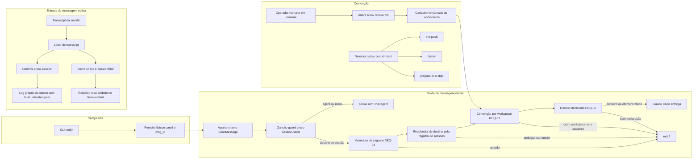

# Design — add-liaison-native-bridge

> Design técnico do change `add-liaison-native-bridge`. Decisões duráveis e transversais merecem ADR (`/forge:new-adr`) — referencie aqui em vez de duplicar.

## 0. Sumário executivo

A mensageria nativa do Claude Code vira campainha e o liaison continua sendo o registro. O design entrega cinco peças que compartilham quatro módulos `.mjs` novos: o subcomando `notify` (ponteiro canônico), o modo `send --via cross-session` (registro do que chegou, com origem extraída do transcript e conferida pelo pid verificado pelo próprio Claude Code), o gancho `PreToolUse` `guard-cross-session-send.sh` (segredo, destino declarado e contenção por workspace), o diagnóstico `native check` fiado no `SessionEnd`/`SessionStart`, e o cadastro humano `native allow|revoke|pin` com um detector único de mudanças de contenção (`native containment`) chamado por pre-push, doctor, `/forge:prepare-pr` e `/forge:ship`.

Três medições feitas para este design mudaram decisões que os requisitos deixavam abertas (evidências em `evidence/`): o payload do `SendMessage` traz `recipient_kind` (`name`, `agent`, `main`, `session`), mas `name` não distingue subagente de sessão, então a classificação é feita pelo registro de sessões; a mensagem recebida tem, além da tag, um objeto estruturado `origin` com `verifiedPeerPid`, que torna a conferência de origem determinística; e a string `cross-session-message` aparece em toda sessão (na documentação da ferramenta), então o detector de "instrumento quebrado" não pode contar a string no arquivo inteiro.

## 1. Contexto e restrições

Arquitetura vigente. O liaison é operado por `template/.forge/scripts/liaison-ops.sh` (bash com blocos `node` embutidos) sobre módulos zero-dep em `scripts/lib/liaison-*.mjs`. O store é JSONL append-only por remetente em `.forge/liaison/<canal>/log/<sender>.jsonl`, lido sempre pelo tronco (`lib/forge-root.sh`, via `--git-common-dir`). `content_sha` cobre o envelope inteiro menos `content_sha` e `trust` (`liaison-merge.mjs`), e `trust` é derivado da presença de `authored_by` (`liaison-trust.mjs`). A marca de publicação da issue #109 mora em `state.json` (`liaison-publish.mjs`). Ganchos `PreToolUse` são declarados em `hooks/pre-tool-use/hooks.manifest.default` e fiados por `sync-adapters.mjs` pelo leitor canônico `hooks-manifest.mjs`, com a regra de que consumidor com `.claude/settings.json` pré-existente recebe gancho novo inativo e nomeado.

Contratos existentes que o design não pode quebrar: o envelope `liaison-message.schema.json` (com `additionalProperties: false`, mas o import valida só por `validateEnvelope`, que hoje ignora `via` e campos extras), o enum `via` (`ask-peer`, `divergence-resolve`), o formato `forge-manifest-format: 1` do `hooks.manifest`, e o gate `w113` [10] (nenhum script ou gancho invoca sessão de agente).

Restrições normativas: NFR-01 (gancho ≤ 300 ms p95 sobre fixture de 20 sessões), NFR-02 (zero dependência nova: bash, node built-ins, git, fallback `jq`/`python3`), NFR-03 (TDD, gate vermelho antes da implementação), regra de dado não confiável (`liaison-untrusted-input.md`), proibição de envio por script ou gancho, e a decisão do dono de que a contenção do cadastro é proteção contra liberação induzida, não fronteira de segurança.

Fatos medidos que restringem a solução (Claude Code 2.1.310 a 2.1.314):

- Payload do gancho (evidência a): `tool_input` normalizado com `to`, `message`, `summary`, `notify_when_idle`, `type`, `recipient`, `recipient_kind` e `content` (cópia de `message`). `recipient_kind` vale `name` para subagente nomeado e para sessão por nome, `agent` para agentId (`a` + 16 hex), `main` para `main` e `session` para `uds:<caminho>`. O pedido só de aviso de ociosidade chega com `message: ""` e `notify_when_idle: true`. Não existe envio múltiplo (`to: "*"` é recusado pelo Claude Code antes do gancho). Chamada feita por subagente traz `agent_id`/`agent_type` e o `transcript_path` da sessão pai. O ref de 6 hex do `ListAgents` não é derivável do registro local.
- Transcript (evidência b): a recepção é uma linha `type: "user"` com `turnOrigin: "peer"`, `message.content` em string com a tag, e um objeto `origin` (`kind: "peer"`, `from`, `verifiedPeerPid`, `msg_id`, `name`, `fromMode`, `body`) idêntico aos valores da tag nas recepções medidas; a medição ampliada da rodada 2 do gate mostrou que `origin` também existe em outros turnos e que nem toda recepção tem `origin.body`, então a tag é a fonte (§2.6). A string literal da tag também aparece em linhas `api-request-shape` e `attachment` (documentação da ferramenta) de toda sessão.
- Registro (evidência c): `~/.claude/sessions/<pid>.json` com `messagingSocketPath` sempre `/tmp/cc-socks/<pid>.sock`, `/tmp` como link para `/private/tmp`, nomes repetidos reais, registro removido na saída normal do processo.
- Ambiente (evidência d): `CLAUDE_CODE_SESSION_ID` e `CLAUDE_PID` no subagente são os da sessão pai; o par socket + token de mensageria está no ambiente do agente.

## 2. Decisão técnica

### 2.1 Visão geral



### 2.2 Módulos compartilhados (novos, em `template/.forge/scripts/lib/`)

Cada responsabilidade tem um único leitor canônico, consumido pelo gancho, pelo CLI e pelos gates. Nenhum módulo abre conexão com socket nem invoca o CLI do Claude Code.

| Módulo | Responsabilidade | Consumidores |
|---|---|---|
| `native-classes.mjs` | Fonte única das classes efêmeras (`EPHEMERAL_CLASSES`), das regex de declaração (`POINTER_LINE_RE = /^liaison:([a-z0-9][a-z0-9-]*)\/([a-z0-9][a-z0-9._-]*)$/`, `EPHEMERAL_LINE_RE = /^ephemeral: ([a-z-]+)$/`) e dos tetos (`NATIVE_FIELD_MAX = 128`, `NATIVE_EXTRA_TEXT_MAX_BYTES = 1024`). | gancho, `native dispose`, `notify`, gate de paridade com a rule (REQ-09) |
| `native-transcript.mjs` | Localiza o transcript, extrai recepções, calcula fingerprint, roda a fixture de controle embutida e decide "instrumento quebrado". | `send --via cross-session`, `native check`, `SessionEnd` |
| `native-registry.mjs` | Lê `~/.claude/sessions/*.json` (nunca `*.key`), filtra vivos, resolve por nome ou por socket, normaliza caminho de socket. | gancho, `send --via cross-session`, `native check` |
| `native-workspace.mjs` | Repositório principal de um caminho (pelo `git-common-dir`, sem subprocesso), raiz de workspace (subida até antes do home), identidade (`git remote get-url origin` normalizado). | gancho, `send --via cross-session`, `native check`, doctor, detector |
| `native-allowlist.mjs` | Lê o cadastro efetivo (versão commitada no tronco), valida pelo schema, escreve `allow`/`revoke`/`pin`. | gancho, `native allow|revoke|pin`, detector, doctor |
| `native-containment.mjs` | Detector único das mudanças de contenção (diff de intervalo e estado atual). | `native containment` (CLI), pre-push, doctor, `/forge:prepare-pr`, `/forge:ship` |

`liaison-publish.mjs` ganha `isPublished({ chDir, self, msgId })` (mesma regra de `unpublishedCount`: o `msg_id` está no log próprio em posição menor ou igual à da marca `published[self]`), e um módulo `liaison-pointer.mjs` expõe `resolvePointer({ root, channel, msgId })`, que devolve `{ ok, reason, thread_id, content_sha, subject }` com as quatro condições do REQ-01 (existe, é própria, está publicada, canal existe). `notify` e o gancho chamam a mesma função, de forma que o ponteiro que `notify` imprime é exatamente o que o gancho aceita.

### 2.3 `liaison-ops.sh notify` (REQ-01)

`notify <channel> <msg_id> --to <destino>`, flags aceitas `--to`. Fluxo: valida flags (`--to` obrigatório; flag desconhecida reprova nomeando `notify` e `--to`), resolve o canal pelo tronco, chama `resolvePointer` e imprime em stdout, em linhas separadas: `liaison:<channel>/<msg_id>`, `thread_id: <id>`, `content_sha: <sha>`, `subject: <assunto>` (assunto já existente no log próprio, logo escrito por este repositório), e uma última linha `to: <destino>` só informativa. Recusas com rc 1: "não existe", "não é mensagem própria", "não publicada — rode `liaison-ops.sh sync <channel>`". O script não envia nada; a doc do comando instrui o agente a colar o bloco no `message` do `SendMessage`.

O gate `w113` [10] é estendido com os padrões listados no REQ-01 sobre `template/.forge/scripts/` e `template/.forge/hooks/`, e com fixture vermelha contendo cada padrão. A busca de `socketPath` é sensível a maiúsculas para não casar `messagingSocketPath`.

### 2.4 `send --via cross-session` (REQ-02, REQ-03)

Flags novas do `send`: `--native-ref <fingerprint>` e `--session <id>`; o valor `cross-session` passa a ser aceito por `--via`. Ordem de validação, todas antes de qualquer escrita:

1. Coerência de flags: `--native-ref`/`--session` sem `--via cross-session`, ou `--via cross-session` sem `--native-ref` ou sem `--authored-by`, reprovam nomeando a flag. `--native-ref` precisa casar `^[0-9a-f]{64}$`. Não existe flag `--from-*`.
2. C1 (REQ-03): `authored_by` precisa estar em `channels.<channel>.participants`; senão rc 1 com os dois caminhos de resolução impressos com os ids preenchidos (`open <channel> --participants <peer>`; `open <novo-canal> --participants <peer>` + `transport set`) e o lembrete de que o peer faz o mesmo do lado dele.
3. Localização do transcript: `--session`, senão `CLAUDE_CODE_SESSION_ID`; o caminho é o único `~/.claude/projects/*/<id>.jsonl` (glob, porque o slug muda em worktree); zero ou mais de um → rc 1 nomeando o que faltou.
4. Leitura pelo `native-transcript.mjs` (mesmo leitor do `native check`): roda a fixture de controle embutida; se ela falhar, ou se o transcript tiver linha candidata e o parser extrair zero, rc 1 "instrumento quebrado". Fingerprint não encontrado → rc 1.
5. Valores extraídos da tag (`from`, `from-name`, `from-mode`, §2.6): teto de 128 caracteres, rejeição de caracteres de controle (`/[\u0000-\u001f\u007f]/`), varredura `findSecrets`. Qualquer falha → rc 1 sem gravar.
6. Conferência de origem (item 4 do gate): o registro de sessões é consultado pelo socket de `from` (normalizado) e, quando a linha traz `verifiedPeerPid`, exige-se que o `pid` do registro seja esse; registro cujo `pid` difere de `verifiedPeerPid` (socket reutilizado por outra sessão depois do envio) é descartado e a conferência cai no caso "registro ausente", nunca em `origin_verified: true`. Achado o registro, o repositório principal do `cwd` dele (por `realpath` + `git-common-dir`) é comparado com o repositório principal do `peer-path` do `authored_by` (mesma normalização). Divergência → rc 1 nomeando os dois caminhos. Registro ausente (sessão encerrada, Remote Control, nuvem) ou `authored_by` sem `peer-path` → `origin_verified: false`. Conferência bem-sucedida → `origin_verified: true`.
7. Corpo: o mesmo caminho do `send` (`_scan_secret_or_fail`, tetos, blob); o corpo é o resumo do operador.
8. Gravação: envelope com `trust: untrusted-peer` (derivado de `authored_by`, como hoje), `via: "cross-session"` e `cross_session: { from_addr, from_name, from_mode, native_ref, origin_verified }`; `content_sha` cobre o objeto inteiro.

`inbox --show` passa a exibir, dentro da moldura `renderUntrusted`, as linhas `via: cross-session`, `nome declarado (autodeclarado): <from_name>`, `modo declarado: <from_mode>` e, quando `origin_verified` é `false`, "origem não verificada". O `CHANNEL.md` de `render` mostra `via: cross-session` e o nome rotulado como autodeclarado, neutralizado pela mesma função.

### 2.5 Gancho de saída `guard-cross-session-send.sh` (REQ-04 a REQ-07)

Arquivo `template/.forge/hooks/pre-tool-use/guard-cross-session-send.sh`, contrato `stdin-json`, matcher `^SendMessage$`. O `.sh` só localiza `scripts/lib/` a partir do próprio caminho e faz `exec node <lib>/native-send-guard.mjs` com o stdin; `node` ausente → exit 2 com a razão. Toda saída de bloqueio é exit 2 com mensagem em stderr; nenhum caminho de erro sai com 1. Etapas, nesta ordem:

1. Parse. Stdin vazio ou JSON malformado → exit 2 ("não consegui ler o payload"). `tool_name` diferente de `SendMessage` → exit 0 (o matcher já filtra; defesa).
2. Classificação do destino (REQ-05, itens 2, 3 e 7 do gate):
   - `recipient_kind: "main"` com `to === "main"` → interno, exit 0.
   - `recipient_kind: "agent"` com `to` casando `^a[0-9a-f]{16}$` → interno, exit 0.
   - `recipient_kind: "session"` (`uds:<caminho>`) → destino de sessão, resolvido pelo socket.
   - `recipient_kind: "name"`: se `to` carrega sufixo de ref (`/ \[[0-9a-f]+\]$/`) → exit 2, porque o ref não é mapeável ao registro local e pode apontar para uma sessão remota homônima; a mensagem pede o nome puro (quando único) ou o endereço `uds:`. Nome puro com exatamente um registro vivo de mesmo `name` → destino de sessão, mesmo que exista subagente ou colega homônimo (item 2: a coincidência é tratada como sessão). Com mais de um → exit 2 pedindo `uds:`. Com nenhum: procura-se no transcript da sessão (`transcript_path` do payload) uma chamada `Agent` cujo `input.name` seja igual a `to`; achada → interno, exit 0; não achada → exit 2 dizendo que o destino não resolve localmente (remoto, nuvem, ou subagente sem nome registrado) e que subagente se endereça pelo agentId. Desvio declarado do critério literal do REQ-05 ("subagente por nome → exit 0"): o caso 1 medido (`probe-helper`, `Agent` sem parâmetro `name` em 2.1.314) é um nome que não resolve a nada local e passa a dar exit 2; o subagente nomeado que o REQ-05 descreve é coberto pela fixture sintética (`Agent` com `input.name`), cujo formato não foi medido, e o item de ledger para medi-lo fica aberto (TASK do REQ-09).
   - `recipient_kind` ausente ou desconhecido, ou `to` com `*`, vírgula ou quebra de linha → destino de sessão não resolvido, exit 2 (fail-closed, com a razão).
3. Pedido só de aviso (REQ-05): `notify_when_idle === true` e `message` (e `content`) vazio ou só espaços → pula as etapas 4 e 6 e aplica só a 5. `message` vazio sem `notify_when_idle` → exit 2 ("sem corpo").
4. Segredo (REQ-04, item 8): percorre recursivamente todos os valores string de `tool_input` (inclusive aninhados e arrays) e aplica `findSecrets` de `secret-scan.mjs`, a mesma função do `send`. Achado → exit 2 nomeando o padrão e o campo, nunca o trecho.
5. Contenção (REQ-07): origem é o `cwd` do payload, cruzado com o registro da própria sessão (o arquivo do registro cujo `sessionId` é o `session_id` do payload): quando esse registro existe e a identidade de workspace do `cwd` dele difere da do `cwd` do payload (o `cwd` do payload segue o `cd` do Bash e pode estar num diretório adicional de outro workspace), exit 2 dizendo que a origem é ambígua; quando não existe, vale o `cwd` do payload e o limite fica registrado no §6. Destino é o `cwd` do registro resolvido. Para cada um: repositório principal (`git-common-dir`), raiz de workspace, identidade. Passa se as identidades são iguais. Senão, lê o cadastro efetivo do repositório principal da origem (seção 4.3) e passa se a identidade do destino é entrada ativa. Antes da comparação, se o cadastro tem `self_identity` e a identidade calculada da origem difere dela, exit 2 ("remote do repositório diverge da identidade fixada; contenção suspensa até decisão humana"). A mensagem de bloqueio nomeia as duas identidades, diz que liberar é decisão do operador fora da sessão, não imprime comando pronto e nunca sugere mexer em `hooks.manifest` ou `settings.json`.
6. Destino declarado (REQ-06, item 5): a primeira linha não vazia de `message` precisa ser `liaison:<channel>/<msg_id>` ou `ephemeral: <class>`. Para o ponteiro, a exigência de posição é um aperto sobre o REQ-06 (que só fixa a posição da declaração efêmera): o `notify` já imprime o ponteiro como primeira linha, e um ponteiro no meio do texto livre seria ambíguo com uma citação; o aperto é declarado no §11 e na doc do `/forge:liaison`.
   - Ponteiro: validado por `resolvePointer` lendo o canal pelo tronco da origem. Falha → exit 2 nomeando a condição. Depois, se o repositório do destino é outro que não o da origem, confere participação: o repositório principal do destino é comparado com os `peer-path` dos participantes do canal; se todos os participantes têm `peer-path` e nenhum coincide → exit 2 ("o destino não participa do canal do ponteiro"); se algum participante não tem `peer-path`, a conferência é inconclusiva e passa (o doctor já avisa participante sem `peer-path`).
   - Efêmero: classe fora de `EPHEMERAL_CLASSES` → exit 2 listando as classes. `internal-coordination` exige mesmo repositório principal (mesmo `git-common-dir`), senão exit 2 explicando que conteúdo substantivo entre repositórios é material de liaison.
   - Teto do texto livre: para ponteiro, as linhas canônicas do `notify` (`thread_id:`, `content_sha:`, `subject:`, `to:`) não contam; o restante tem teto de 1024 bytes. Para as classes efêmeras exceto `internal-coordination`, o corpo inteiro tem teto de 1024 bytes. `internal-coordination` não tem teto próprio (não atravessa repositório).
   - Sem ponteiro nem declaração → exit 2 explicando as duas formas.

A etapa 5 vem antes da 6 porque a 6 precisa do repositório do destino já resolvido e porque contenção é a recusa de maior consequência; o operador vê primeiro o bloqueio que não se resolve reescrevendo a mensagem.

Resolução no registro (`native-registry.mjs`): lê `~/.claude/sessions/*.json` (o diretório vem de `HOME`, sobreponível por `FORGE_CLAUDE_SESSIONS_DIR` só para fixtures). Um arquivo ilegível ou sem `name`, `cwd` ou `messagingSocketPath` faz a resolução falhar com exit 2 nomeando o arquivo (fail-closed do REQ-07) quando a resolução depende dele (qualquer resolução por nome, ou por socket que não achou registro válido). Um registro conta como vivo se `process.kill(pid, 0)` não lança e o `messagingSocketPath` existe como socket (`lstat().isSocket()`); a checagem do socket cobre o reuso de pid por processo que não é do Claude Code sem precisar de `ps`. Endereços `uds:` e `messagingSocketPath` são comparados depois de `realpath` do diretório pai (`/tmp` e `/private/tmp` convergem).

Raiz de workspace (`native-workspace.mjs`): do repositório principal sobe diretório a diretório, parando antes de chegar ao `HOME` ou a qualquer ancestral dele; cada diretório com `.git` (pasta ou arquivo) é candidato, e o mais externo vence. O `.git` em arquivo é seguido (`gitdir:` e `commondir`) para chegar ao repositório principal sem subprocesso. Fora de repositório, o workspace é o próprio `cwd`. Identidade: `git -C <raiz> remote get-url origin` (aplica `insteadOf`, item 9), normalizada para `host/owner/repo` (remove esquema, credencial, porta e sufixo `.git`; forma scp `user@host:owner/repo` vira `host/owner/repo`; host em minúsculas); sem remote, o caminho absoluto `realpath` da raiz. O resultado é cacheado por raiz dentro da execução.

### 2.6 Diagnóstico de cobertura `native check` e `native dispose` (REQ-08)

`native check [--session <id>] [--transcript <path>] [--report] [--pending]`, rc sempre 0. `--transcript` é usado pelo `SessionEnd` com o `transcript_path` do stdin (item 6); sem ele, o CLI localiza como no `send` (seção 2.4, passo 3); sem sessão identificável, imprime o que falta e sai com rc ≠ 0 (único caso de rc ≠ 0, previsto no REQ-08).

Leitor (`native-transcript.mjs`), corrigido pela medição da rodada 2 do gate sobre 60 transcripts reais (registrada na evidência b): o objeto `origin` não é exclusivo da mensageria entre sessões (`origin.kind` vale também `human`, `task-notification` e `coordinator`; `turnOrigin` vale também `human`, `task_notification` e `scheduled`), `origin.kind: "peer"` também marca a mensagem interna de subagente para o `main` (tag `<agent-message>`, `from` em hex de agentId, sem `verifiedPeerPid`), e há recepções reais sem `origin.body`. Por isso a tag é a fonte e o `origin` é conferência:

- **Recepção** é uma linha `type: "user"`, sem `toolUseResult`, cujo texto de `message.content` (string, ou blocos `type: "text"` quando é array; blocos `tool_result` excluídos) contém a tag de abertura `<cross-session-message from="..." from-name="..." from-mode="...">` com o corpo até `</cross-session-message>`, e cujo `from` começa com `uds:`. `from`, `fromName`, `fromMode` e `body` saem da tag; `verifiedPeerPid` sai de `origin` quando existe.
- **Conferência cruzada**: quando a linha tem `origin` com `kind: "peer"`, cada campo presente em `origin` (`from`, `name`, `fromMode`, `body`) precisa ser igual ao valor da tag; campo ausente não é divergência; divergência marca a linha como inconsistente e o relatório como "instrumento quebrado".
- **Candidata** é toda linha `type: "user"`, sem `toolUseResult` nem bloco `tool_result`, que tenha a string `<cross-session-message from="` no texto de `message.content` e um dos marcadores medidos de recepção (`isMeta: true` ou `promptSource: "system"`), ou que tenha `origin.kind: "peer"` com `origin.from` começando em `uds:`. Transcript com candidata e zero recepções extraídas → "instrumento quebrado". A string em linhas `api-request-shape`, `attachment`, `assistant`, `queue-operation` ou em `toolUseResult` não é candidata (medição b), e linhas com `origin` de outros `kind`, `turnOrigin: "scheduled"` ou `<agent-message>` com `origin.kind: "peer"` e `from` de agentId também não.

Esta é a leitura de design do critério "transcript real que contém a string literal" do REQ-08: contar a string no arquivo inteiro daria "instrumento quebrado" em toda sessão sem recepção, e contar qualquer `origin` daria o mesmo em toda sessão com turno humano. O gate de cobertura tem controles negativos com as formas medidas (`origin.kind` `human`, `task-notification` e `coordinator`; `turnOrigin: "scheduled"`; `<agent-message>` com `origin.kind: "peer"`; turno humano que só cita a tag), que precisam dar "nada pendente"; uma recepção sem `origin.body`, que precisa ser extraída com o fingerprint da tag; e fixtures de formato derivado (tag em bloco de texto de `content` array sem `origin`, que precisa ser extraída; `origin.kind: "peer"` com `from` `uds:` e sem a tag no texto, que precisa dar "instrumento quebrado").

Fixture de controle a cada execução: o módulo embute as duas linhas sintéticas da evidência b e exige duas recepções com os fingerprints `b843a088…4654` e `161d6df6…4baf`; se falhar, o relatório é "instrumento quebrado", nunca "nada pendente".

Fingerprint: `sha256` hex minúsculo dos bytes UTF-8 de `JSON.stringify([from, fromName, body])`, com os valores literais da tag (texto do REQ-08); o `origin` só confere.

Destinação de uma recepção: registro no liaison com `cross_session.native_ref` igual ao fingerprint, em qualquer canal do tronco, ou declaração de `native dispose <fingerprint> --ephemeral <class>` (classe de `EPHEMERAL_CLASSES`). Estado local não versionado em `<git-common-dir>/forge-native/`: `dispositions.jsonl` (append de `{ fingerprint, class, at }`) e `reports/<session-id>.json`. Fica fora da árvore de trabalho e é compartilhado por todas as worktrees do repositório.

Workspace do remetente: resolvido pelo socket de `from` e por `verifiedPeerPid` no registro; mesmo workspace, outro workspace ou "workspace desconhecido" (registro ausente). Nunca "mesmo workspace" por omissão. Nome declarado e qualquer trecho impresso passam por `renderUntrusted`.

Fiação: `sync-adapters.mjs` passa a fiar `SessionEnd` quando `handoff.auto` OU `liaison.auto`. `on-session-end.sh` lê o stdin uma vez, roda o handoff só com `handoff.auto` e `native check --transcript <path> --session <id> --report` só com `liaison.auto`, cada parte independente da presença do script da outra, sempre exit 0. `on-session-start.sh`, no bloco do liaison, roda `native check --pending`, que exibe os relatórios não entregues do repositório (do mais recente para o mais antigo, no máximo 5, cada um em uma linha com data, id curto da sessão, contagens de pendentes, de outro workspace e de workspace desconhecido, e o comando `native check --session <id>` para ver os fingerprints; acima de 5, uma linha "+N relatórios") e os marca como entregues.

### 2.7 Cadastro `native allow|revoke|pin` e detector `native containment` (REQ-12)

`native allow <identidade> --reason "<motivo>"`, `native revoke <identidade> --reason "<motivo>"` e `native pin` gravam o arquivo `.forge/liaison/allowed-workspaces.json` do repositório principal (seção 4.3). Os três recusam com rc 1, sem tocar o arquivo, quando: (a) o ambiente tem qualquer marcador `CLAUDECODE`, `CLAUDE_CODE_SESSION_ID`, `CLAUDE_PID` ou `CLAUDE_CODE_ENTRYPOINT`; ou (b) algum ancestral do processo (`ps -o ppid=,comm=` até o pid 1) é o executável do Claude Code (nome `claude` ou caminho contendo `/claude`). A segunda camada existe porque o agente remove variáveis com `env -u`; nenhuma das duas é fronteira, e a doc diz isso.

`allow` grava `self_identity` (identidade atual do repositório) se ausente, e acrescenta `{ id, reason, granted_by, granted_at }` (`git config user.email`; data ISO); identidade ativa repetida é idempotente; identidade revogada recebe entrada ativa nova e a revogada fica. `revoke` marca `revoked_at`, `revoked_by`, `revoke_reason`; inexistente ou já revogada → rc 1. `--reason` vazio → rc 1; identidade fora de `^[a-z0-9.-]+(:[0-9]+)?/[^/\s]+(/[^/\s]+)+$` e não absoluta → rc 1 mostrando o formato. `pin` grava só `self_identity` (nota de convergência: fixar a identidade sem precisar liberar nenhum workspace). Os três terminam lembrando que o cadastro só vale depois de commitado no tronco.

`native containment [--range <a>..<b>] [--format text|markdown]` (item 1 do gate) é o detector único, rc 0 sempre que conseguiu medir e rc 2 quando não conseguiu (git indisponível, intervalo inválido), para o chamador distinguir "nada mudou" de "não medi". Tipos detectados, lista fechada do REQ-12:

| Tipo | Como é medido |
|---|---|
| `allowlist-changed` | `git diff --name-only <range> -- .forge/liaison/allowed-workspaces.json` não vazio (com intervalo); sem intervalo, diferença entre a árvore e `HEAD` (edição não commitada) |
| `hook-line-changed` | a linha de `guard-cross-session-send.sh` em `.forge/hooks/pre-tool-use/hooks.manifest` ou `hooks.manifest.default` foi removida ou teve `matcher` ou `estado` alterados entre as pontas do intervalo (comparação das linhas parseadas por `hooks-manifest.mjs`) |
| `hook-unwired` | Sem intervalo: a derivação efetiva de `derivePreToolUseHooks` (`sync-adapters.mjs`, hoje interna ao módulo, passa a ser exportada sem mudança de comportamento; é a mesma função e a mesma precedência que o `sync-adapters` usa: manifesto do consumidor quando existe, senão o default para instalação nova, senão o semeador) emite a fiação do gancho e o `.claude/settings.json` atual não a contém. Com intervalo: a fiação do gancho estava em `.claude/settings.json` na ponta inicial e não está na final. Gancho que a derivação deixa inativo por semeadura (consumidor existente que ainda não armou) não é mudança de contenção: é aviso do doctor ("gancho de saída inativo"), para não gerar achado permanente em todo consumidor existente |
| `remote-identity-mismatch` | identidade atual do `origin` diferente de `self_identity` do cadastro efetivo |

Só no doctor, como avisos adicionais (fora da lista fechada, notas de convergência): gancho de saída inativo (semeado inativo ou retido no manifesto do consumidor), `self_identity` ausente (troca de remote indetectável até `native pin`), versão do cadastro no `HEAD` do tronco diferente da do ref de upstream do tronco (cadastro commitado e ainda não publicado, ver §4.3), `disableAllHooks: true` ou sobreposição de `PreToolUse` sem o gancho em `.claude/settings.local.json` ou `~/.claude/settings.json` (leitura somente), e edição não commitada do cadastro.

Pontos de chamada: o `pre-push` roda o detector com o intervalo de cada ref enviado (`<remote_sha>..<local_sha>`, ou a base de merge com o tronco para ref novo), imprime em destaque e não bloqueia; o `doctor` roda sem intervalo e acrescenta os avisos de cruzamento do REQ-12 (participante com `peer-path` em outro workspace não cadastrado; participante sem `peer-path` como "não verificável"; cadastro ativo sem participante correspondente; participante no mesmo workspace não gera aviso); `/forge:prepare-pr` e `/forge:ship` (template e plugin) ganham um passo que roda `bash .forge/scripts/liaison-ops.sh native containment --range develop..HEAD --format markdown` e incluem a saída como seção "Mudanças de contenção" do corpo do PR quando não vazia, ou registram "detector indisponível" quando rc 2.

Merge com mudança de contenção é sempre humano, inclusive em modo autônomo (achado MAJOR 2 da rodada 1 do gate). `/forge:ship --yolo` delega o merge em `develop` ao agente `yolo-gate`; sem regra explícita, o cenário do revisor (agente edita o cadastro e roda `/forge:ship --yolo`) fecharia sem humano. Por isso: em `ship.md` (template e plugin), o passo do detector vem antes da decisão de merge e, se `native containment --range develop..HEAD` reportar qualquer mudança ou devolver rc 2, o merge cai para confirmação humana mesmo em yolo, com a seção "Mudanças de contenção" apresentada ao humano; `agents/review/yolo-gate.md` ganha a mesma regra como recusa (o agente decide `block` com o motivo "mudança de contenção exige humano"); e `rules/conventions/autonomy-yolo.md` lista "merge com mudança de contenção" entre as paradas humanas obrigatórias. Um gate de texto confere a regra nos três arquivos (e na cópia do plugin de `ship.md`).

### 2.8 Conteúdo normativo das rules (REQ-09)

`rules/conventions/liaison-protocol.md` ganha a seção "Mensageria nativa entre sessões", com: a regra "o nativo é campainha, o liaison é o registro"; o critério de troca que precisa virar registro (decisão que afeta outro repositório, mudança de contrato ou ack, retratação, achado de segurança, pergunta bloqueante e a resposta, descoberta de trabalho sobreposto); a lista das classes efêmeras, gerada a partir de `EPHEMERAL_CLASSES` e conferida pelo gate de paridade; a regra de que coordenação substantiva no mesmo repositório usa `ephemeral: internal-coordination` e não o liaison; o fluxo campainha (`send` → `sync` → `notify` → `SendMessage` com o ponteiro na primeira linha) e o registro do que chega (`send --via cross-session --native-ref`, ou `native dispose`); e o limite: `allowed_workspaces` vale só para a saída, os dois lados cadastram, e a contenção é proteção contra liberação induzida, não fronteira.

`rules/conventions/liaison-untrusted-input.md` ganha a seção "Mensagem nativa recebida", com: as regras 1 a 4 de dado não confiável valem integralmente para o corpo e os atributos da tag `cross-session-message`; lá não existe nenhuma guarda mecânica de moldura, teto ou neutralização (o corpo entra cru no contexto); `from-name` é autodeclarado e não prova repositório nem empresa; e a declaração de limite do gancho de saída inteiro: o par socket + token de mensageria está no ambiente do agente, e com ele o agente contorna o gancho todo (segredo, destino declarado e contenção), assim como contorna o pre-push com `--no-verify`, o cadastro com commit local no tronco, e a origem com `cd`; a única contenção que o próprio usuário do sistema não altera é a configuração gerenciada do Claude Code, recomendada para repositórios em escopo PCI (negar ou isolar a mensageria entre sessões). As frases obrigatórias de cada uma são conferidas pelo gate de normas (§9), e o item de ledger para avaliar a configuração gerenciada nos repositórios PCI é aberto com origem neste change, junto do item de medição do formato de agente nomeado.

## 3. Alternativas consideradas

| Alternativa | Prós | Contras | Por que não |
|---|---|---|---|
| Classificar destino só por `recipient_kind` | Zero I/O, rápido | `name` cobre subagente e sessão (medição a) | Deixaria sessão por nome passar sem checagem, ou bloquearia todo subagente nomeado |
| Classificar `name` como interno quando não resolve no registro | Nenhuma fricção com subagente nomeado | Nome de sessão remota ou da nuvem passaria sem contenção | Contraria o fail-closed do REQ-05; o design só aceita interno com prova (agentId, `main`, ou `Agent` com `input.name` no transcript) |
| Mapear `nome [ref]` ao registro | Aceitaria a forma que o `ListAgents` sugere para homônimos | O ref não deriva de nenhum campo local (medição a) | Qualquer mapeamento seria palpite; `uds:` é o endereço local inequívoco |
| Parser do transcript só pela tag (regex) | Segue o texto do requisito ao pé da letra | Escape de aspas não observado; string aparece fora de recepções | O objeto `origin` é estruturado e foi medido idêntico; a tag fica como conferência cruzada |
| Cadastro dentro de `liaison.yaml` | Um arquivo de configuração a menos | `writeConfig` regrava o arquivo inteiro em `open`/`join`/`transport`, gerando falso positivo de `allowlist-changed`; o parser é subconjunto de YAML | Arquivo dedicado torna a detecção exata e permite schema JSON |
| Cadastro efetivo lido da árvore do tronco | Vale na hora, sem commit | Edição não commitada (até por agente) libera sem deixar rastro em diff | Só o commitado vale (nota de convergência); custo é um `git show` quando as identidades diferem |
| Fixar `self_identity` só no primeiro `allow` | Nenhum subcomando novo | Repositório sem cadastro fica sem detecção de troca de remote, e trocar o remote para o do destino faz origem e destino "iguais" | `native pin` fecha esse contorno com uma linha de CLI humana |
| Identidade de workspace por caminho em vez de remote | Imune a `git remote set-url` | Contraria a definição aprovada no REQ-07; dois clones do mesmo repositório viram workspaces diferentes | Mantida a definição; o contorno por remote é fechado por `self_identity` |
| `git config remote.origin.url` | Lê o valor cru, sem regras do usuário | Dois clones com e sem `insteadOf` dariam identidades diferentes | `git remote get-url origin` aplica `insteadOf` e é o endereço para onde o push vai |
| Gancho todo em bash com `jq`/`python3` | Padrão dos ganchos atuais | A varredura precisa ser a mesma função do `send` (`secret-scan.mjs`), e a resolução tem I/O estruturado | `node` já é dependência do harness; o `.sh` só faz `exec` |
| Detectar mudança de contenção dentro de cada ponto (pre-push, doctor, PR) | Cada ponto evolui sozinho | Três leitores divergem; os comandos de PR são prosa sem script | Detector único com gate de texto conferindo a invocação (item 1) |
| Espelhar toda mensagem recebida no liaison | Cobertura total | Não existe evento de hook de recepção; transformaria o canal em chat | Fora de escopo nos requisitos |

## 4. Contratos e integrações afetados

### 4.1 `liaison-message.schema.json`

Mudanças aditivas: o enum `via` ganha `cross-session`; nova propriedade `cross_session`:

```json
"cross_session": {
  "type": "object",
  "additionalProperties": false,
  "required": ["from_addr", "from_name", "from_mode", "native_ref", "origin_verified"],
  "properties": {
    "from_addr": { "type": "string", "maxLength": 128, "pattern": "^[^\\u0000-\\u001f\\u007f]*$", "description": "Endereço declarado pela sessão de origem (forma medida: uds:/tmp/cc-socks/<pid>.sock). Autodeclarado." },
    "from_name": { "type": "string", "maxLength": 128, "pattern": "^[^\\u0000-\\u001f\\u007f]*$", "description": "Nome declarado pela sessão de origem. Autodeclarado: não prova repositório nem empresa." },
    "from_mode": { "type": "string", "maxLength": 128, "pattern": "^[^\\u0000-\\u001f\\u007f]*$" },
    "native_ref": { "type": "string", "pattern": "^[0-9a-f]{64}$" },
    "origin_verified": { "type": "boolean" }
  }
}
```

E duas condições no `allOf`: `if { properties: { via: { const: "cross-session" } }, required: ["via"] } then { required: ["authored_by", "cross_session"] }`; `if { required: ["cross_session"] } then { required: ["via"], properties: { via: { const: "cross-session" } } }`. `validateEnvelope` passa a validar `via` (enum) e `cross_session` com as mesmas regras, e um gate de paridade roda uma bateria de envelopes válidos e inválidos pelos dois (schema via validador mínimo do gate e `validateEnvelope`) exigindo o mesmo veredito.

### 4.2 Compatibilidade com peer de harness antigo

Verificado no código atual (`liaison-import.mjs`, passada 1): o import chama `validateEnvelope`, recalcula `content_sha` e confere `body_ref`; não aplica o JSON Schema, e o `validateEnvelope` da v0.18.0 não olha `via` nem rejeita campo desconhecido. Logo um peer antigo que importa uma mensagem `via: cross-session` com `cross_session` a aceita sem conflito; `content_sha` confere porque cobre todos os campos; `trust` é derivado de `authored_by` e sai `untrusted-peer`; o render antigo não mostra `cross_session` (degrada para um `untrusted-peer` comum, com o corpo do operador). Nenhum dado é perdido no store do peer, e quando ele atualizar o harness o render novo passa a mostrar os campos.

Estratégia: mudança aditiva sem versão nova de envelope. O gate de compatibilidade extrai os módulos de import da tag publicada mais recente (`git show v0.18.0:template/.forge/scripts/lib/liaison-import.mjs` e dependências, num diretório temporário) e importa um bundle com a mensagem nova, exigindo zero conflitos e a mensagem presente no destino. No sentido inverso, o `validateEnvelope` novo passa a reprovar valores de `via` fora do enum: mensagem de um peer futuro com valor novo vira conflito em quarentena, visível em `conflicts list`, que é o comportamento já adotado para envelope inválido.

### 4.3 Cadastro `.forge/liaison/allowed-workspaces.json`

Local: `.forge/liaison/allowed-workspaces.json` no repositório principal, versionado, lido pelo tronco. Schema novo `template/.forge/schemas/liaison-allowed-workspaces.schema.json`:

```json
{
  "$schema": "https://json-schema.org/draft/2020-12/schema",
  "type": "object",
  "additionalProperties": false,
  "required": ["version", "allowed_workspaces"],
  "properties": {
    "version": { "const": 1 },
    "self_identity": { "type": "string", "minLength": 1 },
    "allowed_workspaces": {
      "type": "array",
      "items": {
        "type": "object",
        "additionalProperties": false,
        "required": ["id", "reason", "granted_by", "granted_at"],
        "properties": {
          "id": { "type": "string", "minLength": 1 },
          "reason": { "type": "string", "minLength": 1 },
          "granted_by": { "type": "string", "minLength": 1 },
          "granted_at": { "type": "string", "format": "date-time" },
          "revoked_at": { "type": "string", "format": "date-time" },
          "revoked_by": { "type": "string" },
          "revoke_reason": { "type": "string", "minLength": 1 }
        },
        "dependentRequired": { "revoked_at": ["revoked_by", "revoke_reason"] }
      }
    }
  }
}
```

Leitura efetiva: `git -C <tronco> show HEAD:.forge/liaison/allowed-workspaces.json`; arquivo ausente no `HEAD` equivale a cadastro vazio. Limite declarado (achado MINOR 5): um commit local no checkout do tronco libera antes de passar pelo pre-push; ler o ref de upstream foi descartado porque exigiria `fetch` dentro do gancho (custo e rede no caminho do NFR-01) e porque o tronco sem upstream é comum em consumidores; em troca, o doctor avisa quando a versão do cadastro no `HEAD` do tronco difere da do upstream, e a rule registra o limite junto dos demais (a contenção não é fronteira); arquivo presente e inválido pelo schema faz o gancho tratar o cadastro como vazio e o doctor reportar o erro (fail-closed: inválido nunca libera).

### 4.4 `hooks.manifest.default`

Linha nova: `guard-cross-session-send.sh	^SendMessage$	stdin-json	armado	razao=segredo, destino declarado e contenção por workspace antes de a mensagem sair para outra sessão`.

### 4.5 CLI `liaison-ops.sh`

Subcomandos novos: `notify`, `native check|dispose|allow|revoke|pin|containment`. `send` ganha `--native-ref` e `--session` e o valor `cross-session` em `--via`. O `--help` e a mensagem de flags aceitas de cada subcomando são a fonte que o gate de documentação compara com o bloco de protocolo de `/forge:liaison` (REQ-11).

## 5. Plano de migração / rollout

Instalação nova: o gancho nasce armado (linha `armado` no manifesto padrão, sem `settings.json` prévio), `SessionEnd` fiado quando `liaison.auto` está ligado.

Consumidor existente com `.claude/settings.json` (todos os consumidores de hoje, inclusive `payments`, o repositório do incidente; o dogfood do forge-harness não tem `.claude/settings.json` nem `.forge/hooks/`, então não é consumidor do gancho): pela regra vigente, o gancho chega inativo e nomeado, e o doctor o lista como inativo. Para armar sem desfiar os ganchos que já existem (achado MAJOR 1 da rodada 1 do gate): um `hooks.manifest` de consumidor com o marcador `# forge-manifest-format: 1` decide sobre todos os ganchos do diretório, e o gancho não declarado nele sai da fiação (`sync-adapters.mjs`, ramo `consumerDecls`); e um manifesto sem marcador (modo projeção) não lê o campo de estado. Por isso o passo documentado é: (1) rodar `/forge:doctor`, que lista o estado efetivo de cada gancho do diretório; (2) se o consumidor não tem `hooks.manifest`, criá-lo com uma linha por gancho do diretório levando o matcher e o contrato efetivos que o doctor mostrou (nunca os do default, que alargariam em silêncio um matcher que o consumidor restringiu) e o estado efetivo (fiado → `armado`; inativo → o `retido:<motivo>` do default ou `retido:inativo-no-consumidor`) e deixando a linha de `guard-cross-session-send.sh` como `armado`; (3) se o consumidor já tem `hooks.manifest` sem marcador, migrá-lo para o formato canônico (marcador e campo de estado em todas as linhas, com o estado efetivo de hoje) e acrescentar a linha nova; (4) rodar `/forge:sync-adapters` e conferir no doctor que os ganchos antes fiados continuam fiados e que o gancho novo está armado; (5) commitar os dois arquivos. O próximo pre-push e o PR mostram `hook-line-changed` como mudança de contenção esperada. O gate de empacotamento (§9) prova, com uma fixture de consumidor existente que tem os quatro ganchos atuais fiados, que depois do passo documentado os quatro continuam fiados e o novo passa a estar; e prova, com uma fixture de manifesto sem marcador, que só acrescentar a linha nova não arma o gancho (o que justifica o passo 3). O `CHANGELOG.md` (`[Unreleased]`, seção de atualização) e `commands/harness/upgrade.md` (template e plugin) trazem esse passo literal e citam que, sem ele, o consumidor continua sem nenhuma guarda de saída. O `SessionEnd` é fiado na próxima execução de `sync-adapters` se `liaison.auto` já estiver ligado, sem passo manual.

Sem cadastro, a contenção bloqueia toda mensagem para outro workspace; antes de armar num repositório que conversa com outro workspace, o humano roda `native pin` e `native allow` fora da sessão e commita. A ordem recomendada na doc é: `native pin` → `native allow <peer>` → commit → armar o gancho.

Reversão: desarmar a linha no `hooks.manifest` e rodar `sync-adapters`; aparece como mudança de contenção nos três pontos.

## 6. Riscos e mitigação

| Risco | Probabilidade | Impacto | Mitigação / detecção |
|---|---|---|---|
| O Claude Code muda o payload do `SendMessage` (`recipient_kind`, `message`) | Média | Alto (gancho bloquearia tudo ou classificaria errado) | Fail-closed para valor desconhecido; fixtures da evidência a no gate; o gate do gancho falha se o fixture de sessão por nome passar sem checagem |
| Formato do transcript muda e o leitor fica cego | Média | Médio (diagnóstico é aviso) | Fixture de controle a cada execução; linha candidata com zero recepções vira "instrumento quebrado"; divergência entre tag e `origin` também |
| Registro de sessões muda de formato | Média | Alto | Fail-closed nomeando o arquivo; fixture com o formato medido (evidência c) |
| Subagente nomeado (agent teams) é bloqueado porque o formato de `Agent` com `input.name` não foi medido | Média | Médio (fricção, não vazamento) | Mensagem de bloqueio orienta usar agentId; gate com fixture sintética; item de ledger para medir quando o modo estiver disponível |
| Sessão remota homônima de uma sessão local recebe a mensagem | Baixa | Alto | Forma `[ref]` bloqueada; nome puro só passa com registro local único; o Claude Code, pela documentação embutida, recusa nome ambíguo entre local e remoto (texto do fornecedor, não medido) |
| `uds:` deixar de ser aceito pelo Claude Code | Baixa | Médio (homônimos locais sem caminho) | O bloqueio continua seguro; a doc indica renomear a sessão (`/rename`) como alternativa |
| Envio direto pelo socket com o token do ambiente | Baixa | Alto | Fora do alcance de qualquer gancho; rule declara que o limite cobre o gancho inteiro; `w113` [10] proíbe a referência no template; recomendação de configuração gerenciada para PCI |
| Agente remove marcadores e roda `native allow` | Baixa | Médio | Segunda camada por ancestralidade; cadastro só vale commitado; `allowlist-changed` nos três pontos |
| `git push --no-verify` pula o pre-push | Média | Baixo | Doctor e seção do PR continuam cobrindo |
| Gancho estoura 300 ms p95 por ler logs grandes do canal | Média | Médio | Leitura do log só no ramo do ponteiro e só do arquivo próprio; registro e identidade cacheados por execução; gate de desempenho com 50 execuções por caso |
| Declaração efêmera falsa para contornar C2 | Média | Médio | Teto de 1024 bytes nas classes não internas; auditoria amostral registrada na rule |
| Pid reutilizado por outro processo deixa registro morto parecer vivo | Baixa | Médio | Vivo exige pid ativo e socket existente |
| `cwd` do payload segue o `cd` do Bash e pode cair em diretório de outro workspace | Média | Médio | Cruzamento com o registro da própria sessão por `session_id` (§2.5 etapa 5); sem registro próprio vale o `cwd` do payload, limite declarado na rule |
| Chamada `Agent` antiga no transcript (agente já encerrado) libera um nome que o Claude Code pode entregar a uma sessão remota homônima | Baixa | Alto | Só vale quando nenhum registro local vivo tem o nome; o caso remoto homônimo depende da recusa de nome ambíguo pelo Claude Code (texto do fornecedor, não medido); risco residual declarado na rule e coberto pelo item de ledger de medição de agente nomeado |
| Commit local do cadastro no checkout do tronco libera antes do pre-push | Baixa | Médio | Aviso do doctor quando `HEAD` e upstream do tronco divergem no cadastro; limite declarado na rule (§4.3) |
| `ship --yolo` faria merge de mudança de contenção sem humano | Média | Alto | Regra explícita em `ship.md`, `yolo-gate.md` e `autonomy-yolo.md`, conferida por gate de texto (§2.7) |
| Passo de armar mal feito desfia os ganchos existentes do consumidor | Média | Alto | Passo documentado em cinco etapas com conferência no doctor; gate de empacotamento com fixture de consumidor existente (§5) |

## 7. Rastreabilidade

| REQ | Seção do design que o atende |
|---|---|
| REQ-01 | §2.2 (`liaison-pointer.mjs`, `isPublished`), §2.3, §9 |
| REQ-02 | §2.4, §2.6 (leitor e fingerprint), §4.1, §4.2, §9 |
| REQ-03 | §2.4 passo 2, §9 |
| REQ-04 | §2.5 etapas 1 e 4, §9 |
| REQ-05 | §1 (fatos medidos), §2.5 etapas 2 e 3, §8 itens 2, 3 e 7, §9 |
| REQ-06 | §2.5 etapa 6, §8 item 5, §9 |
| REQ-07 | §2.5 etapa 5 e resolução, §4.3, §8 itens 3 e 9, §9 |
| REQ-08 | §2.6, §8 item 6, §9 |
| REQ-09 | §2.2 (`native-classes.mjs`), §2.8, §6, §9, §10 |
| REQ-10 | §4.4, §5, §9 |
| REQ-11 | §2.3, §4.5, §5, §9 |
| REQ-12 | §2.7, §4.3, §5, §8 item 1 e notas, §9 |
| NFR-01 | §2.5 (cache, ordem), §6, §9 |
| NFR-02 | §2.2, §2.5 (só `node` built-ins, `git`, `ps`), §9 (gate de empacotamento) |
| NFR-03 | §9 |

## 8. Entradas do gate

Decisões sobre cada item de `design-inputs.md`.

| Item | Decisão |
|---|---|
| 1 — detector único para o PR | Aceito. `native containment [--range] [--format]` em `native-containment.mjs` (§2.7), chamado por pre-push, doctor, `prepare-pr.md` e `ship.md`. Gate de texto confere a invocação nos quatro arquivos de comando (template e plugin) e fixture mede o detector nos quatro tipos e no caso sem mudança. |
| 2 — nome igual entre subagente e sessão | Aceito, com a medição: o payload dá `recipient_kind: "name"` nos dois casos. Nome com registro vivo único é sempre destino de sessão, mesmo havendo agente homônimo (§2.5 etapa 2). Fixture: transcript com `Agent` de `input.name` igual ao nome de uma sessão viva do registro → tratado como sessão. |
| 3 — resolução divergente com sessão remota | Aceito em parte. Medido: o ref não é mapeável e não há sessão remota para medir a escolha do Claude Code. Decisão: forma `nome [ref]` sempre bloqueada; nome puro só passa com registro local único; homônimo local exige `uds:`. Rejeitada a parte "exigir `uds:` quando o nome não for único entre os destinos do `ListAgents`": o gancho não vê o `ListAgents` (só o registro local), e o caso remoto homônimo depende da recusa de nome ambíguo pelo próprio Claude Code, registrada como risco. |
| 4 — normalização na conferência de origem | Aceito. `realpath` + `git-common-dir` nos dois lados, origem achada por socket e `verifiedPeerPid` (§2.4 passo 6). Fixture com o peer numa worktree do repositório dele. |
| 5 — ponteiro para canal sem o destino e texto livre | Aceito. Bloqueia quando a não participação é verificável, passa quando inconclusiva (participante sem `peer-path`, já avisado pelo doctor); teto de 1024 bytes para texto livre (§2.5 etapa 6). |
| 6 — identificação da sessão no fim | Aceito. `SessionEnd` usa `transcript_path` do stdin via `--transcript`; CLI usa glob `~/.claude/projects/*/<id>.jsonl` com resultado único; vários relatórios pendentes exibidos em lista curta (máx. 5 + contagem) e marcados como entregues (§2.6). |
| 7 — envio para vários destinos | Medido: não existe. `to: "*"` é recusado pelo Claude Code antes do gancho. Defesa no gancho: `to` com `*`, vírgula ou quebra de linha é destino não resolvido, exit 2. |
| 8 — varredura recursiva | Aceito. Todos os valores string de `tool_input`, inclusive aninhados e arrays; medido que o corpo vem duplicado em `message` e `content` (§2.5 etapa 4). |
| 9 — leitura do remote | Aceito: `git remote get-url origin` (aplica `insteadOf`), com fixture de dois clones do mesmo repositório (um com `insteadOf`) dando a mesma identidade. |
| 10 — manifest e consumidores existentes | Aceito. `affected_paths` atualizado (`prepare-pr.md` do template, `plugin/forge/commands/{prepare-pr,ship,doctor,upgrade}.md`, schema do cadastro, `commands/harness/upgrade.md`); passo de armar em `CHANGELOG.md` e `/forge:upgrade` (§5). |
| Nota — troca de remote sem cadastro | Aceito: `native pin` grava `self_identity` sem liberar nada; o gancho bloqueia quando a identidade atual diverge da fixada; `remote-identity-mismatch` nos três pontos; doctor avisa `self_identity` ausente. |
| Nota — ganchos desligados fora da lista fechada | Aceito como aviso só do doctor (`disableAllHooks` e sobreposições em `settings.local.json` e `~/.claude/settings.json`, leitura somente), sem entrar na lista fechada do REQ-12, que é a dos três pontos. |
| Nota — edição não commitada do cadastro | Aceito: só o commitado no `HEAD` do tronco vale (§4.3); a edição não commitada aparece no doctor. |
| Nota — `git push --no-verify` | Aceito como limite declarado; doctor e PR cobrem. Nada a implementar. |
| Nota — envio direto pelo socket | Aceito: a rule (REQ-09) declara que o limite vale para o gancho inteiro (segredo, C2 e C3), não só para `allowed_workspaces`; `w113` [10] proíbe a referência às variáveis no template. |
| Leitura do critério "string literal" do REQ-08 | Decisão de design derivada da medição b: a string literal só conta em linha candidata (`type: "user"` no formato de recepção), porque a documentação da ferramenta a grava em toda sessão (§2.6). |

## 9. Plano de testes

Cada gate é escrito e visto vermelho antes da implementação (NFR-03); o número `wNNN` é atribuído na hora do merge. Toda fixture que prova bloqueio tem controle positivo (o caso que passa) e todo detector tem controle negativo (o caso sem achado), para que um gate verde sobre nada reprove.

| Gate | REQ | O que prova (vermelho antes) | Fixtures |
|---|---|---|---|
| `tests/w113-liaison-enforce-gate.sh` [10] estendido | REQ-01 | Cada padrão proibido numa árvore de fixture reprova; o gancho real passa; `messagingSocketPath` não casa | árvore temporária com um arquivo por padrão |
| `tests/wNNN-liaison-notify-gate.sh` | REQ-01 | Ponteiro idêntico ao log; recusas "não existe", "não é mensagem própria", "não publicada" com o `sync`; flags | canal de fixture com mensagens própria publicada, própria não publicada e de peer |
| `tests/wNNN-liaison-cross-session-record-gate.sh` | REQ-02, REQ-03 | Registro com `cross_session` completo; recusas por flag, fingerprint ausente, instrumento quebrado, teto, controle, segredo; conferência de origem (diverge, não resolve, ok, peer em worktree); C1 com hash de `liaison.yaml`, log, blobs e cursor antes e depois; `check-liaison-acks.sh` aceita; `inbox --show` e `render` | transcript sintético da evidência b; registro de sessões em diretório de fixture; peer em worktree |
| `tests/wNNN-liaison-envelope-parity-gate.sh` | REQ-02 | Bateria de envelopes com o mesmo veredito em schema e `validateEnvelope`; import pela v0.18.0 aceita a mensagem nova; tag `v0.18.0` ausente no clone (clone raso de CI) → FAIL "não verificável", nunca verde | bundle com `via: cross-session`; módulos extraídos da tag |
| `tests/wNNN-native-send-guard-gate.sh` | REQ-04, REQ-05, REQ-06, REQ-07 | Os sete payloads da evidência a com os vereditos do REQ-05; cada família de `SECRET_PATTERNS` → exit 2 sem eco; segredo em campo aninhado; payload vazio/malformado/sem corpo → exit 2; ponteiro válido, inexistente, de peer, não publicado, destino não participante; classes; `internal-coordination` entre repositórios; teto do texto livre; contenção (mesmo repositório, worktree fora da árvore, aninhado, outro workspace com e sem cadastro, cadastro só não commitado, `self_identity` divergente, homônimo, `[ref]`, sem registro, registro ilegível, pid morto, `/tmp` vs `/private/tmp`, home como repositório, caso `forge-harness` → `payments`); dois clones com `insteadOf`; nome de sessão igual a `Agent` nomeado; teste que altera um padrão de `secret-scan.mjs` e vê `send` e gancho mudarem juntos | evidência a (higienizada), registro de 20 sessões, árvore de workspaces de fixture |
| `tests/wNNN-native-send-guard-perf-gate.sh` | NFR-01 | p95 ≤ 300 ms em 50 execuções por caso do REQ-05 com `node:perf_hooks` | mesma árvore do gate anterior |
| `tests/wNNN-native-coverage-gate.sh` | REQ-08 | Controle de duas detecções com fingerprints fixos; candidata sem extração → instrumento quebrado; linha `api-request-shape` sozinha → nada pendente (controle negativo); controles negativos medidos (`origin.kind` `human`, `task-notification`, `coordinator`; `turnOrigin: "scheduled"`; `<agent-message>` com `origin.kind: "peer"`) → nada pendente; recepção sem `origin.body` extraída com o fingerprint da tag; formato derivado (tag em bloco de texto sem `origin` → extraída; `origin.kind: "peer"` com `from` `uds:` sem tag → instrumento quebrado); divergência entre tag e `origin` → instrumento quebrado; `dispose` com classe válida e inválida; workspace desconhecido; `renderUntrusted` no relatório; `--session` e ambiente; persistência e entrega única; fiação nas quatro combinações de `handoff.auto` e `liaison.auto` em `sync-adapters.mjs` e em `on-session-end.sh` | transcript sintético; repositório de fixture com `forge.yaml` nas quatro combinações |
| `tests/wNNN-native-containment-gate.sh` | REQ-12 | Recusa de `allow`/`revoke`/`pin` com cada marcador e com ancestral `claude` simulado; idempotência, revogação, reativação, formato, `--reason`; detector nos quatro tipos via pre-push, doctor e `native containment --format markdown`, e o caso sem mudança; cenário do revisor (recusa do CLI, edição direta + push aparecendo nos três pontos); avisos de cruzamento do doctor; gate de texto: `prepare-pr.md` e `ship.md` (template e plugin) invocam o detector, e `ship.md` (template e plugin), `agents/review/yolo-gate.md` e `rules/conventions/autonomy-yolo.md` trazem a regra de merge humano com mudança de contenção; consumidor existente sem mudança e com o gancho semeado inativo → nenhum achado no detector (controle negativo do `hook-unwired`), só o aviso do doctor; `hook-unwired` por intervalo quando a fiação some do `settings.json` entre as pontas | repositório de fixture com remote, hooks.manifest e settings |
| `tests/wNNN-native-rules-parity-gate.sh` | REQ-09 | Classes da rule = `EPHEMERAL_CLASSES` (alterar um lado reprova); frases normativas obrigatórias presentes; `validate-rules.sh` com `FORGE_ROOT` no template; `last_reviewed` atualizado; item de ledger com origem no change | cópia temporária da rule com a lista alterada |
| `tests/wNNN-native-hook-packaging-gate.sh` | REQ-10, NFR-02 | Fiação do gancho derivada do manifesto, sem literal novo em `sync-adapters.mjs`; consumidor com `settings.json` recebe inativo e nomeado; instalação nova recebe armado; consumidor existente com os quatro ganchos atuais fiados segue o passo de armar do §5 e mantém os quatro fiados com o novo armado; manifesto sem marcador com só a linha nova não arma (controle); varredura de `import`/`require` dos arquivos novos aceita só `node:*` e caminhos relativos; `package.json` sem dependência nova em relação ao ponto de partida da branch | consumidores de fixture (novo, existente sem manifesto, existente com manifesto sem marcador) |
| `tests/wNNN-native-docs-gate.sh` | REQ-11 | `argument-hint` com os subcomandos; flags do bloco de protocolo = flags aceitas do script para cada subcomando novo ou alterado; `send` cross-session sem flags de origem; `slash-commands.md`, `CHANGELOG.md` com passo de armar, `upgrade.md` | o próprio repositório |

Gates existentes que precisam continuar verdes e podem precisar de ajuste no mesmo change: `plugin-sync-gate.sh` (cópias do plugin), `w197-normative-text-parity-gate.sh` (lê o schema de mensagem), `w208-hooks-manifest-esquema-gate.sh` e `w215-hook-wiring-derived-gate.sh` (linha nova do manifesto), `w200-readme-inventory-gate.sh` (inventário e badge).

## 10. Sugestão de ADR

Sim. A decisão "a mensageria nativa é campainha, o liaison é a verdade" é transversal (vale para o próximo change da rodada, o bastão de handoff, e para qualquer canal futuro entre agentes), muda o que um agente pode considerar registro e fixa a postura de contenção como proteção contra liberação induzida e não fronteira. Sugestão: `/forge:adr` com o título "Mensageria nativa entre sessões é sinalização; o registro durável é o liaison", contendo o contexto do incidente de 2026-10-30, as opções (nativo como registro, espelhamento total, campainha com ponteiro), a decisão, e as consequências: corpo canônico sempre no liaison, ponteiro `liaison:<canal>/<msg_id>`, declaração efêmera com classes fechadas, contenção por workspace com cadastro humano e detecção, configuração gerenciada como única fronteira real.

## 11. Pontos para o dono confirmar no gate `design_reviewed`

Nenhum ponto ficou sem decisão. Rodada 1 do gate: (1) aceita; (2) e (3) aceitas com ajuste, já incorporado (candidata ampliada com fixtures de formato derivado no §2.6; desvio do caso 1 do REQ-05 e risco do `Agent` antigo declarados no §2.5 e no §6). Quatro decisões vão além do texto literal dos requisitos: (4) o ponteiro também precisa estar na primeira linha não vazia (§2.5 etapa 6), aperto sobre o REQ-06; e as três originais: (1) o subcomando `native pin` (§2.7), acrescentado para a nota de convergência de troca de remote, que amplia a superfície do REQ-12 em um verbo humano; (2) a leitura do critério de "string literal" do REQ-08 restrita a linhas candidatas (§2.6), derivada da medição b; (3) o bloqueio de toda forma `nome [ref]` e de nome que não resolve localmente nem como `Agent` nomeado no transcript (§2.5), que troca fricção com subagentes nomeados (formato não medido) por fail-closed.
