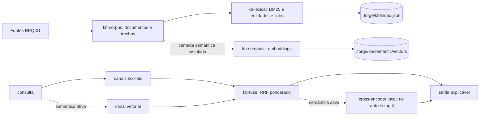

# Design — add-unified-knowledge-search

> Design técnico do change `add-unified-knowledge-search`. Medições que sustentam as decisões: `evidence/corpus-measurement.md` (corpus e plataforma) e `evidence/semantic-feasibility.md` (runtime, modelos, qualidade e latência). Decisão durável e transversal (primeira camada opt-in com dependência instalada sob demanda no projeto-alvo) registrada como ADR 0004 no baseline (§2.9).

## 1. Contexto e restrições

Restrições inegociáveis, as duas do dono: (R1) o Forge é zero-dependency no projeto-alvo — bash + Node >= 20 `.mjs`, sem build step, sem `node_modules` no alvo (`docs/plans/spikes/w40-graph-engine-spike.md`, ADR 0001); (R2) memória semântica com embeddings e re-rank deve ser implementada neste change, executada localmente, sem provedor cloud por padrão e sem binding nativo.

Outras restrições medidas: o piso é Node 20 (`package.json > engines`), então `node:sqlite` (Node >= 22.5, experimental) está fora; o corpus desta instância tem 335 documentos e 5.167 trechos, e o índice lexical em Node puro constrói em ~0,7 s e consulta em menos de 1 ms (corpus-measurement.md), o que dispensa banco ou índice externo. Liaison: 451 de 463 mensagens são `untrusted-peer` e a rule `conventions/liaison-untrusted-input.md` manda tratar conteúdo de peer como dado, nunca instrução.

Precedente: o spike W40 descreveu a "Opção C" (nativo por padrão + camada WASM opt-in), mas a decisão final foi a Opção B pura e nenhuma camada opt-in com dependência instalada chegou a existir no harness (conferido: nenhum script do template carrega pacote npm em runtime). Este change é, portanto, o primeiro a materializar o padrão, e por isso o padrão é registrado em ADR (§2.9) em vez de herdado.

## 2. Decisão técnica

### 2.1 Visão geral: duas camadas, um pipeline

O default (camada lexical) usa apenas `node:*` e módulos do próprio harness. A camada semântica é código do harness, versionado e testado neste change, que só executa quando o runtime e os modelos foram instalados pelo consumidor com `kb.sh semantic install`. Resolução da tensão R1 × R2: o código dos embeddings e do re-rank é entregue a todos (R2 cumprida, não prometida); a dependência de execução (runtime WASM e pesos) só entra no projeto quando o consumidor a pede, fora do `package.json` dele, com versões e hashes fixados no template (R1 preservada no default). Nenhum dos dois lados é contornado: sem instalação, a busca funciona inteira em modo lexical; com instalação, os quatro canais e o re-rank operam de fato.

### 2.2 Módulos

| Arquivo | Papel | Imports permitidos |
|---|---|---|
| `template/.forge/scripts/kb.sh` | dispatcher: `build`, `query`, `status`, `semantic install|remove|status` | bash + node |
| `lib/kb-corpus.mjs` | coleta das fontes do REQ-01, corte em trechos, impressão digital | `node:*` |
| `lib/kb-lexical.mjs` | normalização, BM25, entidades, grafo de links, serialização do índice | `node:*` |
| `lib/kb-fuse.mjs` | RRF ponderado e combinação do re-rank (funções puras) | nenhum |
| `lib/kb-semantic.mjs` | carga do runtime instalado, verificação de integridade, embeddings, cross-encoder, cache de vetores | `node:*` + runtime instalado via `createRequire` em `.forge/kb/semantic/runtime/` |
| `lib/kb-install.mjs` | único módulo com rede: `npm ci` do runtime e download dos modelos com sha256 | `node:*` |
| `lib/kb-cli.mjs` | orquestra build, query, status; formata saída texto e `--json` | módulos acima |
| `template/.forge/scripts/lib/kb-pins/package.json` + `package-lock.json` | runtime fixado: `onnxruntime-web` e `@huggingface/tokenizers`, versões exatas, `integrity` sha512 por pacote | dado |
| `template/.forge/scripts/lib/kb-pins/models.json` | modelos fixados: repositório, revisão (commit), arquivo, sha256, tamanho, papel, prefixos e limites de tokens | dado |
| `template/.forge/commands/graph/kb.md` | comando `/forge:kb` | — |

Os pins moram em `scripts/lib/kb-pins/`, isto é, na maquinaria: chegam ao consumidor pelo instalador (`cp -R` do template) e pelo `forge update` (overlay recursivo de `scripts/`), ficam versionados no consumidor, e nunca dentro de `.forge/kb/` (que é derivado, ignorado pelo git e apagado por `semantic remove`).

### 2.2.1 Resolução de raiz e canais de saída

`kb.sh` faz `source` de `lib/forge-root.sh`. Com `FORGE_ROOT` definido, tudo usa ele. Sem ele, documentos versionados por branch e o índice usam `forge_worktree_root` (a árvore de trabalho corrente), e ledger e liaison usam `forge_resolve_root` (o checkout principal), a mesma convenção de `ledger-ops.sh`/`liaison-ops.sh`; as duas raízes são passadas ao Node como argumentos. O único git executado é `rev-parse`. Resultado em stdout; avisos (reconstrução, vetores faltando, progresso do build semântico) em stderr. Saída texto: primeira linha de stdout `modo: lexical (<motivo>)` ou `modo: semantic`. `--json`: stdout é um único objeto `{format: 1, mode, mode_reason, rebuilt, weights, rerank, results: [...]}`.

`kb-semantic.mjs` não é importado estaticamente por ninguém: `kb-cli.mjs` o carrega com `import()` dinâmico só quando `.forge/kb/semantic/installed.json` existe e o operador não passou `--lexical`. Assim o caminho lexical nunca avalia código que toque o runtime.

### 2.3 Corpus e trechos (REQ-01)

Fontes exatamente como no REQ-01. Cada documento tem `id` (path relativo à raiz, `ledger:<LDG-id>` ou `liaison:<msg_id>`), `kind` (`baseline`, `archived-spec`, `plan`, `changelog`, `ledger`, `liaison`) e `sha256` do texto. Liaison (na raiz de estado durável): lê `self.id` de `.forge/liaison/liaison.yaml` (via `lib/yaml-lite.mjs`), percorre `.forge/liaison/*/log/<self>.jsonl` e aceita só linhas com `trust === 'self'` e sem `authored_by`; `body_ref` nunca é seguido (blobs ficam fora por construção, não por filtro de path). Ledger: uma entrada por documento, texto = id + título + campos textuais da entrada em ordem fixa. Corte em trechos: markdown por heading de nível 1 a 3, teto de 1.500 caracteres por trecho (o mesmo do protótipo medido), registrando heading e linha inicial; YAML e entradas estruturadas cortados só pelo teto. Itens ilegíveis são pulados e contados por fonte.

### 2.4 Índice lexical (REQ-02, REQ-03)

`.forge/kb/index.json` (formato 1) guarda: lista ordenada de documentos com sha256, trechos (doc, heading, linha, texto), postings BM25 (termo → pares trecho/frequência), comprimentos, postings de entidades e adjacência de links. Tudo ordenado por chave; sem relógio; `JSON.stringify` com ordem estável, logo dois builds sobre a mesma fonte são byte-idênticos. A impressão digital das fontes é o sha256 da lista ordenada `(id, sha256)`; `status` e `query` a recalculam (leitura das fontes, ~0,1 s) e reconstroem o índice lexical se divergir.

Normalização: NFD sem diacríticos, minúsculas, corte em não alfanumérico, stopwords pt/en curtas e redução de sufixos comuns do português (`-ções`, `-ção`, `-mente`, `-idade`, `-ado/a`, `-ando`, `-endo`, `-ar/-er/-ir`, plural). BM25 com k1 = 1,2 e b = 0,75. Entidades: regex fixa sobre `LDG-NNNN`, `ADR NNNN`, `REQ-*`, `TASK-NN`, `wNNN`, nomes de arquivo `*.sh|mjs|md|yaml|json`, `/forge:<cmd>` e siglas em caixa alta; score = soma de idf das entidades da consulta presentes no trecho. Links: aresta entre documentos quando um cita o id de ledger de outro, o nome de arquivo de outro ou o change-id de uma spec arquivada; o canal pontua vizinhos dos documentos semente (top 10 da fusão BM25 + entidades), amortecido pelo grau dos dois lados, e só sobre documentos que já estão entre os candidatos das sementes (medição mostrou que vizinhos fora do conjunto candidato derrubam o hit@1, ver semantic-feasibility.md §Calibração).

### 2.5 Fusão (REQ-03, REQ-04)

RRF ponderado por documento: `score(d) = Σ_c w_c / (k + rank_c(d))`, com k = 60 e pesos constantes exportados por `kb-fuse.mjs` e emitidos no `--json`. Pesos calibrados no conjunto de avaliação versionado (semantic-feasibility.md §Calibração): BM25 1,0; entidades 0,5; links 0,1; vetor (modo semântico) PESO-VETOR. A saída por resultado traz, por canal, a posição e a contribuição `w_c / (k + rank)`, de modo que o motivo de cada resultado é legível.

### 2.6 Camada semântica (REQ-05, REQ-06, REQ-07)

Runtime: `onnxruntime-web` (WASM, sem binário nativo, sem script de instalação, 6 dependências transitivas JS) e `@huggingface/tokenizers` (JS puro, zero dependência, paridade com os tokenizadores do Hugging Face). Medido em Node 20.20.2, 22.22.2 e 26.0.0 (semantic-feasibility.md). `transformers.js` foi descartado porque puxa `onnxruntime-node` (binário nativo baixado em postinstall) e `sharp`.

Modelos (fixados por revisão de commit e sha256 em `models.json`): MODELOS-ESCOLHIDOS.

Embeddings: no `build`, para cada trecho sem vetor em cache, tokeniza com o prefixo do modelo, roda o modelo, aplica mean pooling pela máscara de atenção e normaliza L2. Cache: `.forge/kb/semantic/vectors.bin` (Float32 contíguo) + `vectors.json` (chave `sha256(trecho)` → offset, mais `model_id`); trocar de modelo invalida o cache inteiro; trechos ausentes da fonte saem do cache no build. Na consulta, o vetor da consulta é comparado por cosseno a todos os vetores (varredura linear, 5.167 × 384 multiplicações, menos de 50 ms) e o canal entra na fusão com seu peso.

Re-rank: os K = 10 primeiros documentos da fusão; para cada um, o trecho representante é o de maior BM25 dentro do documento (ou o primeiro trecho, se nenhum casar); o cross-encoder pontua o par (consulta, trecho truncado a 256 tokens). Ordem final dos K: RRF entre a posição do cross-encoder e a posição da fusão com k = 5 (`score = 1/(5 + rank_ce) + 1/(5 + rank_fusão)`), fórmula emitida no `--json`; documentos além de K mantêm a ordem da fusão. A combinação é deliberada: no conjunto de avaliação o cross-encoder sozinho reordena bem o topo mas erra quando o trecho representante é fraco, e a posição da fusão segura esses casos (números em semantic-feasibility.md).

Integridade e degradação (REQ-08): `installed.json` registra versões do runtime e, por arquivo de modelo, sha256 esperado (copiado de `models.json`). A cada carga (`build`, `query`, `eval`), `kb-semantic.mjs`: (1) varre `.forge/kb/semantic/` por binário nativo — extensões `.node`, `.dylib`, `.so`, `.dll` e assinatura nos primeiros 4 bytes (Mach-O `feedface`/`feedfacf`/`cafebabe` e reversos, ELF `7f454c46`, PE `4d5a`); (2) confere a presença dos pacotes do runtime nas versões do lockfile; (3) confere existência e tamanho de cada arquivo de modelo e o sha256 completo, memorizado em `.forge/kb/semantic/verified.json` por `(path, size, mtimeMs)` para não reler ~270 MB a cada consulta (qualquer mudança de tamanho ou mtime força nova conferência). Os seis casos (ausente, modelo faltando, sha256 divergente, pacote faltando, binário nativo, runtime que lança) viram modo lexical com motivo nomeado e exit 0; `build` constrói o lexical e reporta que os vetores não foram calculados.

### 2.7 Instalação (REQ-05)

`kb.sh semantic install`: (1) imprime o que vai baixar (pacotes e modelos, origem, tamanho total aproximado) e segue sem pergunta interativa (o comando em si é a ativação explícita); (2) copia `package.json` + `package-lock.json` de `lib/kb-pins/` para `.forge/kb/semantic/runtime/` e roda `npm ci --ignore-scripts --no-audit --no-fund` ali — o lockfile fixa versão e `integrity` (sha512) de cada pacote, e `--ignore-scripts` neutraliza o único script de instalação da árvore (`postinstall` de `protobufjs`, uma checagem de versão); (3) varre `.forge/kb/semantic/` por binário nativo (mesma varredura da carga) e desfaz tudo se achar; (4) baixa cada arquivo de modelo de `https://huggingface.co/<repo>/resolve/<revisão>/<arquivo>` com `fetch` do Node para um `.part`, confere sha256 e só então renomeia; divergência apaga e aborta; (5) grava `installed.json` por último (é ele que ativa a camada). `semantic remove` apaga `.forge/kb/semantic/`. Sem `npm` disponível, o install falha com mensagem clara e nada é ativado.

### 2.8 Rede e cloud (REQ-09)

Só `kb-install.mjs` importa `fetch`/`child_process` e só é carregado por `semantic install`. Gate estático reprova, em `lib/kb-*.mjs` exceto `kb-install.mjs`, import de `node:http`, `node:https`, `node:http2`, `node:net`, `node:tls`, `node:dgram`, `node:dns`, `node:child_process`, `node:worker_threads` e uso de `fetch(`; e reprova em `kb.sh` e nos arquivos que ele inclui por `source` `curl`, `wget`, `nc`, `ssh`, `npm`, `npx` e subcomandos de rede do git. Gate dinâmico, nos modos lexical, semântico (fixture, conferindo `mode: semantic`) e nos seis degradados, para `build`, `query`, `status`, `eval` e `semantic status`: (a) sob `node --permission --allow-fs-read=* --allow-fs-write=<tmp> --allow-worker` quando o Node suporta `--allow-net` (>= 25), sem `--allow-net` nem `--allow-child-process`; (b) em qualquer Node, sob `--import` de um interceptador que faz lançar `fetch`, `http(s).request/get`, `http2.connect`, `net.connect/createConnection`, `tls.connect`, `dns.lookup/resolve*`, `dgram.createSocket` e todo `child_process.*`; (c) com `git` substituto no `PATH` que registra subcomandos (só `rev-parse` aceito). O gate imprime qual mecanismo rodou. `onnxruntime-web` em Node carrega o `.wasm` do próprio pacote via sistema de arquivos, o que o gate (a) confirma. Cloud: não implementado; o `kb.md` declara que provedor cloud só pode existir como opt-in explícito, decisão do dono, por causa de dado regulado.

### 2.9 Superfície, doctor, gitignore e ADR (REQ-10)

`/forge:kb` (`template/.forge/commands/graph/kb.md`), apontado por `query.md`. `installer/gitignore.patch` ganha `.forge/kb/` no bloco gerenciado; `.gitignore` da raiz do repositório ganha a mesma linha (o repositório é fonte do bloco e não o aplica em si). `doctor.sh` ganha uma linha `info` com o estado do índice (presente/ausente/defasado) e da camada semântica (não instalada/instalada/integridade divergente), nunca `warn`/`fail` pela ausência. Plugin regenerado com `npm run build:plugin`. ADR 0004 no baseline: "camada opt-in com dependência instalada sob demanda" — o padrão de que dependência de execução só entra no projeto-alvo por comando explícito, fora do `package.json` do consumidor, com versões e hashes fixados no template, sem binário nativo, e com degradação para o caminho zero-dep.

### 2.10 Testes

Default: gates `wNNN-kb-*` sobre raiz de fixture em diretório temporário fora do repositório (sem `node_modules` resolvível acima), cobrindo REQ-01..04, 08..10. Camada semântica com inferência real: o workspace de desenvolvimento do harness ganha `onnxruntime-web` e `@huggingface/tokenizers` como `devDependencies` nas mesmas versões exatas do `package-lock.json` do template (um gate confere a igualdade); o teste gera em tempo de execução modelos ONNX minúsculos (protobuf escrito à mão: `Gather` para o embedder; `Gather → ReduceMean → MatMul` para o cross-encoder) e um `tokenizer.json` de vocabulário pequeno, monta uma camada instalada de fixture e roda `build`/`query` reais pelo runtime. Isso prova que o código de embeddings e re-rank roda de verdade em toda execução da suíte, offline, sem baixar os modelos de produção. A qualidade com os modelos de produção é medida fora da suíte (o download de ~300 MB não cabe no CI) e registrada em evidence, com o script de avaliação versionado (`tests/fixtures/kb/eval/`).

## 3. Alternativas consideradas

| Alternativa | Prós | Contras | Por que não |
|---|---|---|---|
| `node:sqlite` com FTS5 | ranking FTS pronto | exige Node >= 22.5 (experimental); piso do harness é 20 | quebra o piso; Node puro já mede < 1 ms por consulta |
| Embeddings e re-rank só "previstos" (opt-in futuro) | zero esforço | viola R2 | decisão do dono |
| Camada semântica no default (dependência em `package.json` do alvo) | sempre ativa | viola R1; ~400 MB em todo projeto | decisão do dono |
| Provedor cloud (OpenAI/Voyage) | qualidade alta, sem download | texto sai da máquina; repositórios PCI DSS | rejeitado; só como opt-in futuro explícito |
| `transformers.js` | API alto nível | dependências `onnxruntime-node` (nativo, postinstall) e `sharp` (nativo) | viola "sem binding nativo" |
| BERT em JS puro escrito à mão | zero dependência até na camada semântica | estimativa ~2 GFLOP por trecho de 128 tokens, minutos por consulta no re-rank | latência inviável |
| Embedding estático (model2vec/potion) em JS puro | sem runtime; build em ~37 s | qualidade medida inferior (semantic-feasibility.md) | ALTERNATIVA-POTION |
| Tokenizador Unigram próprio | menos uma dependência | paridade com o tokenizador de referência não garantida (normalizador `Precompiled`) | `@huggingface/tokenizers` é JS puro, sem dependência, oficial |
| Links como canal RRF de peso cheio | fiel ao `ai-memory` | medido: derruba hit@1 de 0,44 para 0,18 | peso baixo restrito a candidatos |
| Novo modo em `/forge:query` (`graph.sh`) | uma superfície só | mistura grafo de código com conhecimento; `graph.sh` exige grafo construído | comando próprio `/forge:kb`, com remissão em `query.md` |

## 4. Contratos e integrações afetados

Nenhum contrato existente muda. Novos: CLI `kb.sh` (subcomandos e flags do Checklist de superfície do requirements), formato `--json` (campo `format: 1`), arquivos `.forge/kb/index.json`, `.forge/kb/semantic/installed.json`, `vectors.*` (todos derivados, ignorados pelo git, reconstruíveis; mudança de formato = número de formato novo e reconstrução automática). `installer/gitignore.patch` ganha uma linha no bloco gerenciado (o mecanismo de reconciliação do bloco, gate w133, propaga a consumidores existentes). `package.json` do harness ganha duas `devDependencies` (não vão no pacote publicado; `files` não inclui `node_modules`).

## 5. Plano de migração / rollout

Aditivo. Consumidores recebem `kb.sh` e `/forge:kb` no próximo `forge update`; nada roda até alguém chamar. O índice é criado no primeiro `build`/`query`. A camada semântica só existe após `kb.sh semantic install`. Remoção: `kb.sh semantic remove` e apagar `.forge/kb/`.

## 6. Riscos e mitigação

| Risco | Probabilidade | Impacto | Mitigação / detecção |
|---|---|---|---|
| Caminho lexical passar a depender de pacote | baixa | quebra R1 | gate estático de imports + gate que roda em raiz sem `node_modules` |
| Dado de peer não confiável no índice | baixa | injeção de instrução via resultado de busca | aceitação só de `trust === 'self'` no log próprio; gate com fixture `untrusted-peer`, log de outro remetente e `body_ref` |
| Download adulterado | baixa | código/pesos maliciosos | `npm ci` com `integrity` do lockfile, `--ignore-scripts`, recusa de `*.node`, sha256 por arquivo de modelo |
| Fusão piorar o ranking | média | resultado ruim | conjunto de avaliação versionado; REQ-03 e REQ-06 exigem não piorar hit@5 |
| Calibração superajustada ao conjunto de 34 consultas | média | pesos piores em outro corpus | pesos conservadores (canal principal domina), números registrados com a ressalva; recalibração futura vai ao ledger |
| Build semântico inicial lento | alta | minutos na primeira vez | cache por sha256 do trecho; progresso reportado; tempo medido em evidence |
| Versão do `onnxruntime-web` quebrar em Node futuro | média | camada semântica falha | degradação para lexical com motivo (REQ-08); versão fixada |
| Índice copiar segredo presente em documento | baixa | segredo em arquivo derivado local | índice é derivado de arquivos já versionados e fica ignorado pelo git; não amplia exposição |

## 7. Rastreabilidade

| REQ | Seção do design que o atende |
|---|---|
| REQ-01 | §2.3 |
| REQ-02 | §2.4, §2.8 |
| REQ-03 | §2.4, §2.5 |
| REQ-04 | §2.5, §2.2 (`kb-cli.mjs`) |
| REQ-05 | §2.7 |
| REQ-06 | §2.6 (Embeddings), §2.10 |
| REQ-07 | §2.6 (Re-rank), §2.10 |
| REQ-08 | §2.6 (Integridade e degradação) |
| REQ-09 | §2.8 |
| REQ-10 | §2.9 |
| NFR-01 | §2.4 (medição em corpus-measurement.md) |
| NFR-02 | §2.6 (medição em semantic-feasibility.md) |
| NFR-03 | §2.2, §2.8, §2.10 |
