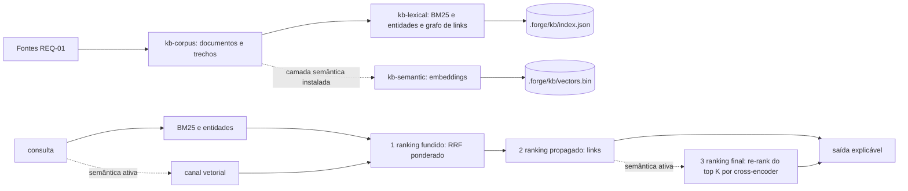

# Design — add-unified-knowledge-search

> Design técnico do change `add-unified-knowledge-search`. Medições que sustentam as decisões: `evidence/corpus-measurement.md` (corpus e plataforma) e `evidence/semantic-feasibility.md` (runtime, modelos, qualidade e latência). Decisão durável e transversal (primeira camada opt-in com dependência instalada sob demanda no projeto-alvo) a registrar como ADR 0004 no baseline pela TASK-11 (§2.9), emendando de forma explícita o "sem dependência no alvo" da ADR 0001.

## 1. Contexto e restrições

Restrições inegociáveis, as duas do dono: (R1) o Forge é zero-dependency no projeto-alvo — bash + Node >= 20 `.mjs`, sem build step, sem `node_modules` no alvo (`docs/plans/spikes/w40-graph-engine-spike.md`, ADR 0001); (R2) memória semântica com embeddings e re-rank deve ser implementada neste change, executada localmente, sem provedor cloud por padrão e sem binding nativo.

Outras restrições medidas: o piso é Node 20 (`package.json > engines`), então `node:sqlite` (Node >= 22.5, experimental) está fora; o corpus desta instância tem 335 documentos e 5.167 trechos, e o índice lexical em Node puro constrói em ~0,7 s e consulta em menos de 1 ms (corpus-measurement.md), o que dispensa banco ou índice externo. Liaison: 451 de 463 mensagens são `untrusted-peer` e a rule `conventions/liaison-untrusted-input.md` manda tratar conteúdo de peer como dado, nunca instrução.

Precedente: o spike W40 descreveu a "Opção C" (nativo por padrão + camada WASM opt-in), mas a decisão final foi a Opção B pura e nenhuma camada opt-in com dependência instalada chegou a existir no harness (conferido: nenhum script do template carrega pacote npm em runtime). Este change é, portanto, o primeiro a materializar o padrão, e por isso o padrão é registrado em ADR (§2.9) em vez de herdado.

## 2. Decisão técnica

### 2.1 Visão geral: duas camadas, um pipeline

O default (camada lexical) usa apenas `node:*` e módulos do próprio harness. A camada semântica é código do harness, versionado e testado neste change, que só executa quando o runtime e os modelos foram instalados pelo consumidor com `kb.sh semantic install`. Resolução da tensão R1 × R2: o código dos embeddings e do re-rank é entregue a todos (R2 cumprida, não prometida); a dependência de execução (runtime WASM e pesos) só entra no projeto quando o consumidor a pede, fora do `package.json` dele, com versões e hashes fixados no template (R1 preservada no default). Nenhum dos dois lados é contornado: sem instalação, a busca funciona inteira em modo lexical; com instalação, o canal vetorial entra na fusão e o re-rank opera de fato sobre o resultado.

### 2.2 Módulos

| Arquivo | Papel | Imports permitidos |
|---|---|---|
| `template/.forge/scripts/kb.sh` | dispatcher: `build`, `query`, `status`, `eval`, `semantic install|remove|status`; resolve as raízes | bash + `node` + `git rev-parse` (via `lib/forge-root.sh`) |
| `lib/kb-corpus.mjs` | coleta das fontes do REQ-01, corte em trechos, impressão digital | `node:*` |
| `lib/kb-lexical.mjs` | normalização, BM25, entidades, grafo de links, serialização do índice | `node:*` |
| `lib/kb-fuse.mjs` | RRF ponderado, propagação de links e combinação do re-rank (funções puras) | nenhum |
| `lib/kb-semantic.mjs` | verificação de integridade (pins, varredura nativa, versões, sha256), carga do runtime confinada a `.forge/kb/semantic/runtime/node_modules/`, embeddings, cross-encoder, cache de vetores | `node:*` + runtime instalado (caminho resolvido conferido) |
| `lib/kb-install.mjs` | único módulo com rede e processo filho: `npm ci` do runtime e download dos modelos com sha256 | `node:*` (inclusive `child_process` e `fetch`) |
| `lib/kb-cli.mjs` | orquestra build, query, status, eval; formata saída texto e `--json`; neutraliza trechos | módulos acima |
| `template/.forge/scripts/lib/kb-pins/package.json` + `package-lock.json` | runtime fixado: `onnxruntime-web` e `@huggingface/tokenizers`, versões exatas, `integrity` sha512 por pacote | dado |
| `template/.forge/scripts/lib/kb-pins/models.json` | modelos fixados: repositório, revisão (commit), arquivo, sha256, tamanho, papel, prefixos e limites de tokens | dado |
| `template/.forge/commands/graph/kb.md` | comando `/forge:kb` | — |

Os pins moram em `scripts/lib/kb-pins/`, isto é, na maquinaria: chegam ao consumidor pelo instalador (`cp -R` do template) e pelo `forge update` (overlay recursivo de `scripts/`), ficam versionados no consumidor, e nunca dentro de `.forge/kb/` (que é derivado e ignorado pelo git; `semantic remove` apaga só `.forge/kb/semantic/`).

### 2.2.1 Resolução de raiz e canais de saída

Local dos artefatos: o índice lexical (`.forge/kb/index.json`, `texts.bin`) fica na raiz de documentos (árvore de trabalho, porque o corpus é por branch); a instalação da camada semântica (`.forge/kb/semantic/`: runtime, modelos, `installed.json`) fica na raiz de estado (checkout principal), compartilhada por todas as worktrees — os ~420 MB são instalados uma vez por máquina e só são lidos; o cache de vetores (`.forge/kb/vectors.bin`) é derivado do corpus e fica na raiz de documentos, por branch, ao lado do índice, para que a poda de trechos de uma branch nunca apague vetores de outra (cada worktree paga o próprio build de vetores, ~9 min no corpus deste repositório, uma vez). Com `FORGE_ROOT`, as duas raízes coincidem. Como nada da instalação é escrito fora de `semantic install`/`semantic remove`, não há escrita concorrente entre worktrees no diretório compartilhado.

`kb.sh` faz `source` de `lib/forge-root.sh`. Com `FORGE_ROOT` definido, tudo usa ele. Sem ele, documentos versionados por branch e o índice usam `forge_worktree_root` (a árvore de trabalho corrente), e ledger e liaison usam `forge_resolve_root` (o checkout principal), a mesma convenção de `ledger-ops.sh`/`liaison-ops.sh`; as duas raízes são passadas ao Node como argumentos. O único git executado é `rev-parse`. Resultado em stdout; avisos (reconstrução, vetores faltando, progresso do build semântico) em stderr. Saída texto: primeira linha de stdout `modo: lexical (<motivo>)` ou `modo: semantic`. `--json`: stdout é um único objeto `{format: 1, query, mode, mode_reason, rebuilt, weights, rrf_k, links: {alpha, top}, rerank: {applied, k, formula}, results: [...]}`; cada resultado traz `doc`, `heading`, `line`, `score`, `channels` (por canal RRF `{rank, contribution}`; `links: {contribution, from}`), `rerank` (`{ce_score, ce_rank, fusion_rank, final_score}` ou `null`) e `snippet` neutralizado (crases triplas trocadas, linhas `/<palavra>:` prefixadas por `⟪neutralizado⟫`, ≤ 240 caracteres). A saída texto mostra os mesmos campos, com o trecho dentro de bloco cercado.

`kb-semantic.mjs` não é importado estaticamente por ninguém: `kb-cli.mjs` o carrega com `import()` dinâmico só quando `.forge/kb/semantic/installed.json` existe **na raiz de estado** e o operador não passou `--lexical`. Assim o caminho lexical nunca avalia código que toque o runtime.

### 2.3 Corpus e trechos (REQ-01)

Fontes exatamente como no REQ-01. Cada documento tem `id` (path relativo à raiz, `ledger:<LDG-id>` ou `liaison:<msg_id>`), `kind` (`baseline`, `archived-spec`, `plan`, `changelog`, `ledger`, `liaison`) e `sha256` do texto. Liaison (na raiz de estado durável): lê `self.id` de `.forge/liaison/liaison.yaml` (via `lib/yaml-lite.mjs`), percorre `.forge/liaison/*/log/<self>.jsonl` e aceita só linhas em que a regra canônica de procedência `expectedTrust(msg, self, self)` de `lib/liaison-trust.mjs` dá `self` (sem `authored_by`) **e** o campo gravado `trust` é `self` — as duas checagens, para que uma mudança futura na regra canônica não divirja em silêncio e um log corrompido também não passe; `body_ref` nunca é seguido (blobs ficam fora por construção, não por filtro de path). Ledger (na raiz de estado durável): uma entrada por documento, texto = id + título + `type`, `status`, `priority`, `severity`, `detail`, `source`, `links`, em ordem fixa. Corte em trechos: markdown por heading de nível 1 a 3, teto de 1.500 caracteres por trecho (o mesmo do protótipo medido), registrando heading e linha inicial; YAML e entradas estruturadas cortados só pelo teto. Itens ilegíveis são pulados e contados por fonte.

### 2.4 Índice lexical (REQ-02, REQ-03)

`.forge/kb/index.json` (formato 1) guarda: lista ordenada de documentos com sha256, metadados dos trechos (doc, heading, linha, deslocamento e tamanho em bytes do texto), postings BM25 (termo → pares trecho/frequência), comprimentos, postings de entidades e adjacência de links; o texto dos trechos fica em `.forge/kb/texts.bin` (UTF-8 concatenado), lido por deslocamento só para os trechos exibidos ou re-ranqueados. Motivo medido: com o texto embutido o `index.json` tem 10,8 MB e o `JSON.parse` sozinho custa ~76 ms; os textos são 6,3 MB desse total, e tirá-los do parse é o que põe a consulta lexical dentro do NFR-01. Os dois arquivos são escritos por rename atômico, `texts.bin` primeiro, e o `index.json` registra o sha256 do `texts.bin` correspondente; divergência na carga = índice defasado (reconstrução). Tudo ordenado por chave; sem relógio; `JSON.stringify` com ordem estável, logo dois builds sobre a mesma fonte são byte-idênticos. A impressão digital das fontes é o sha256 da lista ordenada `(id, sha256)`. Para a consulta não reler todo o corpus (medido: ler e hashear as fontes custa ~90 ms, metade do orçamento do NFR-01), o índice guarda também uma impressão rápida — sha256 da lista ordenada `(caminho, tamanho, mtimeMs)` dos arquivos-fonte (inclusive `ledger.json` e os logs próprios do liaison). `query`/`eval`/`status` comparam primeiro a rápida; se ela bater, o índice está atual; se divergir, calculam a de conteúdo, e só reconstroem se a de conteúdo também divergir (um `git checkout` que muda mtime sem mudar conteúdo não força reconstrução; nesse caso a consulta regrava só o campo `quick_fingerprint` do `index.json`, por rename atômico, para que as consultas seguintes voltem ao caminho barato). `INDEX_FORMAT` muda sempre que a tokenização ou a estrutura do índice muda, o que força reconstrução em quem tinha índice antigo.

Normalização: NFD sem diacríticos, minúsculas, corte em não alfanumérico, stopwords pt/en curtas e redução de sufixos comuns do português (`-ções`, `-ção`, `-mente`, `-idade`, `-ado/a`, `-ando`, `-endo`, `-ar/-er/-ir`, plural). BM25 com k1 = 1,2 e b = 0,75. Entidades: regex fixa sobre `LDG-NNNN`, `ADR NNNN`, `REQ-*`, `TASK-NN`, `wNNN`, nomes de arquivo `*.sh|mjs|md|yaml|json`, `/forge:<cmd>` e siglas em caixa alta; score = soma de idf das entidades da consulta presentes no trecho. Links: aresta não direcionada quando um documento cita o id de ledger de outro, o nome de arquivo de outro (único no índice e fora da lista fechada de nomes genéricos do REQ-03) ou o change-id de uma spec arquivada (a aresta vai para o `proposal.md` da spec, ou o primeiro arquivo dela). A adjacência fica no índice; o uso é a propagação da §2.5.

### 2.5 Fusão (REQ-03, REQ-04)

Três etapas, nesta ordem (REQ-03):

1. **Ranking fundido.** RRF ponderado por documento: `score(d) = Σ_c w_c / (k + rank_c(d))`, k = 60, com o rank de cada canal em nível de documento pelo melhor trecho. Canais: BM25 (w = 1,0) e entidades (w = 0,2); no modo semântico, também o vetor (w = 1,0).
2. **Ranking propagado.** Cada um dos T = 10 primeiros transfere `α · score(origem) / sqrt(grau(origem) · grau(vizinho))` a cada vizinho no grafo de links, α = 0,1; vizinho fora do ranking fundido entra só com o que recebeu. Links como canal RRF foram descartados por medição (semantic-feasibility.md §3.1: a distância entre posições vizinhas do BM25 em RRF é menor que a contribuição mínima de um canal, e qualquer peso testado derrubou o hit@5).
3. **Ranking final.** No modo semântico sem `--no-rerank`, o re-rank da §2.6 sobre os K = 10 primeiros do ranking propagado; nos demais casos, o ranking propagado.

Todas as constantes são exportadas por `kb-fuse.mjs` e emitidas no `--json`; foram escolhidas só na partição de calibração (semantic-feasibility.md §3.1 e §5).

### 2.6 Camada semântica (REQ-05, REQ-06, REQ-07)

Runtime: `onnxruntime-web` (WASM, sem binário nativo, sem script de instalação, 6 dependências transitivas JS) e `@huggingface/tokenizers` (JS puro, zero dependência, paridade com os tokenizadores do Hugging Face). Medido em Node 20.20.2, 22.22.2 e 26.0.0 (semantic-feasibility.md). `transformers.js` foi descartado porque puxa `onnxruntime-node` (binário nativo baixado em postinstall) e `sharp`.

Modelos (fixados por revisão de commit, URL, sha256 e tamanho em `models.json`): embedding `Xenova/multilingual-e5-small` (`onnx/model_int8.onnx`, 118 MB, MIT, multilíngue, prefixos `query: `/`passage: `, 256 tokens, mean pooling, L2); re-rank `cross-encoder/mmarco-mMiniLMv2-L12-H384-v1` (`onnx/model_qint8_arm64.onnx`, 119 MB, Apache-2.0, multilíngue; o quantizado int8 roda em qualquer arquitetura no WASM; consulta até 64 tokens, trecho até 256, par no formato XLM-R `<s> A </s></s> B </s>`). Tokenizadores (`tokenizer.json`, `tokenizer_config.json`) fixados da mesma revisão. Escolha medida em semantic-feasibility.md §3: o e5 é o único sinal que supera o BM25 sozinho em hit@5; embeddings estáticos (potion) pioram a fusão; modelos só-inglês não servem a um corpus pt-BR.

Embeddings: no `build`, para cada trecho sem vetor em cache, tokeniza (com o prefixo de passagem do modelo), roda o modelo, aplica mean pooling pela máscara de atenção e normaliza L2. O cache é o arquivo único `.forge/kb/vectors.bin` da raiz de documentos (formato no fim desta seção), por branch como o índice; trocar de modelo invalida o cache inteiro (o `model_id` inclui o sha256 do modelo); trechos ausentes da fonte desta árvore saem do cache no build — o que é correto justamente porque o cache não é compartilhado entre worktrees. Na consulta, o vetor da consulta (prefixo de consulta) é comparado por cosseno a todos os vetores (varredura linear, ~5.100 × 384 multiplicações) e o canal vetorial entra na fusão com seu peso.

Re-rank: os K = 10 primeiros do ranking propagado; para cada documento, o trecho representante é o de maior similaridade vetorial com a consulta dentro do documento (medido melhor que o de maior BM25: MRR 0,710 contra 0,632 na calibração); o cross-encoder pontua o par (consulta, trecho). Ordem final dos K: `score = 1/(5 + rank_ce) + 1/(5 + rank_propagado)` (w_ce = 1, k = 5), desempate pela posição do cross-encoder (emenda do REQ-07: com desempate pela posição propagada, uma inversão simétrica dos extremos deixava o primeiro no lugar e contradizia o critério (ii); na calibração as métricas são idênticas sob as duas regras), fórmula emitida no `--json`; documentos além de K mantêm a ordem do ranking propagado. A combinação é deliberada: nenhum dos dois sinais decide sozinho (REQ-07), e os parâmetros saem da calibração (semantic-feasibility.md §5).

Integridade do runtime depois da instalação: a conferência na carga é por versão de pacote (o `integrity` sha512 do lockfile é verificado pelo `npm ci` na instalação; adulteração local posterior de um arquivo do runtime não é detectada por hash, mas o conteúdo continua confinado, sem binário nativo e sem rede no processo). Integridade e degradação (REQ-08): `installed.json` registra as versões dos pacotes de topo e o sha256 de `package-lock.json` + `models.json` dos pins usados (`pins_sha256`). A cada carga (`build`, `query`, `eval`), `kb-semantic.mjs`: (0) compara `pins_sha256` com os pins atuais (diferente = "pins mudaram desde a instalação — rode kb.sh semantic install"); (1) varre `.forge/kb/semantic/` por binário nativo — extensões `.node`, `.dylib`, `.so`, `.dll` e assinatura nos primeiros 4 bytes (Mach-O `feedface`/`feedfacf`/`cafebabe` e reversos, ELF `7f454c46`, PE `4d5a`); (2) confere a presença de cada pacote do lockfile em `runtime/node_modules/<pacote>/package.json` na versão fixada; (3) confere existência, tamanho e sha256 completo de cada arquivo de modelo a cada carga, sem memorização (medido: hashear os ~270 MB custa ~225 ms, dentro do NFR-02; uma memória por tamanho e mtime deixaria passar adulteração que preserva os dois, como `touch -r`). `semantic status` faz a mesma conferência. (4) importa `onnxruntime-web` e `@huggingface/tokenizers` por caminho resolvido com `createRequire` ancorado em `runtime/package.json` e **conferido**: se o caminho resolvido não estiver dentro de `runtime/node_modules/`, a carga recusa com "pacote do runtime faltando" antes de qualquer `import()` — é isso que impede um pacote do projeto-alvo ou do harness de ser carregado. As dependências transitivas são resolvidas pelo Node a partir do pacote já confinado e, por (2), existem dentro do confinamento. Os oito casos do REQ-08 (ausente, modelo faltando, sha256 divergente, pacote faltando ou fora do confinamento, binário nativo, pins mudaram, runtime que lança na importação, runtime que lança na inferência) viram modo lexical com motivo nomeado e exit 0; `build` constrói o lexical e reporta que os vetores não foram calculados. Cache de vetores num arquivo só, `.forge/kb/vectors.bin` (raiz de documentos): cabeçalho fixo (`FKBV`, versão, dimensão, quantidade, tamanho do JSON de chaves), o JSON das chaves (`model_id` e `sha256(trecho)` → posição) e os Float32 — gravado inteiro a cada 200 trechos calculados e no fim, por rename atômico de um arquivo único (não há par de arquivos que possa ficar inconsistente); na carga, cabeçalho, tamanho total e `model_id` são conferidos e qualquer divergência descarta o cache (recalcula). Build interrompido preserva o que já calculou.

### 2.7 Instalação (REQ-05)

`kb.sh semantic install`: (1) imprime o que vai baixar (pacotes e modelos, origem, tamanho total aproximado) e segue sem pergunta interativa (o comando em si é a ativação explícita); (2) copia `package.json` + `package-lock.json` de `lib/kb-pins/` para `.forge/kb/semantic/runtime/` e roda `npm ci --ignore-scripts --no-audit --no-fund` ali — o lockfile fixa versão e `integrity` (sha512) de cada pacote, e `--ignore-scripts` neutraliza o único script de instalação da árvore (`postinstall` de `protobufjs`, uma checagem de versão); (3) varre `.forge/kb/semantic/` por binário nativo (mesma varredura da carga) e desfaz tudo se achar; (4) baixa cada arquivo de modelo da `url` dos pins (`https://huggingface.co/<repo>/resolve/<revisão>/<arquivo>`; o instalador recusa qualquer esquema que não seja `https://`, salvo `http://` para `127.0.0.1`/`localhost`, que serve ao teste) com `fetch` do Node para um `.part`, confere sha256 e tamanho e só então renomeia; divergência apaga e aborta; arquivo já presente e íntegro não é baixado de novo; (5) grava `installed.json` por último (é ele que ativa a camada). `semantic remove` apaga `.forge/kb/semantic/` e só ele. Sem `npm` no `PATH`, o install falha com mensagem clara, exit 1, e nada é ativado.

### 2.8 Rede e cloud (REQ-09)

Só `kb-install.mjs` importa `fetch`/`child_process` e só é carregado por `semantic install`. Gate estático reprova, em `lib/kb-*.mjs` exceto `kb-install.mjs`, import de `node:http`, `node:https`, `node:http2`, `node:net`, `node:tls`, `node:dgram`, `node:dns`, `node:child_process`, `node:worker_threads` e uso de `fetch(`; e reprova em `kb.sh` e nos arquivos que ele inclui por `source` `curl`, `wget`, `nc`, `ssh`, `npm`, `npx` e subcomandos de rede do git. Gate dinâmico, nos modos lexical, semântico (fixture, conferindo `mode: semantic`) e nos oito degradados, para `build`, `query`, `status`, `eval`, `semantic status` e `semantic remove`: (a) sob `node --permission --allow-fs-read=* --allow-fs-write=<tmp> --allow-worker` quando o Node suporta `--allow-net` (>= 25), sem `--allow-net` nem `--allow-child-process`; (b) em qualquer Node (é o único mecanismo no CI, que roda Node 20), sob `--require` de um interceptador CommonJS que faz lançar `fetch`, `http(s).request/get`, `http2.connect`, `net.connect/createConnection`, `tls.connect`, `dns.lookup/resolve*`, `dgram.createSocket` e todo `child_process.*`, e registra cada tentativa em arquivo (tentativa engolida por try/catch ainda aparece). `--require`, e não `--import`: medido em Node 20 e 26 que um Worker não executa o módulo de `--import` nem com ele no `execArgv` (`fetch` num Worker saía para a rede), enquanto `--require` é aplicado dentro de cada Worker — e o `onnxruntime-web` roda com threads WASM; (b') controle positivo a cada execução: um canário tenta `fetch` e `net.connect` contra o servidor local na thread principal e num Worker, e tem de ser bloqueado nas quatro tentativas sob cada mecanismo e passar nas quatro sem bloqueio (recontrole), para que um bloqueio inerte não passe verde; (c) com `git` substituto no `PATH` que registra subcomandos (só `rev-parse` aceito). O gate imprime qual mecanismo rodou. `onnxruntime-web` em Node carrega o `.wasm` do próprio pacote via sistema de arquivos, o que o gate (a) confirma. Cloud: não implementado; o `kb.md` declara que provedor cloud só pode existir como opt-in explícito, decisão do dono, por causa de dado regulado.

### 2.9 Superfície, doctor, gitignore e ADR (REQ-10)

`/forge:kb` (`template/.forge/commands/graph/kb.md`), apontado por `query.md`. `installer/gitignore.patch` ganha `.forge/kb/` no bloco gerenciado; `.gitignore` da raiz do repositório ganha a mesma linha (o repositório é fonte do bloco e não o aplica em si). `doctor.sh` ganha uma linha `info` (marcador `·`), olhando o índice na sua `ROOT` e a instalação semântica na raiz de estado (`FORGE_ROOT` se definido; senão o checkout principal, via `git rev-parse --path-format=absolute --git-common-dir`, o mesmo critério e a mesma flag de `lib/forge-root.sh`, com recuo para a própria `ROOT` fora de git), com o estado do índice (construído ou não) e da camada semântica (instalada ou não, com o comando para conferir integridade, `kb.sh semantic status`), nunca `warn`/`fail` pela ausência. O doctor só testa a presença de arquivos com `[ -f ]`: não executa node para isso e não importa nenhum módulo da busca, então não pode disparar instalação nem rede (a checagem de integridade completa é do `semantic status`). Plugin regenerado com `npm run build:plugin`. ADR 0004 no baseline: "camada opt-in com dependência instalada sob demanda" — o padrão de que dependência de execução só entra no projeto-alvo por comando explícito, fora do `package.json` do consumidor, com versões e hashes fixados no template, sem binário nativo, e com degradação para o caminho zero-dep.

### 2.10 Testes

Default: gates `wNNN-kb-*` sobre raiz de fixture em diretório temporário fora do repositório (sem `node_modules` resolvível acima), cobrindo REQ-01..04, 08..11.

Camada semântica com inferência real, sem override de produção (REQ-06): o workspace de desenvolvimento ganha `onnxruntime-web` e `@huggingface/tokenizers` como `devDependencies` nas versões exatas dos pins (gate confere igualdade e ausência de bloco `dependencies`). O gate monta a raiz de fixture com uma **cópia da maquinaria** (`.forge/scripts/`), troca nela apenas `lib/kb-pins/models.json` por um que aponta para arquivos de fixture servidos por um servidor HTTP local (`http://127.0.0.1:<porta>`), com os sha256 e tamanhos deles; os modelos de fixture são ONNX minúsculos gerados no próprio teste (protobuf escrito à mão: `Gather` → `last_hidden_state` para o embedder; `Gather → ReduceMean → MatMul` → `logits` para o cross-encoder) e um `tokenizer.json` de vocabulário pequeno, de modo que textos com as mesmas palavras ficam próximos e textos sem palavras em comum, não. O gate roda o `kb.sh semantic install` **real**, com um `npm` substituto no `PATH` (seam de teste por `PATH`, como o `git` substituto) que copia para `runtime/node_modules` os pacotes do lockfile a partir do `node_modules` do workspace. Download, sha256, varredura nativa, versões, `installed.json`, carga confinada e inferência são o código de produção. Casos negativos sobre a mesma fixture: byte trocado no modelo; pacote de topo ausente; dependência transitiva ausente com versão envenenada no `node_modules` da raiz de fixture (módulo que grava marcador e lança); binário nativo plantado (arquivo `.node` e arquivo com cabeçalho ELF sem extensão); pins alterados após a instalação; runtime substituído por módulo que lança na importação; runtime que lança na inferência (modelo de fixture com entrada incompatível). A qualidade com os modelos de produção é medida fora da suíte (download de ~270 MB e build de ~15 min não cabem no CI) e registrada em evidence pelo `kb.sh eval`.

### 2.11 Avaliação (REQ-11) e erros de uso (REQ-04, REQ-08)

`kb.sh eval <arquivo>`: lê `[{q, gold: [fragmentos]}]`; recusa arquivo malformado como erro de uso; consulta cujo nenhum fragmento casa id de documento do índice (por substring, sem caixa) é erro (exit 1, lista em stderr); fragmento que casa mais de 10 documentos gera aviso em stderr e a contagem por fragmento sai no `--json` (`gold_matches`). Modos avaliados: `bm25` (canal isolado), `lexical` (pipeline lexical completo), e, com a camada semântica carregada, `semantic` (sem re-rank) e `semantic+rerank`; métricas em nível de documento: hit@1, hit@5, hit@10 e MRR (posição do primeiro relevante; zero se ausente). Determinístico. `tests/fixtures/kb/eval/calibration.json` e `holdout.json` são cópias byte a byte de `evidence/prototype/queries.json` e `holdout.json` (gate confere com `cmp`); a ordem holdout → constantes é verificável por `git log --follow` (o holdout foi versionado em `5a2675bc`/`7dd0a8bc`, antes de `lib/kb-fuse.mjs` existir). O gate hermético roda `eval` sobre corpus e consultas de fixture com métricas esperadas escritas à mão.

Erros de uso (exit 2, mensagem de uso em stderr): subcomando desconhecido, flag desconhecida, consulta vazia, `--top` fora de 1..50 ou não inteiro, `eval` sem arquivo, `semantic` sem subcomando válido. Default `--top 8`.

### 2.12 Guardas estáticas e de superfície

Além das de rede (§2.8): gate estático reprova, em `kb.sh` e `lib/kb-*.mjs`, qualquer referência por limite de palavra aos hosts/SDKs de provedor de LLM listados no REQ-04 (lista no próprio gate); gate estático varre `template/`, `installer/` e `bin/` e exige que `kb-install.mjs` seja referenciado só por `kb-cli.mjs`, uma vez, dentro do ramo `semantic install`; gate de execução roda `doctor.sh` numa raiz de fixture com `FORGE_ROOT` (raízes coincidentes) e confere a linha `info` e a ausência de `.forge/kb/semantic/` nessa raiz depois dele; e roda também numa worktree git real de uma fixture, sem `FORGE_ROOT`, com a camada instalada só no checkout principal, conferindo que a linha diz "instalada" (raízes diferentes resolvidas certo). Os gates semânticos reprovam (não pulam) quando as devDependencies não estão instaladas — pular seria verde falso; o CI já roda `npm ci`, que passa a baixar também `onnxruntime-web` (~150 MB descompactado) e `@huggingface/tokenizers`.

## 3. Alternativas consideradas

| Alternativa | Prós | Contras | Por que não |
|---|---|---|---|
| `node:sqlite` com FTS5 | ranking FTS pronto | exige Node >= 22.5 (experimental); piso do harness é 20 | quebra o piso; Node puro já mede < 1 ms por consulta |
| Embeddings e re-rank só "previstos" (opt-in futuro) | zero esforço | viola R2 | decisão do dono |
| Camada semântica no default (dependência em `package.json` do alvo) | sempre ativa | viola R1; ~400 MB em todo projeto | decisão do dono |
| Provedor cloud (OpenAI/Voyage) | qualidade alta, sem download | texto sai da máquina; repositórios PCI DSS | rejeitado; só como opt-in futuro explícito |
| `transformers.js` | API alto nível | dependências `onnxruntime-node` (nativo, postinstall) e `sharp` (nativo) | viola "sem binding nativo" |
| BERT em JS puro escrito à mão | zero dependência até na camada semântica | estimativa ~2 GFLOP por trecho de 128 tokens, minutos por consulta no re-rank | latência inviável |
| Embedding estático (model2vec/potion) em JS puro | sem runtime; build em ~37 s | vetor isolado hit@5 0,529 (multilíngue, 512 MB) e 0,324 (inglês) contra 0,824 do e5; com ele a fusão piora (semantic-feasibility.md §3) | qualidade; e o re-rank exige runtime de qualquer forma |
| Tokenizador Unigram próprio | menos uma dependência | paridade com o tokenizador de referência não garantida (normalizador `Precompiled`) | `@huggingface/tokenizers` é JS puro, sem dependência, oficial |
| Links como canal RRF | fiel ao `ai-memory` | medido: qualquer peso testado (0,05 a 1,0) derruba hit@5 na calibração | propagação de score sobre o topo (§2.5) |
| Novo modo em `/forge:query` (`graph.sh`) | uma superfície só | mistura grafo de código com conhecimento; `graph.sh` exige grafo construído | comando próprio `/forge:kb`, com remissão em `query.md` |

## 4. Contratos e integrações afetados

Nenhum contrato existente muda. Novos: CLI `kb.sh` (subcomandos e flags do Checklist de superfície do requirements), formato `--json` (campo `format: 1`), arquivos derivados na raiz de documentos — `.forge/kb/index.json` + `.forge/kb/texts.bin` (par gravado `texts.bin` primeiro e amarrado pelo `texts_sha256` do índice) e `.forge/kb/vectors.bin` (cabeçalho `FKBV` versionado) — e, na raiz de estado, `.forge/kb/semantic/` (`installed.json`, `runtime/`, `models/`). Todos ignorados pelo git e reconstruíveis; mudança de formato = número de formato novo e reconstrução automática. `installer/gitignore.patch` ganha uma linha no bloco gerenciado (o mecanismo de reconciliação do bloco, gate w133, propaga a consumidores existentes). `package.json` do harness ganha duas `devDependencies` (não vão no pacote publicado; `files` não inclui `node_modules`).

## 5. Plano de migração / rollout

Aditivo. Consumidores recebem `kb.sh` e `/forge:kb` no próximo `forge update`; nada roda até alguém chamar. O índice é criado no primeiro `build`/`query`. A camada semântica só existe após `kb.sh semantic install`. Remoção: `kb.sh semantic remove` e apagar `.forge/kb/`.

## 6. Riscos e mitigação

| Risco | Probabilidade | Impacto | Mitigação / detecção |
|---|---|---|---|
| Caminho lexical passar a depender de pacote | baixa | quebra R1 | gate estático de imports + gate que roda em raiz sem `node_modules` |
| Dado de peer não confiável no índice | baixa | injeção de instrução via resultado de busca | aceitação só de `trust === 'self'` no log próprio; gate com fixture `untrusted-peer`, log de outro remetente e `body_ref` |
| Download adulterado | baixa | código/pesos maliciosos | `npm ci` com `integrity` do lockfile, `--ignore-scripts`, recusa de `*.node`, sha256 por arquivo de modelo |
| Fusão piorar o ranking | média | resultado ruim | conjunto de avaliação versionado; REQ-03 e REQ-06 exigem não piorar hit@5 |
| Calibração superajustada à partição de calibração | média | pesos piores em outro corpus | holdout de 18 consultas reportado sem ajuste (semantic-feasibility.md §5): já mostra o lexical default 0,016 de MRR abaixo do BM25 e o re-rank 0,004 de MRR abaixo do semântico sem re-rank (−1 consulta em hit@5). Pelos critérios aprovados, é provável que o verify repita isso e que o change pare antes do archive com a decisão no dono (REQ-03, REQ-07) — o que é o comportamento desenhado, não uma falha do processo |
| Build semântico inicial lento | alta | ~9 min no corpus deste repositório | cache por sha256 do trecho gravado a cada 200; progresso em stderr; só trechos novos depois |
| Versão do `onnxruntime-web` quebrar em Node futuro | média | camada semântica falha | degradação para lexical com motivo (REQ-08); versão fixada |
| Consulta lexical acima do NFR-01 | média | latência | texto dos trechos fora do `index.json` e impressão rápida por stat (§2.4); medido no verify com `time`; plano B se não bastar: postings em formato binário |
| Falso positivo da varredura nativa em arquivo de dado | baixa | camada desativada sem motivo real | a varredura só percorre `.forge/kb/semantic/` (runtime e modelos); o cache de vetores fica fora dela; os modelos são conferidos por sha256 fixado e começam por bytes de protobuf/JSON, não por assinatura de executável |
| Índice copiar segredo presente em documento | baixa | segredo em arquivo derivado local | índice é derivado de arquivos já versionados e fica ignorado pelo git; não amplia exposição |
| Licença dos dados de treino dos modelos | média | uso comercial (Vellus/Axis) de pesos treinados com dados derivados do MS MARCO, cujos termos são de uso não comercial (não verificado juridicamente) | as licenças declaradas dos pesos são MIT (e5) e Apache-2.0 (mmarco); a dúvida sobre os dados de treino fica registrada aqui e na ADR 0004 como decisão jurídica do dono; trocar de modelo é mudança de pins, sem mudança de código |
| Paridade numérica e latência fora de Apple Silicon | média | o arquivo `qint8_arm64` ou a latência podem diferir em x86_64 | o verify mede também em x86_64 (Node x64 sob Rosetta nesta máquina; declarado como emulação) |

## 7. Rastreabilidade

| REQ | Seção do design que o atende |
|---|---|
| REQ-01 | §2.3 |
| REQ-02 | §2.4, §2.8 |
| REQ-03 | §2.4, §2.5 |
| REQ-04 | §2.2.1 (saída), §2.5, §2.11 (uso), §2.12 (provedores de LLM) |
| REQ-05 | §2.6 (integridade na carga), §2.7, §2.12 (instalação só por `semantic install`; doctor) |
| REQ-06 | §2.6 (Embeddings), §2.10 |
| REQ-07 | §2.6 (Re-rank), §2.10 |
| REQ-08 | §2.6 (Integridade e degradação), §2.11 (erros de uso) |
| REQ-09 | §2.8 |
| REQ-10 | §2.9, §2.12 |
| REQ-11 | §2.11, §2.10 |
| NFR-01 | §2.4 (texto fora do JSON e impressão rápida; números de partida em semantic-feasibility.md §4.1; alvo < 200 ms medido no verify) |
| NFR-02 | §2.6 (medido: 3,2 s com re-rank; build inicial 529 s) |
| NFR-03 | §2.2, §2.8, §2.10 |
