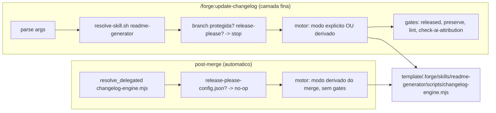

# Design — add-unify-changelog-skill

> Design técnico do change `add-unify-changelog-skill`. Decisões duráveis e transversais merecem ADR (`/forge:new-adr`) — referencie aqui em vez de duplicar.

## 1. Contexto e restrições

- Stack do harness é bash/node; `python3` é dependência opcional hoje (só `approval-log.sh`), nunca obrigatória para um hook de git. Decisão do dono: hook `post-merge` continua automático (opção B). Logo, o motor que o hook chama não pode depender de `python3`.
- `post-merge` segue o padrão de delegação estrita (issue #49): alvo ausente com diretório-lar presente = erro observável, nunca no-op silencioso. O padrão já existe em `resolve_delegated()` (linhas 29-60 do hook) e é reaproveitado, não reinventado.
- `post-merge` é informacional — git ignora seu exit status — então qualquer gate de bloqueio (`released`/`preserve`/`lint`/`check-ai-attribution`) só faz sentido no comando, que roda antes do merge, nunca no hook.
- `resolve-skill.sh` (novo) é especificamente para localizar uma skill projetada em `.claude/skills/` por `sync-adapters`, com fallback para skill de usuário — é um mecanismo do COMANDO. O hook nunca usa esse resolvedor (REQ-07/REQ-12/REQ-13 do `refactor.md`): ele resolve pelo mesmo `resolve_delegated()` que já usa para `check-liaison-log-integrity.sh`, restrito a `.forge/skills/readme-generator/<script>` do projeto que executa.
- `rules/conventions/conventional-commits.md` é a fonte única do mapeamento tipo→seção (`feat`→Added/Adicionado, `fix`/`perf`→Fixed/Corrigido; demais tipos não geram entrada).
- O CHANGELOG raiz deste repositório já tem `### Fixed` (inglês) em `[Unreleased]` hoje — confirmado em `CHANGELOG.md:1-3`. DIV-01 (`refactor.md`) aceita que, após a adoção, novas entradas em pt-BR convivam com essa até a próxima release; não há migração retroativa.
- `template/machinery-history.json` é **gerado**, não editado à mão: schema `forge-machinery-history/v1`, indexado `paths: {<path>: [sha256...]}`, com nota explícita "Gerado por `tools/build-machinery-history.mjs` — não edite à mão", regenerado no pós-tag (memória `feedback-machinery-history-pos-tag.md`). Este change não o toca diretamente; a entrada da remoção de `changelog-from-merge.mjs` aparece sozinha na próxima rodada de `build-machinery-history.mjs` após a tag, pela queda de hash do path.
- `snapshot/project-bootstrap/` é referência **imutável**, travada por `tests/snapshot/verify-manifest.sh` contra `MANIFEST.sha256` (gerada num único commit, `e3f9858c`, W0.2) e sem gerador neste repo (`docs/release/sync-policy.md:9`). Este change NÃO toca `snapshot/project-bootstrap/.claude/commands/docs/update-changelog.md` — o snapshot congelado fica desatualizado em relação ao comando novo, exatamente como já fica em relação a qualquer mudança de comando desde W0.2; não é regressão introduzida por este change.

## 2. Decisão técnica

Um motor único de rascunho de changelog, em Node, com dois consumidores:

- **Skill** `template/.forge/skills/readme-generator/` (projetada em `.claude/skills/readme-generator` pelo `sync-adapters`):
  - `SKILL.md` — descreve só o que é portado agora: derivação de CHANGELOG a partir de Conventional Commits (modo explícito e derivado) e os gates `released`/`preserve`/`lint`. Não promete README nem comparação de branches irmãs (fora de escopo, §3 da proposal).
  - `scripts/changelog-engine.mjs` — motor único: recebe modo (`--type/--description` explícito, `--subject`, `--path`, ou `--merge-range` para o hook), deriva entradas de Conventional Commits quando aplicável, aplica o mapeamento tipo→seção de `conventional-commits.md`, escreve em pt-BR, deduplica por hash. **Contrato de criação de arquivo, para não colidir REQ-02 com REQ-14:** no modo `--merge-range` (hook), o motor NUNCA cria `CHANGELOG.md` — se o arquivo não existir, sai silenciosamente sem erro (REQ-02, mesma condição de hoje, linha 25 do `.mjs` antigo); a checagem de "`HEAD` não é merge" (REQ-02, linha 30 do `.mjs` antigo) também migra para dentro do motor, no mesmo modo. Nos modos explícito/derivado (chamados só pelo comando), o motor cria o CHANGELOG ausente com cabeçalho Keep a Changelog padrão (REQ-14) — essas duas regras de criação são mutuamente exclusivas por modo, nunca pela mesma chamada.
  - `scripts/gates/released.mjs`, `preserve.mjs`, `lint.mjs` — um módulo cada, chamado só pelo comando.
  - `references/` — vazio no template ou com um único exemplo genérico; nada específico de consumidor (a referência Payments fica fora, como a issue pede).
- **`template/.forge/scripts/resolve-skill.sh <nome> [<arquivo>...]`** — novo, usado só pelo comando. Ordem: `FORGE_SKILL_DIR_<NOME>` → `.forge/skills/<nome>/` do projeto → skill de usuário do adapter ativo (`.claude/skills/<nome>` em `$HOME` ou equivalente). Ausência nas três: `FAIL skill <nome> ausente`, rc 1.
- **`template/.forge/commands/docs/update-changelog.md`** reescrito como camada fina: 3 argumentos passam a opcionais; resolve a skill; trava em `develop`/`master`/`main`; detecta `release-please-config.json` e recusa editar; chama `changelog-engine.mjs` no modo apropriado; roda os 4 gates; nunca commita.
- **`template/.forge/hooks/git/post-merge`** — troca a chamada de `changelog-from-merge.mjs` por `resolve_delegated changelog-engine "skills/readme-generator/scripts/changelog-engine.mjs"` (segundo argumento do helper é o caminho relativo a `.forge/`; o motor fica na skill, não em `scripts/lib/`, porque é a cópia canônica usada pelos dois consumidores). O hook chama o motor em modo `--merge-range HEAD^1..HEAD^2` (ou o range já calculado), sem gates, e antes disso verifica `release-please-config.json` na raiz (REQ-10b) — no-op se presente. **Trade-off aceito e justificado:** o "diretório-lar" de `resolve_delegated` passa a ser `skills/readme-generator/`, em vez de `scripts/lib/` (sempre presente hoje). Se a skill inteira estiver ausente numa worktree que já tem `.forge/` (ex.: update parcial que ainda não trouxe `skills/`), `resolve_delegated` cai no rc 2 (no-op silencioso), não no rc 1 (erro) — mesma categoria de "harness não adotou esta peça ainda" que REQ-05c já aceita para `.forge/` totalmente ausente. Aceito porque: (a) é o mesmo padrão que já existe para outros alvos cujo diretório-lar pode faltar num update parcial; (b) o `forge:doctor` é o mecanismo correto para detectar "skill esperada e ausente", não o hook informacional. O texto literal da recusa de erro (hoje "`.forge/scripts/lib/ existe mas changelog-from-merge.mjs não`") muda para citar `skills/readme-generator/scripts/` — `w147` precisa casar o texto novo, não o antigo.
- **Remoção com tombstone**: `changelog-from-merge.mjs` e `tests/changelog-merge-gate.sh` saem; `installer/removed-files.txt` ganha a entrada do `.mjs` (path relativo a `.forge/`, conferir formato real do arquivo antes de editar — um path por linha). `template/machinery-history.json` **não é editado à mão** (ver §1) — a queda do hash do path some sozinha na próxima rodada de `tools/build-machinery-history.mjs` após a tag; nenhuma tarefa de implementação toca esse arquivo.
- **Espelhos**: `plugin/forge/commands/update-changelog.md` é regenerado via `template/.forge/scripts/build-plugin.sh` (mirror vivo). `snapshot/project-bootstrap/.claude/commands/docs/update-changelog.md` **não é tocado** (ver §1) — é referência imutável travada por `tests/snapshot/verify-manifest.sh`, sem gerador neste repo; ficar desatualizado em relação ao comando novo é o mesmo estado em que já fica para qualquer mudança de comando desde W0.2, não uma regressão deste change.
- **Testes — checklist de paridade obrigatório em `tasks.md` (não inventar cenário novo nem perder nenhum destes):**
  - `w147-hook-delegation-gate.sh`: cenário [1] (erro quando `scripts/lib/` existe mas o alvo não — adaptar para `skills/readme-generator/` existente e `scripts/changelog-engine.mjs` ausente) e a variante `process.exit(3)` da linha 65.
  - `w223-delegacao-arvore-do-hook-gate.sh`: cenários [3], [8] e [10*] (hoje montam `scripts/lib` como lar; passam a montar `skills/readme-generator/scripts/`).
  - `w248-git-dir-isolation-gate.sh`: cenários [1], [2], [12], [14] e [16] (vítima troca de `changelog-merge-gate.sh` para o teste de regressão `released`/`preserve` novo — esse teste precisa nascer com o mesmo preâmbulo de isolamento de `GIT_DIR`/`GIT_WORK_TREE`/etc. que o antigo tinha, linha 11 do `changelog-merge-gate.sh`, senão o cenário [2], que é uma mutação dependente desse preâmbulo, fica com controle vazio).
  - Teste novo cobrindo os cenários do `changelog-merge-gate.sh` antigo contra o motor novo: feat/fix→entrada em pt-BR, chore ignorado, refactor/revert ignorados (DIV-02), idempotência, no-op sem merge, no-op sem CHANGELOG raiz, no-op com `release-please-config.json` (REQ-10b).
  - Teste de regressão dedicado aos gates `released`/`preserve` com os 4 controles da issue (versão publicada alterada, versão removida, bloco removido, conjunto vazio) — este é o novo arquivo que serve de vítima ao w248 acima.

## 3. Alternativas consideradas

| Alternativa | Prós | Contras | Por que não |
|---|---|---|---|
| Portar a skill em Python (como no Payments) | Fiel à prova de conceito já testada em produção | Introduz `python3` como dependência obrigatória de um hook de git automático, que roda em toda máquina/CI | Risco novo não coberto pela POC do Payments (ela só exercitou o caminho do comando, não um hook não-interativo); template já é bash/node |
| Hook continuar chamando `changelog-from-merge.mjs` corrigido in-place (idioma + mapeamento), sem unificar motor com a skill | Menor diff, menos arquivos novos | Mantém DUAS implementações do mesmo contrato (ponto central do LDG-0014 que a issue denuncia) — qualquer correção futura diverge de novo | Contradiz o objetivo da issue: motor único |
| Remover o hook (opção A original) | Simplifica a superfície, menos lugares escrevendo CHANGELOG | Decisão do dono foi explicitamente pela opção B | Descartada por decisão do dono (2026-10-31) |
| Gates de bloqueio também no hook, revertendo o merge se reprovarem | Consistência total com o comando | Hook é informacional, git ignora seu exit status (não bloqueia merge); provocar bloqueio exigiria reescrever o merge, fora do padrão `post-merge` do repo | Fora do padrão estabelecido; não pedido pela issue |

## 4. Contratos e integrações afetados

- Contrato de entrada do comando `/forge:update-changelog`: aditivo (3 args continuam funcionando; novos modos são opcionais).
- Saída do hook `post-merge` sobre `CHANGELOG.md` raiz: muda de idioma e de conjunto de tipos aceitos (DIV-01/DIV-02) — não há consumidor automatizado lendo esse arquivo por idioma (é documentação para humano), então não há contrato de máquina quebrado.
- `installer/removed-files.txt`: contrato interno do mecanismo de tombstone — seguir o formato existente (um path por linha, relativo a `.forge/`), sem inventar novo. `template/machinery-history.json` não é tocado por este change (ver §1).

## 5. Plano de migração / rollout

1. TDD: escrever primeiro os testes (motor, resolve-skill.sh, comando, hook, gates, regressão `released`/`preserve`) falhando.
2. Implementar o motor (`changelog-engine.mjs`) e os gates em Node.
3. Implementar `resolve-skill.sh`.
4. Reescrever o comando delegante.
5. Religar o hook ao motor novo (via `resolve_delegated`), com a checagem de release-please antes.
6. Remover `changelog-from-merge.mjs` + `tests/changelog-merge-gate.sh`, com tombstone em `installer/removed-files.txt` (sem tocar `machinery-history.json`, que é gerado — ver §1).
7. Reescrever `w147`/`w223`/`w248` cenário a cenário.
8. Rodar `build-plugin.sh` para sincronizar o espelho vivo `plugin/forge/commands/update-changelog.md` (sem tocar `snapshot/project-bootstrap/`, que é referência imutável sem gerador — ver §1).
9. `npm test` completo.

Sem feature flag: é dogfood interno do próprio template, sem consumidor em produção a proteger durante o rollout (consumidores externos recebem a mudança só na próxima release via `forge update`, quando já está testada aqui).

## 6. Riscos e mitigação

| Risco | Probabilidade | Impacto | Mitigação / detecção |
|---|---|---|---|
| Perder cobertura ao reescrever w147/w223/w248 | Média | Alto (gate vivo quebrado) | Checklist de paridade cenário a cenário em `tasks.md`; `npm test` antes/depois |
| Espelho vivo `plugin/` dessincronizado da fonte | Média | Alto (classe de BLOCKER já vista no PR #42) | `build-plugin.sh` como passo explícito de tasks, antes do `npm test` final. `snapshot/project-bootstrap/` não entra nesse risco — não é tocado neste change (ver §1) |
| Colisão de nome `readme-generator` entre skill do template e skill de usuário do Payments | Baixa | Médio | `resolve-skill.sh` resolve o projeto primeiro (REQ-12); hook nunca usa esse resolvedor, só `.forge/skills/` do projeto (REQ-07) |
| `installer/removed-files.txt` com formato incorreto deixa o `.mjs` órfão em consumidores | Baixa | Médio | Conferir formato real do arquivo antes de editar; `forge:doctor` num clone de teste pós-mudança |
| Hook com release-please presente volta a divergir do comando | Baixa (coberta por REQ-10b) | Alto (reabre a queixa da issue) | Teste dedicado: merge num repo com `release-please-config.json` não altera `CHANGELOG.md` |

## 7. Rastreabilidade

| REQ | Seção do design que o atende |
|---|---|
| REQ-01 | §2 (comando, caminho feliz) |
| REQ-02, REQ-03, REQ-03b, REQ-03c, REQ-03d, REQ-03e | §2 (hook religado ao motor, mesmo contrato observável) |
| REQ-04 | §1 (fora de escopo, intocado) |
| REQ-05, REQ-05b, REQ-05c | §2 (`resolve_delegated` reaproveitado) |
| REQ-06 | §2 (motor único, formato Keep a Changelog) |
| REQ-07 | §1, §2 (hook nunca usa `resolve-skill.sh`) |
| REQ-08 | §2 (motor, modo derivado) |
| REQ-09 | §2 (comando, trava de branch) |
| REQ-10 | §2 (comando, release-please) |
| REQ-10b | §2 (hook, release-please) |
| REQ-11 | §2 (comando, 4 gates) |
| REQ-12 | §2 (`resolve-skill.sh`) |
| REQ-13 | §2 (hook, `resolve_delegated` + `delegation_failed`) |
| REQ-14 | §2 (motor, dedup com CHANGELOG inexistente) |
| DIV-01, DIV-02 | §2 (motor, mapeamento e idioma) |
