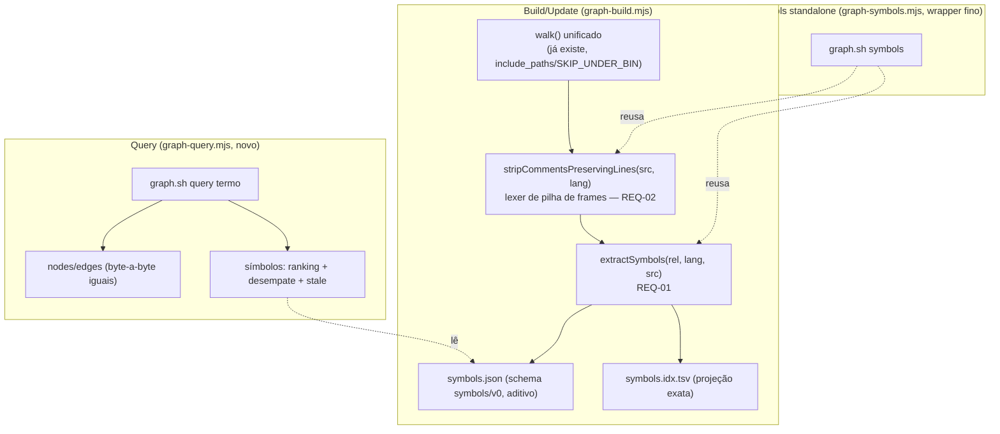

# Design — fix-graph-query-symbols-fusion

> Design técnico do change `fix-graph-query-symbols-fusion`. Decisões duráveis e transversais merecem ADR (`/forge:new-adr`) — referencio aqui em vez de duplicar. `type: bugfix`, `scale: 2`: este design existe porque a correção tem decisão arquitetural real (um lexer stateful novo, migração de `query` para módulo próprio, modelo de defasagem por arquivo) — não é o caso trivial em que `bugfix.md` basta.
>
> Todo o detalhe comportamental, critério de aceite por REQ e bateria de testes já estão fechados em `bugfix.md` (REQ-01 a REQ-10, seções 2/5/6, convergidos em 6 rodadas de revisão adversarial com achados medidos sobre corpus real). Este documento não duplica esse conteúdo — decide a arquitetura que implementa os REQs e registra as alternativas descartadas.

## 1. Contexto e restrições

- **ADR 0001 (`graph-engine`, accepted):** engine do grafo é subset local nativo zero-dep (Node ≥20); tree-sitter WASM opt-in fica registrado como evolução sancionada da v0.2, **não vetada por zero-dep** (WASM puro, sem `node-gyp`/Python), condicionada ao gatilho real do ADR — que, pelo histórico de revisão do próprio ADR (2026-07-16, caso Java), é mais estreito do que "perda de precisão relevante em qualquer caso": o gatilho que de fato importou foi "linguagem cuja resolução import→arquivo dependa de AST" — o caso Java (grafo vazio) foi resolvido SEM tree-sitter, com um extractor heurístico adicional, porque Java segue a convenção pacote=diretório. As limitações aceitas desta fatia (REQ-02: regex após `)`, text blocks Java/Kotlin, strings verbatim C#, `$'...'`/`((...))` sem `$` em shell) são heurísticas pontuais sobre padrões raros/ausentes no corpus, e nenhuma delas depende de resolução de import via AST — não se qualificam para o gatilho real do ADR. Registrado aqui para não reabrir a decisão sem necessidade, com a leitura correta do próprio histórico do ADR (não a versão simplificada "qualquer perda de precisão" da v1 deste design).
- **Zero-dep é inegociável** (mesmo ADR) — a correção inteira é regex/lexer artesanal, nunca AST real. É a causa raiz de todos os achados medidos nas rodadas de revisão (fantasmas de string, regex JS/TS com crase, aspas aninhadas em shell): uma heurística sem AST sempre tem superfície de caso de borda, e o presente design assume que vai continuar tendo — a resposta arquitetural é o oráculo de corpus real obrigatório (REQ-02, w344 [32]/[32b]), não perseguir 100% de precisão.
- **Contratos existentes que não podem quebrar:** `graph.json` (schema `additionalProperties:false`, 15+ consumidores — `w141-codegraph-layer-map-gate.sh` golden byte a byte); `symbols.json` schema `symbols/v0` (consumido por `lib/mdl-gen.mjs:119` e `tests/graph-symbols-gate.sh` [2]/[3]); strings literais `'zero tokens'`/`'structural change'` grepadas por `tests/w41-graph-gate.sh`.
- **Rules aplicáveis pela superfície tocada** (varredura contra `.forge/rules/**` com `applies_to` relevante, não por lembrança): `rules/testing/regression-red-first.md` (TDD red-first, toda a bateria w344/w345 segue o protocolo); `rules/testing/property-based-testing.md` (w345); `rules/conventions/lsp-impact-analysis.md` (é o próprio alvo do REQ-09 — a rule que instrui o agente a usar `query`, corrigida por este change, não só consultada); `rules/conventions/git-worktree.md` (worktree desta sessão já criada conforme a convenção); `rules/conventions/no-ai-attribution.md` (commits desta implementação). Nenhuma rule de `architecture/` existe neste repositório (dogfood, `.forge/rules/` é parcial — ver memória de dogfood) que colida com o desenho.
- **Nenhum ADR/spec arquivada conflitante encontrado:** `git grep` em `.forge/specs/archived/**` por `lexer`/`stripComments`/`graph-symbols` só encontra menções incidentais em `impact.json` de changes não relacionados — nenhuma decisão anterior sobre extração de símbolos ou lexer de comentário/string foi tomada e precisa ser reconciliada.

## 2. Decisão técnica

- **DD-01 — Lexer de comentário/string como pilha de frames, não par linear de estados.** `stripCommentsPreservingLines(src, lang)` (novo módulo, REQ-02) implementa uma máquina de estados com pilha explícita: frames `top`/`sq`/`dq`/`subst` (shell), mais estados-irmãos `line-comment`/`block-comment`/`regex` (JS/TS) e `heredoc` (shell) que **só os frames de código** (`top`/`subst`) podem assumir — **correção de imprecisão na v1 deste documento, que dizia "qualquer frame não-`sq`", incluindo `dq` por engano**: dentro de `dq`, `<<` nunca abre heredoc e `#` nunca abre comentário (ambos são conteúdo literal mascarado como string — o bugfix.md REQ-02 já fixa essa regra, "`<<` só abre heredoc em frame de código (`top` ou `subst`), nunca dentro de `sq`/`dq`"; o design precisa dizer o mesmo, não a versão mais ampla). Decisão tomada depois de dois achados medidos em rodadas sucessivas de revisão (regex JS/TS com aspas/crase; substituição de comando `$(...)`/crase em shell) — ambos têm a mesma causa raiz: **um modelo que não empilha contexto quebra sempre que um delimitador de abertura pode aparecer dentro de outro delimitador já aberto.** A pilha generaliza a correção para qualquer aninhamento futuro (ex. um terceiro achado do mesmo tipo não exigiria um terceiro remendo ad-hoc).
- **DD-02 — Extração de símbolos integrada ao walk de `build`/`update`, não mais um script standalone com walk próprio.** `extractSymbols(rel, lang, src)` (novo módulo `graph-symbols-extract.mjs`, REQ-01) é chamado por `graph-build.mjs` dentro do mesmo walk que já respeita `include_paths`/`SKIP_UNDER_BIN` — elimina a causa raiz 2 do `bugfix.md` §4 (walk divergente de `graph-symbols.mjs`, 60,8% do repo nunca indexado).
  - **Exportação do `walk()` sem efeito colateral (resolve CLARIFY/CONFLICT — correção de imprecisão factual da rodada anterior).** `walk()` hoje (`graph-build.mjs:91-141`) não é pura: fecha sobre globais do módulo (`root`, `includeGlobs` — derivado de `compileLayerMap` sobre o frontmatter do `FORGE.md`, `SKIP_DIRS`, `SKIP_UNDER_BIN`, `CENSUS_EXT`, `LANG`) e **muta** a variável `census` declarada no módulo (não chama `structuralFingerprint`/não existe `layerByFile` em `graph-build.mjs` — essas duas afirmações da v1 deste design estavam erradas; `structuralFingerprint` só é usado depois do walk, no processamento de cada node em `:275`, e `layerByFile` é um `Map` de módulo específico de `graph-symbols.mjs:20-22`, não algo que `graph-build.mjs` usa). **Refatoração mínima decidida:** extrair `walk()` para um módulo novo `graph-walk.mjs` como função pura `walkSourceFiles({root, includeGlobs})` que recebe os dois parâmetros de que de fato depende (ambos já calculados cedo em `graph-build.mjs`, antes do walk), e **retorna** `{files, census}` em vez de mutar uma closure — quem chama decide o que fazer com `census` (`graph-build.mjs` grava em `graph.json > stats.census`, campo lido por `validate-graph.mjs:114` para a regra de cobertura por linguagem — **correção de imprecisão**: a v2 deste design dizia "`report.md`", que é só onde o número aparece formatado para humano, não a fonte estrutural; o wrapper `graph.sh symbols`, REQ-08, descarta `census`, porque não grava nem `graph.json` nem `report.md`). `SKIP_DIRS`/`SKIP_UNDER_BIN`/`CENSUS_EXT`/`LANG`/`SKIP_FILE` (as cinco constantes de que `walk()` depende, incluindo `SKIP_FILE` — ausente da lista da rodada anterior) migram **junto** com `walkSourceFiles` para `graph-walk.mjs` e são exportadas de lá — nunca duplicadas em `graph-build.mjs`/no wrapper `symbols`, para não reabrir a causa raiz 2 do `bugfix.md` §4 (dois walks com constantes divergentes). `graph-build.mjs` continua a usar `LANG` fora do walk (processamento de cada node, `:213`/`:229`/`:272`) — importa de `graph-walk.mjs` para isso também, em vez de manter uma cópia local. `graph-build.mjs` e o wrapper `graph.sh symbols` importam a mesma `walkSourceFiles`; a escrita de `graph.json`/`fingerprints.json`/`report.md` continua decisão exclusiva de `graph-build.mjs` (chamada só no fluxo `build`/`update`), nunca do wrapper `symbols` — garantindo que o universo ampliado (`include_paths`, `.sh`/`.go`) do REQ-03/REQ-08 seja herdado por construção, não por reimplementação paralela do walk.
  - **`includeGlobs` do wrapper `graph.sh symbols` não é `[]` por omissão (resolve achado 6, segunda parte).** O wrapper calcula `includeGlobs` exatamente como `graph-build.mjs` faz hoje — confirmado por leitura de `graph-build.mjs:90-97`: `const forgeFrontmatter = readForgeFrontmatter(root); const layerMap = compileLayerMap(forgeFrontmatter); const includeGlobs = layerMap.includeGlobs || [];` — chama `readForgeFrontmatter`/`compileLayerMap` de `graph-layers.mjs` ele mesmo, nunca herda `[]` por omissão nem reimplementa esse cálculo de outra forma. Sem isso, `graph.sh symbols` isolado perderia a cobertura de `codegraph.include_paths` que o REQ-08 promete herdar do REQ-03.
  - **`graph.sh symbols` isolado é diagnóstico, pode gerar órfão esperado (resolve achado 6, primeira parte).** O wrapper faz um walk AO VIVO via `walkSourceFiles` (REQ-08 do `bugfix.md`: "o mesmo walk de `graph-build.mjs`") — não lê o `graph.json` já existente para restringir o universo de arquivos. Consequência aceita e documentada: rodar `graph.sh symbols` isolado depois de criar um arquivo novo (ainda sem `graph.sh build`/`update`) produz `symbol.file` para esse arquivo novo mesmo que ele não exista em `graph.nodes` — se `graph.sh validate` rodar nesse meio-tempo, DD-06 reprova esse `symbol.file` como órfão, mesmo sem nenhum bug real. Isso é esperado, não um defeito: `graph.sh symbols` standalone é uma operação de diagnóstico/inspeção (mesmo contrato de hoje, "não polui `graph.json`"), e `validate` é a verificação de verdade só depois de `build`/`update`. A alternativa (restringir o wrapper ao universo já conhecido do último `graph.json`) contradiria o REQ-08 do `bugfix.md`, que manda o wrapper herdar o walk ampliado por construção — não por um recorte adicional sobre um `graph.json` potencialmente mais antigo. Documentado aqui para que esse órfão não seja tratado como bug ao implementar REQ-07/REQ-08 juntos.
  - **Ponto de injeção de ordem para teste P4/[26] (resolve achado 3 — `readdirSync` em APFS não reflete ordem de criação).** A resolução de herança (REQ-03) e o desempate de ranking (REQ-05/DD-04) nunca operam sobre a saída viva de `walkSourceFiles()` — ambos recebem o array `symbols[]` já materializado (um por arquivo, concatenado) como parâmetro explícito, nunca fechando sobre a ordem do walk do sistema de arquivos. Para a herança, isso significa uma função pura nova e exportada — `resolveInheritance(symbolsByFile)`, **FIXADA em `graph-symbols-extract.mjs` — nunca em `graph-build.mjs` (correção da 2ª rodada adversarial; a v2 deste design deixava isso como "decisão de implementação" em aberto, o que é inseguro)**. Confirmado por leitura de `template/.forge/scripts/lib/graph-build.mjs:16`: `const root = resolve(process.argv[2] || '.');` é efeito colateral de módulo executado no topo do arquivo, fora de qualquer função — e `:357`, `:360`, `:363`, `:383` (bloco de escrita): `writeFileSync(join(outDir, 'graph.json'), ...)`, `writeFileSync(join(cacheDir, 'fingerprints.json'), ...)`, `writeFileSync(join(cacheDir, 'summaries.json'), ...)` e `writeFileSync(join(outDir, 'report.md'), ...)` também rodam no nível do módulo, não atrás de um guarda de CLI — importar `graph-build.mjs` de dentro de um teste de propriedade (P4/[26]) disparia um `graph.sh build` real no cwd corrente, sobrescrevendo `graph.json`/`fingerprints.json`/`summaries.json`/`report.md` deste próprio repositório (dogfood), com `resolve(process.argv[2] || '.')` resolvendo para o cwd do processo de teste, não para o diretório do módulo. `graph-symbols-extract.mjs`, ao contrário, é criado por este change como módulo de função pura (REQ-01, `extractSymbols`) sem nenhum efeito colateral de topo — é o único lugar seguro para `resolveInheritance`, e qualquer outra função pura testável por propriedade deste change (desempate de ranking, etc.) segue a mesma regra: nunca em `graph-build.mjs`. P4 (w345) e [26] (w344) chamam essa função diretamente (import de módulo), passando a MESMA lista de entradas em ordens embaralhadas em memória (`shuffle(entries)`, nunca dependente de criar arquivos físicos em ordens diferentes) — o teste afirma que os `edges` resolvidos (e, para [3]/[24] do desempate de `query`, a ordem de exibição) são idênticos independente da permutação de entrada. Esse é o seam de teste que resolve a vacuidade apontada: sem ele, um teste que só reordene a criação física de arquivos no disco é vácuo em APFS (macOS), porque `readdirSync` já devolve ordem própria do sistema de arquivos, não a ordem de criação.
  - **Vocabulário de `lang` unificado (resolve CLARIFY — termo corrigido: `java`/`kotlin`/`go`/`shell` são os *valores* do mapa `LANG` de `graph-build.mjs:47`, indexado por extensão, não "chaves"):** o `DECL` de `graph-symbols.mjs:36-46` usa `jvm` para java+kotlin juntos. `extractSymbols(rel, lang, src)` adota o vocabulário de valores de `LANG` de `graph-build.mjs` (`java`, `kotlin`, `go`, `shell`, não `jvm`) como fonte única — a função resolve `java`/`kotlin` para o mesmo conjunto de regexes `DECL` internamente (ambos compartilham sintaxe de declaração), eliminando a tradução implícita que a v1 deste design deixava em aberto.
- **DD-03 — `graph.sh query` migra de `node -e` inline para módulo próprio (`graph-query.mjs`).** Necessário porque a lógica cresceu (ranking de 3 níveis, desempate determinístico, dica de 0-resultados, defasagem por símbolo, `--json`) muito além do que cabe em um `node -e` de uma linha; migração não muda o contrato de `nodes`/`edges` (preservados byte a byte, golden do w141).
- **DD-04 — Identidade de símbolo não-única (`file#name`) com chave de dedup separada (`file,name,type,line`) e desempate determinístico (`name,file,line`, `localeCompare`+numérico).** Em vez de forçar unicidade (o que exigiria um sufixo artificial no `id`, quebrando o formato que `tests/graph-symbols-gate.sh:55` já exige via `endsWith("#"+a)`), a decisão separa três preocupações que a v1 deste design confundia em uma: identidade (formato estável, não-único), deduplicação (evita contar a mesma extração duas vezes), e ordenação de exibição (determinística, independente da ordem do walk). **Nota sobre terminologia (resolve achado 10 — "ordem lexicográfica" vs `localeCompare`; correção adicional na 2ª rodada adversarial — dilema falso entre `localeCompare` e byte-order resolvido fixando o locale): a ordenação usa deliberadamente `String.prototype.localeCompare`, nunca uma comparação byte-order nativa (`a < b`/`Array.prototype.sort()` padrão) — decisão herdada textualmente de REQ-05 do `bugfix.md` ("comparados por `String.prototype.localeCompare`, mesmo comparador que `graph-symbols.mjs:80` já usa"), não preferência deste design. A v2 deste design registrava aqui um dilema entre "`localeCompare` por mandato do REQ-05" e "byte-order determinístico, preferível para um artefato de grep/lookup externo como `symbols.idx.tsv`" como decisão de escopo não resolvida — esse dilema é falso: `a.localeCompare(b, 'en')`, com o segundo argumento (`locales`) FIXO em `'en'`, CONTINUA sendo `localeCompare` ao pé da letra (satisfaz REQ-05, que não especifica locale) e elimina a dependência do locale/ICU do ambiente/SO, porque o algoritmo de colação passa a ser sempre o de `en` — determinístico entre máquinas, independente da variável de ambiente `LANG`/ICU do processo Node que o rodar. Decisão: `rankSymbols`/`tieBreak` em `graph-query.mjs` (DD-09) e a geração de `symbols.idx.tsv` usam `localeCompare(b, 'en')` com locale fixo em todas as comparações de `name`/`file`, nunca `localeCompare(b)` sem argumento. `symbols.idx.tsv` usa o MESMO comparador `localeCompare('en')`+numérico do `query` (nunca um `sort()` nativo diferente, nunca um locale não especificado) — consistência interna entre os dois artefatos, e agora também entre máquinas.
- **DD-05 — Defasagem por `{mtime,size}` por arquivo, não por fingerprint estrutural, com escopo de comparação assimétrico entre `graph.json` e `symbols.json` (ampliado — resolve achado 4, subespecificação de "gravar só se mudou").** `graph.json` ignora `generated_at`/`root` ao decidir se regrava (honestidade do `update`, REQ-06); `symbols.json` **inclui** `{mtime,size}` na mesma decisão (correção do achado B1 — excluir esses campos deixaria a defasagem presa para sempre depois de uma edição real que não move a linha da declaração). Trade-off aceito e documentado: um checkout/worktree novo regrava `symbols.json` mesmo sem edição real (E/S sem custo de token).
  - **(i) Contra o que a comparação é feita.** Sempre contra o **conteúdo do arquivo de saída em disco** (`graph.json`/`symbols.json`/`fingerprints.json`/`summaries.json` já existentes, lidos e reparseados no início do `update`) — nunca contra um cache em memória ou um arquivo separado. Não existe segunda fonte de verdade; o arquivo de saída anterior É o baseline de comparação.
  - **(ii) Arquivo de saída corrompido em disco no momento da comparação.** Se a leitura (`readFileSync`) ou o `JSON.parse` do arquivo de saída existente falhar — JSON truncado, processo anterior interrompido no meio da escrita, ou arquivo ausente — `update` trata isso como "mudou" e escreve incondicionalmente, preservando o comportamento de recuperação que `build`/`update` já têm hoje (sobrescrever e se recuperar). Nunca propaga a exceção de parse para fora de `update` nem recusa escrever por causa disso — um `symbols.json` corrompido não pode travar o próprio mecanismo que o regeneraria.
  - **(iii) `build` preserva a semântica de escrita sempre forçada; só `update` ganha "gravar só se mudou" — mecanismo concreto: flag nova `--if-changed` (correção da 2ª rodada adversarial — a versão anterior não especificava COMO `graph-build.mjs` distingue os dois casos).** Confirmado por leitura de `template/.forge/scripts/graph.sh:18`-`:19` (case `build`: `node "$SCRIPT_DIR/lib/graph-build.mjs" "$ROOT" ;;`) e `:20`-`:26` (case `update`: `node "$SCRIPT_DIR/lib/graph-build.mjs" "$ROOT" >/dev/null` na linha `:23`) — HOJE as duas chamadas passam o MESMO argv (`"$ROOT"`), sem nenhuma flag que distinga a invocação; `graph-build.mjs` não tem como saber se foi chamado por `build` ou por `update`, e por isso hoje sempre reconstrói e escreve tudo incondicionalmente nos dois casos (a honestidade de `update` hoje vem só do wrapper em shell comparando hash de `fingerprints.json` antes/depois, nunca de `graph-build.mjs` pular a própria escrita). **Mecanismo deste change:** `graph.sh` passa uma flag nova `--if-changed` **só** na chamada de `update` (linha `:23` do dispatcher), nunca na chamada de `build` (linha `:19`) — ex. `node "$SCRIPT_DIR/lib/graph-build.mjs" "$ROOT" --if-changed`. Dentro de `graph-build.mjs`, a presença de `--if-changed` em `process.argv` faz o módulo, antes de escrever cada um dos 5 artefatos (`graph.json`/`fingerprints.json`/`summaries.json`/`report.md`, mais `symbols.json`/`symbols.idx.tsv` do REQ-03/REQ-04/B1), comparar o conteúdo novo contra o conteúdo já em disco (lido e reparseado, ver DD-05(i)) e pular a escrita (`writeFileSync`) quando o conteúdo não tiver mudado pelo critério já descrito (sem `generated_at`/`root` para `graph.json`; com `{mtime,size}` para `symbols.json`). Sem `--if-changed` (caso `build`), `graph-build.mjs` escreve sempre, incondicionalmente, exatamente como hoje — nenhuma mudança de comportamento para `build`. O texto de `graph.sh:4` (comentário de cabeçalho de `build`, "(re)build .forge/graph/graph.json from the repo (deterministic, zero tokens)") permanece correto sem alteração; as linhas `:25`/`:26` atuais do mesmo arquivo (que comparam hash de `fingerprints.json` fora do processo Node e escolhem entre as duas mensagens que `tests/w41-graph-gate.sh` [4]/[5] grepam via `grep -q 'zero tokens'`/`grep -q 'structural change'`) continuam existindo no wrapper shell — `--if-changed` dentro de `graph-build.mjs` é o mecanismo que faz a E/S real ser pulada; a comparação de hash do wrapper shell é o que decide qual das duas mensagens imprimir, papel distinto e complementar, não substituído por `--if-changed`. Decisão: a honestidade de "gravar só se mudou" (REQ-06) é exclusiva de `update` via `--if-changed`; `build` nunca recebe essa flag e continua sendo reconstrução total e forçada — escolha que preserva o contrato que `w41-graph-gate.sh` [4]/[5] já exercitam (testam `update`, não `build`) sem reinterpretar o que "build" significa para quem já usa o comando.
- **DD-06 — Integridade referencial como checagem obrigatória (quando `symbols.json` existe) e opcional por ausência de arquivo, em `validate-graph.mjs` (REQ-07) — distinta de staleness cosmética (corrige contradição interna da revisão anterior).** `validate-graph.mjs` ganha um passo novo, guardado por `existsSync(symbolsPath)`:
  - **Sem `symbols.json`** (caso normal em CI, arquivo não versionado): o passo é pulado e o resultado de `validate` é idêntico ao de hoje.
  - **Com `symbols.json` presente, dois cenários distintos, com critérios de reprovação OPOSTOS** — a contradição apontada na revisão (um texto dizendo "não reprova por desatualizado" e outro dizendo "é coberto pelo mesmo caminho que reprova") vinha de tratar os dois cenários como um só:
    1. **Órfão referencial — REPROVA.** `symbol.file` não existe como `node.id` em `graph.json` (ex.: depois de um `git pull` que mudou/removeu/renomeou arquivos do repositório sem `build` local — REQ-07, teste w344 [17]). Cada `symbol.file` de `symbols.json` é conferido contra o `Set` de `node.id` já construído para a validação de `graph.json` (reaproveitado, não recalculado); qualquer um ausente reprova com mensagem explícita (`FAIL symbols.json referencia arquivo ausente em graph.json: <file> — rode graph.sh build`), nunca um "FAIL" genérico.
    2. **Staleness cosmética — NÃO REPROVA.** O arquivo referenciado AINDA existe em `graph.nodes`, mas `{mtime,size}` gravados em `symbols.json` divergem do estado atual do arquivo em disco (ex.: achado 4, um comentário inserido acima de uma declaração desloca `line` sem mudar nada estruturalmente). `validate-graph.mjs` **nunca** checa `{mtime,size}` — essa divergência só é tratada em `query` (DD-05/REQ-04, sufixo `(linha possivelmente defasada)` por símbolo), nunca como falha de `validate`.
  - **Critério que distingue os dois:** existência do arquivo como `node.id` em `graph.json` — ausente ⇒ órfão ⇒ reprova; presente (mesmo com `mtime`/`size` divergente) ⇒ cosmético ⇒ não reprova. A formulação anterior ("nunca reprova... desatualizado em relação a um `git pull` recente") vale só para o cenário (2); para o cenário (1) — que é exatamente REQ-07/teste [17] — o `validate` reprova, e deve reprovar.
  - **`symbols.json` corrompido no momento da leitura por `validate-graph.mjs` (resolve achado 13).** `validate-graph.mjs` já trata `JSON.parse` falho de `graph.json` com `try/catch` → `FAIL (graph.json parse: <mensagem>)` + `process.exit(1)` — padrão existente, confirmado por leitura de `template/.forge/scripts/lib/validate-graph.mjs:25`: `` try { g = JSON.parse(readFileSync(graphPath, 'utf8')); } catch (e) { console.log(`FAIL (graph.json parse: ${e.message})`); process.exit(1); } ``. A leitura de `symbols.json` para a checagem referencial deste DD-06 segue o MESMO padrão — `try/catch` dedicado ao redor do `JSON.parse` de `symbols.json`, produzindo `FAIL (symbols.json inválido — rode graph.sh build)` em vez de deixar o processo cair com stack trace não tratado. Distinto de `readSymbolsSafely()` (DD-07, usado por `query`, que DEGRADA sem falhar): em `validate-graph.mjs` um `symbols.json` corrompido é tratado como falha reportável (`FAIL`), porque `validate` é precisamente o comando cujo propósito é apontar esse tipo de problema — degradar silenciosamente aqui esconderia o sinal que o comando existe para dar.
- **DD-07 — Degradação graciosa de `query` concentrada num único wrapper de leitura (REQ-10), não espalhada pelo código de ranking.** `lib/graph-query.mjs` lê `symbols.json` através de uma função `readSymbolsSafely()` que captura `JSON.parse` e devolve `{symbols: null, warn: 'symbols.json inválido — mostrando só nodes/edges; rode graph.sh build'}` em caso de falha (emitido em stderr, `query` continua e omite a seção `symbols` por completo, exit 0) — este é o ÚNICO caso que emite `WARN` por corrupção. Os outros dois casos do REQ-10 são tratados **no nível do símbolo individual**, dentro do cálculo de defasagem (DD-05), não como degradação global: ENOENT no `stat()` de um arquivo referenciado marca aquele símbolo com o sufixo próprio `(arquivo não encontrado — rode graph.sh build)` e `missing: true` no `--json` (sem WARN, sem afetar os demais resultados); uma entrada legada sem `mtime`/`size` é tratada como "não verificável" (sem marcar `stale`, sem log, sem afetar os demais). As três degradações nunca lançam exceção não tratada — `readSymbolsSafely()` e o cálculo de defasagem por símbolo são os dois únicos pontos de `try/catch` do módulo.
  - **Aviso de ausência/formato legado (resolve achado 5 — busca por símbolo falha em silêncio; critério corrigido na 2ª rodada adversarial — vacuidade quando `symbols[]` está vazio).** Distinto dos três casos do REQ-10 (que tratam `symbols.json` presente mas problemático), este é um aviso de **capacidade indisponível**: quando `symbols.json` está ausente, OU está presente mas `symbols.length > 0` **E** nenhuma entrada de `symbols[]` tem o campo `mtime` (sinal de formato legado pré-fusão — exatamente o estado observável nesta própria árvore de trabalho antes do primeiro `build` desta fatia). **O critério "nenhuma entrada tem `mtime`" isolado é vacuamente verdadeiro quando `symbols[]` está vazio** — um projeto só com arquivos `.go` produz `symbols: []` sempre (REQ-03, "Decisão sobre Go": `extractSymbols` não ganha `DECL.go` nesta fatia), o que não é formato legado nenhum, é ausência real de símbolo extraível; sem a condição `symbols.length > 0`, esse projeto receberia o aviso "formato legado" permanentemente e incorretamente, mesmo depois de `build`/`update` reais. Com `symbols.length > 0 E nenhuma entrada com mtime`, `graph.sh query` emite em **stderr** (nunca stdout, para não quebrar o golden byte-a-byte do w141 [2] nem o teste [1] de controle do w344) a linha `aviso: symbols.json ausente ou em formato legado — rode \`graph.sh update\` para habilitar busca por símbolo`. A seção `symbols (N):` do stdout continua simplesmente omitida nesse caso (mesmo comportamento de "sem `symbols.json`" já descrito em §4) — o aviso é só o sinal adicional em stderr, não uma seção nova de stdout. Diferente do `WARN` de JSON corrompido (problema transitório/recuperável), este aviso indica estado normal-mas-incompleto (nunca rodou `build`/`update` ainda, ou checkout anterior à fusão) — barato de emitir, independente da Parte B/A.3 adiadas.
- **DD-08 — Estratégia de Red-first para TODA task que toca qualquer arquivo sob `template/.forge/scripts/`, tratado como infraestrutura por `isInfraPath` (resolve achado 1 — conflito com `red-replay.mjs`; escopo ampliado na 2ª rodada adversarial, achado anterior cobria só os 3 módulos novos).** Confirmado por leitura de código: `template/.forge/scripts/lib/red-replay.mjs:900` define `INFRA_DIR_SEGMENTS = new Set(['scripts', 'ci'])` e `isInfraPath(p)` (`:929`) retorna `true` quando qualquer segmento do caminho está nesse set OU começa com `.` (`:934`: `segs.some((seg) => seg.startsWith('.') || INFRA_DIR_SEGMENTS.has(seg.toLowerCase()))`). **Isso não se restringe aos 3 módulos novos: QUALQUER caminho sob `template/.forge/scripts/...` tem o segmento `.forge` (começa com `.`) e o segmento `scripts` — qualquer um dos dois já basta.** Inclui, portanto, não só `graph-symbols-extract.mjs`/`graph-query.mjs`/`graph-walk.mjs` (módulos novos), mas também `graph-build.mjs`, `validate-graph.mjs` e `graph-symbols.mjs` — arquivos JÁ EXISTENTES que este change EDITA (adicionar o campo `mtime`/`size` em `graph-build.mjs`, adicionar o passo de integridade referencial em `validate-graph.mjs`, transformar `graph-symbols.mjs` em wrapper fino) — e `graph.sh`, mesmo sem o segmento `.forge` dentro de `scripts/lib`, por estar sob `template/.forge/scripts/`. Em `replayTask()`, o commit vermelho que tocar qualquer caminho assim (fora de `tests/`, que `isTestPath` exclui da checagem) recebe `{ok:false, stage:'vermelho', code:'vermelho-infra', ...}` — vale para QUALQUER touch nesse caminho no commit vermelho, inclusive um stub neutro de produção OU um diff mínimo num arquivo já existente (ex. adicionar só a chamada a `extractSymbols` em `graph-build.mjs`). **A prescrição de `bugfix.md` §5 intro ("commit vermelho = só teste + stub neutro de produção") não é executável para NENHUMA task que toque `template/.forge/scripts/` — é incompatível com a maquinaria real do próprio projeto, não um detalhe de estilo, e não um detalhe restrito aos 3 módulos novos.**
  - **Estratégia correta, aplicável a módulo novo E a módulo já existente: o commit vermelho de toda TASK sob `template/.forge/scripts/` NÃO toca nenhum arquivo de produção — só o(s) arquivo(s) de teste novo(s) em `tests/`** (`tests` não está em `INFRA_DIR_SEGMENTS` e não começa com `.`, então nunca aciona `isInfraPath`). Para um módulo NOVO (`graph-symbols-extract.mjs`/`graph-query.mjs`/`graph-walk.mjs`), o arquivo de produção só passa a existir no commit **verde** da mesma TASK — fora do `diff-tree` do commit vermelho. Para um EXPORT NOVO num módulo JÁ EXISTENTE (ex. uma função `resolveInheritance` adicionada em `graph-symbols-extract.mjs` por uma task posterior, ou um campo novo em `graph-build.mjs`), o mesmo vale: o commit vermelho não edita o arquivo já existente — o teste importa o módulo via `import()` dinâmico e verifica a presença do export (ver abaixo), e só o commit verde adiciona o export/campo ao arquivo. **Detalhe que distingue os dois casos (achado da 3ª rodada, corrigindo uma mecânica errada da 2ª):** `import()` dinâmico de um módulo `.mjs` que JÁ EXISTE, mas ainda sem o export novo, NÃO lança excepción alguma — o módulo carrega normalmente e o export ausente resolve para `undefined`; só a CHAMADA seguinte (`mod.resolveInheritance(...)`) lançaria `TypeError: ... is not a function`, cuja mensagem não casa nenhuma assinatura de `red-classify.mjs` e cairia em `unknown` (recusado por `red-replay.mjs` como `vermelho-padrao`). Por isso os dois casos usam mecânicas DIFERENTES: módulo inteiro ausente (`ERR_MODULE_NOT_FOUND` do `import()`) é capturado por `try/catch` em volta do `import()`; export ausente em módulo existente é detectado por checagem explícita de tipo (`typeof mod.<export> !== 'function'`) depois do `import()` resolver, SEM depender de nenhuma exceção do próprio `import()`.
  - **Como o teste falha de forma comportamental (item normativo 1 da rule `testing/regression-red-first.md`: "nunca por erro de compilação, import quebrado") sem o módulo/export existir.** O teste nunca faz `import` estático do módulo (ou do export) ainda inexistente no topo do arquivo — isso travaria a própria execução do processo de teste com `ERR_MODULE_NOT_FOUND` (módulo inteiro ausente) antes de qualquer asserção rodar; essa mensagem casa `BUILD_ERROR_SIGNATURES` de `lib/red-classify.mjs:28` (`{ lang: 'js-ts', label: 'Cannot find module', re: /Cannot find module/ }`, sem âncora), confirmada por leitura. Em vez disso, o teste usa `import()` **dinâmico** dentro de um `try/catch` para o caso de módulo inteiro ausente, convertendo a falha de resolução capturada numa asserção explícita própria (ex. `assert.fail('RED <task-id>: graph-symbols-extract.mjs ainda não existe')`); e, para o caso de export ausente em módulo já existente, importa o módulo normalmente (sem `try/catch`, porque não há exceção a capturar) e faz `if (typeof mod.resolveInheritance !== 'function') assert.fail('RED <task-id>: resolveInheritance ainda não é exportado por graph-symbols-extract.mjs')` — nos dois casos a saída que chega ao `red-replay` é a mensagem de `assert.fail`, formatada pelo gate shell como `FAIL [n] ...` (assinatura `^FAIL \[[^\]\n]+\]`, nunca um `throw` crú sem essa moldura). Como `lib/red-classify.mjs` prioriza `BEHAVIORAL_SIGNATURES` sobre `BUILD_ERROR_SIGNATURES` (comentário do próprio arquivo, linhas 8-16: "a prioridade agora é BEHAVIORAL-primeiro... uma assinatura comportamental clara vence qualquer assinatura de build que apareça no mesmo texto", confirmado por leitura), a saída é classificada `behavioral` — mesmo que o texto capturado contenha a substring "Cannot find module" — satisfazendo o item normativo 1 sem tocar nenhum caminho infra, tanto para módulo novo quanto para export novo em módulo existente.
  - **`failure_pattern` da evidência de Red** casa com a mensagem literal da asserção controlada (ex. a string passada a `assert.fail`), nunca com o texto crú "Cannot find module"/"SyntaxError" — âncora específica exigida pelo item normativo 5 da rule, evitando que a falha case com qualquer erro adjacente não relacionado.
  - Compatível com o fluxo normal da rule: o Red continua sendo observado via `red-evidence.sh record`/`replay` antes da correção, reproduz o defeito (ausência do módulo/export = comportamento ainda não implementado), permanece na suíte depois do Green, e nunca precisa de waiver — não é um caso de "Red impossível", é uma forma diferente, igualmente válida, de produzir uma falha comportamental. Atualiza o item 1 do plano de rollout (§5): a referência a "stub neutro de produção" em `bugfix.md` §5 intro é superada, para TODA task que toque `template/.forge/scripts/` (não só os três módulos novos), por esta estratégia — a implementação segue este design quanto à MECÂNICA do commit vermelho; o COMPORTAMENTO exigido pelos REQs permanece o do `bugfix.md`, intocado.
- **DD-09 — Contrato de interface de `graph.sh query <termo> [--json]` e de `lib/graph-query.mjs` como módulo puro (resolve achados 8, 9 e 11).**
  - **Posição de `--json` (achado 8):** a flag pode vir em qualquer posição relativa ao termo de busca (`graph.sh query --json <termo>` e `graph.sh query <termo> --json` são equivalentes) — o parsing remove `--json` de `process.argv` onde estiver e trata o(s) token(s) remanescente(s) como o termo. **Fora de escopo nesta fatia:** um termo de busca que comece literalmente com `--` (ex. um símbolo chamado `--foo`) não é suportado — cenário raro/inexistente no corpus real de nomes de símbolo, sem convenção de escape nesta fatia. O parsing é convenção simples e própria deste módulo — **não** depende de `lib/arg-guards.sh` (outro propósito: validação de argumentos de scripts shell, não parsing de CLI Node).
  - **`graph-query.mjs` importável sem efeito colateral de CLI (achado 9) — correção de guarda quebrada no macOS (2ª rodada adversarial).** O módulo exporta as funções puras de ranking/busca (ex. `rankSymbols`/`tieBreak`) via `export function ...`, sem corte de 20 resultados dentro delas — o corte de 20 é decisão de apresentação do CLI, aplicada depois de chamar a função pura. Todo código que só deve rodar quando invocado como CLI (leitura de `process.argv`, impressão em stdout/stderr, `process.exit`) fica atrás de um guarda de "sou o módulo principal". **O guarda `import.meta.url === \`file://${process.argv[1]}\`` está EXCLUÍDO — provado quebrado no macOS:** `import.meta.url` resolve com symlink (`/tmp`→`/private/tmp`, `/var/folders/...`) e com espaços percent-encoded (`%20`), enquanto `process.argv[1]` chega como o caminho lógico que `graph.sh` monta — a comparação dá `false` sempre que o processo roda de um diretório temporário/symlinkado (exatamente o padrão de `tests/w41-graph-gate.sh`, que roda de `/tmp/forge-w41.*`), e `query`/o módulo sai `rc=0` sem imprimir nada, em silêncio. **Padrão correto, confirmado por leitura de `template/.forge/scripts/lib/kb-cli.mjs:352`:** `realpathSync(process.argv[1]) === realpathSync(fileURLToPath(import.meta.url))` dentro de um `try/catch` que retorna `false` em caso de erro (mesmo padrão replicado em `sync-adapters.mjs` função `isMainModule()`, `red-evidence-ops.mjs` função `isMainModule()`, `ledger-aging.mjs` — `let isMain = false; try { isMain = realpathSync(fileURLToPath(import.meta.url)) === realpathSync(process.argv[1]); } catch { isMain = false; }` — e `native-send-guard.mjs` função `isDirectInvocation()`, que resolve só `process.argv[1]` via `realpathSync` e compara contra `import.meta.url` bruto). `graph-query.mjs` usa o mesmo formato de `kb-cli.mjs` — `realpathSync` dos dois lados antes de comparar, nunca comparação direta de string com `file://` concatenado. Isso permite que P1/P3 do w345 importem a função de ranking diretamente e testem sobre o conjunto completo de resultados, sem truncamento de 20 e sem subprocess, **e** mantém `tests/w41-graph-gate.sh` [7] verde no macOS.
  - **Propósito de `symbols.idx.tsv` nesta fatia (achado 11).** Gerado nesta fatia como artefato PREPARATÓRIO para o hook de direcionamento do agente da Parte B (`graph-lookup-hint.sh`, adiada — proposal.md §3), sem nenhum consumidor nesta primeira entrega. Intencional, não lacuna: o formato TSV plano (grep/lookup externo rápido, sem parse de JSON) é o que a Parte B vai precisar; gerá-lo já nesta fatia (par atômico com `symbols.json`, DD-02/REQ-03) evita migração de schema quando a Parte B chegar.

## 3. Alternativas consideradas

| Alternativa | Prós | Contras | Por que não |
|---|---|---|---|
| AST real via tree-sitter (opção 3 do ADR 0001) para a extração de símbolos | Elimina de raiz toda a classe de bug desta fatia (fantasma, regex-com-crase, aspas aninhadas) | Dependência de build/runtime nova (mesmo sendo WASM puro, sem `node-gyp`/Python) só se justifica pelo gatilho do ADR, que não disparou aqui; adotar agora reabriria uma decisão já tomada sem o fato que a reabriria | ADR 0001: o gatilho real é "linguagem cuja resolução import→arquivo dependa de AST" — nenhuma limitação aceita desta fatia se qualifica; heurística regex/lexer continua sendo a decisão vigente |
| Par linear de dois estados (`sq`/`dq`) sem pilha, só com regras ad-hoc por caso encontrado (ex. "ignorar aspa se vier depois de `$(`") | Mudança menor, mais rápida de escrever | Generaliza mal — cada achado novo (regex-com-crase, depois `$(...)` em shell) exigiria outro remendo específico; o padrão de dois achados sucessivos com a mesma causa raiz (contexto aninhado) é o sinal de que o modelo errado foi escolhido, não o caso | Rejeitada depois do 2º achado medido da mesma classe (rodada 6 do gate) — DD-01 generaliza em vez de remendar |
| `id` de símbolo globalmente único (sufixo artificial, ex. `file#name#2` em colisão) | Simplifica comparação de igualdade em alguns testes | Quebra o formato `file#name` que `tests/graph-symbols-gate.sh:55` já exige (`endsWith("#"+a)`); sufixo artificial não é estável entre builds se a ordem de extração mudar | DD-04: separar identidade (estável, não-única) de dedup (tupla de 4 campos) resolve sem quebrar o consumidor existente |
| Cache por hash de conteúdo (`rawSha256`) em vez de `{mtime,size}` para defasagem | Exato, sem falso-positivo de checkout novo | Mais caro (precisa reler/rehash todo arquivo); o próprio plano aprovado qualifica isso como a correção de precisão da Fase 2, condicionada à medição da Parte C | Adiado para A.2 Fase 2 — fora de escopo desta fatia (decisão já registrada no plano aprovado, não reaberta aqui) |
| Versionar `symbols.json`/`symbols.idx.tsv` junto com `graph.json` | Consistência de tratamento com o grafo de arquivos | Conteúdo muda a cada edição de arquivo real (ao contrário de `graph.json`, que só muda com mudança estrutural) — geraria conflito de merge constante | REQ-03/B4: não versionar, com entrada em `gitignore.patch`/`.gitignore` local |

## 4. Contratos e integrações afetados

| Contrato | Estratégia de compatibilidade |
|---|---|
| `graph.json` (schema `additionalProperties:false`) | Inalterado — golden byte a byte (w141 [2]) |
| `symbols.json` (schema `symbols/v0`) | Aditivo (`{id,file,name,type,line,layer,mtime,size}` em `symbols[]`, `edges`/`stats`/`note` preservados) — nunca `v1`; consumidores (`lib/mdl-gen.mjs`, `tests/graph-symbols-gate.sh`) continuam funcionando sem alteração de leitura |
| `symbols.idx.tsv` | Novo artefato derivado, projeção exata de `symbols.json` — sem consumidor existente a quebrar |
| `graph.sh query` (saída humana) | `nodes`/`edges` byte a byte iguais; seção `symbols` é aditiva (só aparece com `symbols.json` presente); **dica de 0-resultados é comportamento novo independente de `symbols.json`** — quando `nodes`/`edges`/`symbols` casam zero, uma linha `hint:` é impressa em stdout (exit 0), mesmo sem `symbols.json` presente (REQ-05) |
| `graph.sh query --json` | Contrato novo (`{nodes,edges,symbols,hint?}`) — sem consumidor existente, nada a migrar |
| `graph.sh query <termo> [--json]` (parsing de argv) | Convenção própria do módulo (DD-09) — `--json` em qualquer posição relativa ao termo; termo iniciando com `--` fora de escopo; não depende de `lib/arg-guards.sh` |
| `installer/gitignore.patch` | Aditivo (`symbols.idx.tsv` nova entrada) — `tests/w133-gitignore-reconcile-gate.sh` prova que o mecanismo de reconciliação já existente propaga a consumidores instalados, sem exigir nova versão do patch nem migração manual |
| Rules/docs (`lsp-impact-analysis.md:54`/`:56`, `commands/specs/implement.md:51`, `commands/graph/query.md` corpo+`description:`, `graph.sh:7`/`:59`, `commands/graph/codegraph.md`, `README.md`, `docs/refer/slash-commands.md:93`, `update.md:2`/`:16`) | Edição de texto, sem contrato de dado — `npm run build:plugin` sincroniza o espelho `plugin/forge/commands/`; `lsp-impact-analysis.md:54` recebe ajuste de precisão (não só adição de frase — a frase existente "não entende semântica de símbolo" precisa coexistir sem contradizer a frase nova) |

## 5. Plano de migração / rollout

Sem feature flag — é uma correção determinística de comportamento, não uma feature opt-in. Sequência segura:

1. TDD red-first por task: para TODA task que toca qualquer arquivo sob `template/.forge/scripts/` — os três módulos novos (`graph-symbols-extract.mjs`, `graph-query.mjs`, `graph-walk.mjs`) E os módulos já existentes editados por este change (`graph-build.mjs`, `validate-graph.mjs`, `graph-symbols.mjs`, `graph.sh`) —, segue a estratégia corrigida e ampliada do DD-08 (commit vermelho só com teste, falha comportamental via `import()` dinâmico + asserção controlada — nunca "stub neutro de produção" nem diff de produção, que `bugfix.md` §5 intro prescreve mas que `red-replay.mjs` recusa como `vermelho-infra` para qualquer caminho sob `scripts/`). Não há "demais tasks fora de `isInfraPath`" neste change — todo o código de produção tocado vive sob `template/.forge/scripts/`. Os snapshots do oráculo (REQ-02, `old-engine-snapshot.mjs`/`corpus-snapshot/`) são capturados num commit de fixture dedicado, **antes** da primeira task de produção.
2. `tests/run-all.sh` 100% verde incluindo toda a regressão listada em `bugfix.md` §5.3 (w41, w141, w165, graph-symbols-gate, mdl-gen-gate, graph-deps/jvm/govern-gate, w172, w42, w43, w100, check-authz-gate, w133) — nenhum gate existente quebra.
3. `npm run build:plugin` sem diff pendente entre `template/.forge/commands/` e `plugin/forge/`.
4. Teste manual (já descrito no plano aprovado): rodar `graph.sh build`, editar um arquivo real adicionando classe/função nova, `graph.sh query <nome>` acha a definição recém-criada.
5. Nenhum rollback especial necessário — se `tests/run-all.sh` ficar vermelho em produção, a reversão é o revert do commit, sem estado persistente a limpar (symbols.json/symbols.idx.tsv não são versionados, regeneram no próximo `build`).
6. **Documentação e registro (resolve achado 7 — fiação não fica implícita):**
   - **CHANGELOG:** `CHANGELOG.md` (já em `manifest.yaml > affected_paths`) ganha uma entrada declarando a mudança de universo observável de `graph.sh symbols`/`query`/`update` (REQ-03/REQ-06 do `bugfix.md` já exigem a mudança de comportamento; este item garante que ela fica registrada no histórico do projeto, não só no código).
   - **Contagem de arquivos do README, seção "Estrutura" (correção de descrição errada — 2ª rodada adversarial; o gate não conta gates, conta arquivos por diretório).** Confirmado por leitura de `tests/w200-readme-inventory-gate.sh`: o gate extrai o bloco fenceado da seção `## 📁 Estrutura` do `README.md`, e para cada linha no formato `<dir>/ (N)` confere `N` contra `find "<root>/<dir>" -type f ! -name 'README.md' | wc -l` (contagem RECURSIVA de arquivos sob o diretório, não uma contagem de "gates"). A linha relevante hoje, confirmada por leitura de `README.md:190`, é `└── scripts/ (176)      # engine determinista (graph, archive, eval, provenance, hooks, …) — inclui lib/ e tests/`; `find template/.forge/scripts -type f ! -name 'README.md' | wc -l` confirma **176** no estado atual deste repositório (contagem recursiva — um `find -maxdepth 1` do topo do diretório dá só 67, número diferente e irrelevante para este gate). Os módulos novos deste change (`graph-symbols-extract.mjs`, `graph-query.mjs`, `graph-walk.mjs`) entram em `template/.forge/scripts/lib/`, dentro da árvore que esse `find` recursivo percorre — cada um dos três soma +1 a essa contagem; `scripts/ (176)` precisa subir para `scripts/ (179)` (ou o número real medido no momento do fechamento do change, se outros arquivos tiverem mudado nesse meio-tempo) antes do fechamento. `tests/w344-graph-query-symbols-gate.sh` e `tests/w345-graph-symbols-property-gate.sh` ficam em `tests/` na raiz do repositório, fora de `template/.forge/scripts`, e portanto NÃO entram nessa contagem. Item do checklist de encerramento, verificado pelo próprio `w200` ao rodar `tests/run-all.sh`.
   - **`lib/graph-walk.mjs` ausente do manifest/proposal:** confirmado por leitura — `graph-walk.mjs` (novo, DD-02) não consta em `.forge/specs/active/fix-graph-query-symbols-fusion/manifest.yaml > affected_paths` nem em `proposal.md §4`, que listam `graph-build.mjs`/`graph-symbols.mjs`/`graph-symbols-extract.mjs`/`graph-query.mjs` mas não `graph-walk.mjs`. Responsabilidade de uma task de fechamento (não deste design): adicionar `template/.forge/scripts/lib/graph-walk.mjs` a `manifest.yaml > affected_paths` antes ou durante a task que o cria.
   - **`template/.forge/commands/graph/kb.md` desalinhado (resolve achado 12):** confirmado por leitura — `kb.md:8` contém "Para código (nodes, imports, caminhos), use `/forge:query`", sem menção a busca por símbolo. REQ-09 do `bugfix.md` já cobre os textos principais (`lsp-impact-analysis.md`, `commands/specs/implement.md`, `commands/graph/query.md`, `README.md`), mas não este arquivo. Registrado aqui como achado de documentação a endereçar por uma task (atualizar a frase para também citar busca por nome de símbolo) — não implementado neste design, só encontrado e registrado, conforme pedido.

## 6. Riscos e mitigação

| Risco | Probabilidade | Impacto | Mitigação / detecção |
|---|---|---|---|
| Heurística regex/lexer perde função real em padrão não previsto (mesma classe dos 3 achados já medidos) | Média (histórico de 3 achados em 6 rodadas) | Alto — reproduz a reclamação original em silêncio | Oráculo de corpus real obrigatório (REQ-02, w344 [32] `.mjs` + [32b] shell) com asserção nominal, não só agregada — roda a cada execução da suíte, não uma vez à mão |
| Quebra de consumidor não listado de `symbols.json` | Baixa (já mapeado `mdl-gen.mjs`) | Alto se ocorrer | Regressão explícita `tests/mdl-gen-gate.sh`, `tests/graph-symbols-gate.sh` |
| Regressão no golden byte a byte de `graph.json` (w141) | Baixa (schema não tocado) | Alto se ocorrer | `tests/w141-codegraph-layer-map-gate.sh` [2] na regressão obrigatória |
| Defasagem de `symbols.json` presa permanentemente (achado B1) | Resolvida nesta fatia | Médio | `{mtime,size}` entra na comparação de "mudou de verdade" só para `symbols.json`; teste w344 [22] prova que o sufixo some após `update` real |
| Correção de código sem efeito prático (rule/doc não atualizada) | Resolvida nesta fatia (REQ-09) | Alto (é a reclamação de origem) | w344 [33] executa a checagem de doc/rule, não confere manualmente |
| Limitações aceitas (regex após `)`, text blocks, `$'...'`, etc.) mascaram função real em código futuro ainda não escrito | Baixa (nenhuma ocorrência hoje) | Médio, localizado | Documentadas explicitamente em `bugfix.md` REQ-02; o oráculo de corpus real (acima) detecta se/quando um desses padrões aparecer e passar a causar perda real |

## 7. Rastreabilidade

| REQ | Seção do design que o atende |
|---|---|
| REQ-01 (extractSymbols, identidade/dedup/desempate) | §2 DD-02, DD-04 |
| REQ-02 (lexer de pilha de frames) | §2 DD-01; §3 (alternativa do par linear rejeitada); §6 (risco de heurística) |
| REQ-03 (integração em graph-build.mjs, gitignore) | §2 DD-02; §4 (gitignore.patch) |
| REQ-04 (defasagem por mtime/size) | §2 DD-05; §6 |
| REQ-05 (query migra para graph-query.mjs) | §2 DD-03; §4 |
| REQ-06 (update honesto, escopo assimétrico) | §2 DD-05; §4 |
| REQ-07 (integridade referencial) | §2 DD-06 |
| REQ-08 (symbols wrapper fino, sem side-effect) | §2 DD-02 (exportação de `walk()` sem efeito colateral, vocabulário de `lang`) |
| REQ-09 (fiação de doc/rule) | §4 (rules/docs, lista completa); §6 |
| REQ-10 (degradação graciosa) | §2 DD-07 |

Nota: DD-08 (estratégia de Red-first para toda task que toca `template/.forge/scripts/`, tratado como infraestrutura por `isInfraPath` — módulos novos e módulos já existentes editados) e DD-09 (contrato de argv/CLI guard de `graph-query.mjs`, propósito de `symbols.idx.tsv`) não mapeiam a um REQ-NN isolado — são decisões de processo/implementação transversais a REQ-01/REQ-02/REQ-03 (DD-08) e a REQ-05 (DD-09), registradas aqui para rastreabilidade completa do design, sem alterar o comportamento observável já coberto pelo `bugfix.md`.
