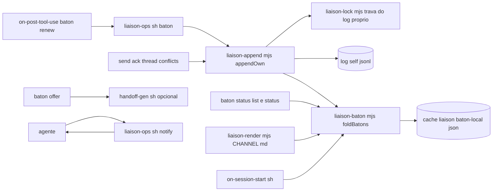
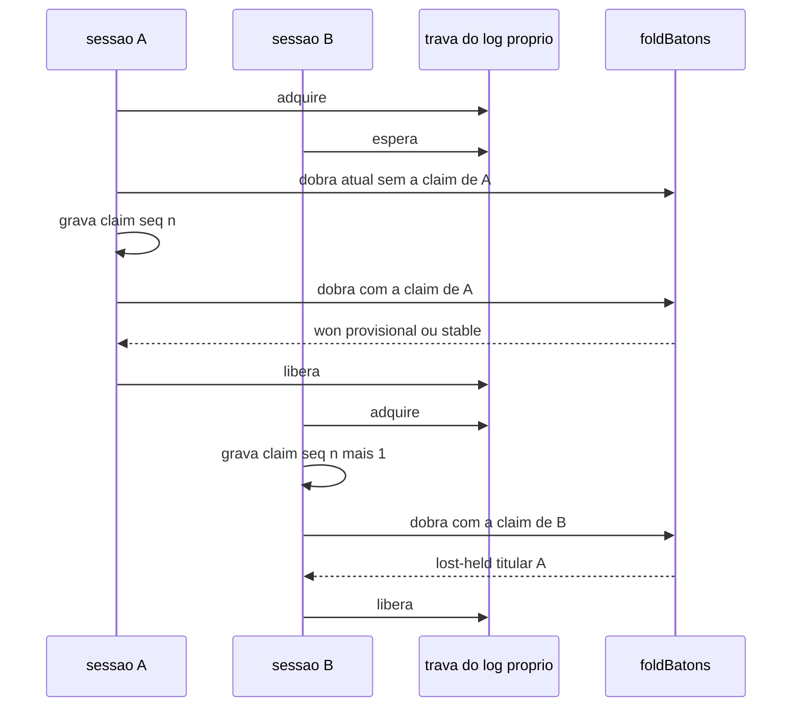

# Design — add-liaison-handoff-baton

> Design técnico do change `add-liaison-handoff-baton`. Decisões duráveis e transversais merecem ADR (`/forge:new-adr`) — referencie aqui em vez de duplicar.

## 0. Sumário executivo

O bastão é um conjunto de mensagens `kind: note` com um objeto `baton`, gravadas no log próprio de quem age, numa thread do liaison que tem participante de outro repositório. O dono de cada bastão é calculado por uma única função pura (`foldBatons`) que dobra essas mensagens na ordem total que o liaison já define, `(lamport, sender, seq)`, usando só carimbos e parâmetros gravados nas mensagens. Dentro de um clone, a reivindicação é um compare-and-set de verdade: leitura, dobra, gravação e nova dobra acontecem sob uma trava exclusiva do log próprio, a mesma que passa a proteger todo escritor do log (hoje `send`/`ack`/`thread` reescrevem o arquivo sem trava e o push do `sync` copia a união de volta por cima do log próprio, e qualquer um deles pode perder uma gravação concorrente). A oferta grava os repositórios elegíveis, o prazo máximo e a folga, e o desempate de `sender` na ordem da thread passa a ser por code point, para que todas as réplicas decidam igual. Entre clones, o resultado é determinístico mas pode ser revertido até a réplica observar os demais participantes, e por isso a posse carrega a marca `provisional` ou `stable`. O lease é renovado automaticamente por um gancho `PostToolUse` enquanto a sessão age, e vence sozinho quando ela para. A implementação depende de `add-liaison-native-bridge` mesclado em `develop`.

## 1. Contexto e restrições

- **Store do liaison.** Um JSONL append-only por remetente (`log/<sender>.jsonl`), escritor único por arquivo, `seq` sem buraco por remetente, `lamport` por thread, ordem `(lamport, sender, seq)` em `threadOrder` (`lib/liaison-merge.mjs`). O canal mora no tronco: `ROOT` é resolvido por `lib/forge-root.sh` a partir do `--git-common-dir`, então todas as worktrees de um clone escrevem o mesmo `log/<self>.jsonl`.
- **Escrita atual sem trava (medido em `liaison-ops.sh`, bloco `send`).** Cada escritor lê todos os logs, calcula `seq = nextSeq(own)` e `lamport = nextLamport(threadMsgs)`, monta o envelope e reescreve o arquivo inteiro (`writeFileSync(tmp)` + `renameSync`). Dois processos concorrentes no mesmo clone produzem o mesmo `seq` ou apagam a gravação um do outro (última reescrita vence). É o mesmo defeito que a rule `liaison-protocol` descreve para "duas cópias do mesmo log", só que dentro de um único clone. O bastão concentra exatamente esse tipo de concorrência, então a trava é pré-requisito. O push do `sync` tem o mesmo defeito por outro caminho: `_dir_push_union` (`lib/transports/_common.sh`) calcula a união do log próprio com o do hub e termina com `cp "$hubf" "$own"`, que sobrescreve o log próprio com uma união calculada a partir de uma leitura anterior; um `send` que caia entre a leitura e a cópia é apagado localmente.
- **Desempate da ordem dependente de locale (medido pelo validador do change).** `threadOrder` e a escolha do `thread-open` em `mergeLogs` comparam `sender` com `String.prototype.localeCompare`, que segue colação ICU e o locale do processo; com ids `[a-z0-9._-]`, ids que diferem por pontuação ordenam diferente de code point (`localeCompare`: `a_b a-b a-c a.b a0 ab`; code point: `a-b a-c a.b a0 a_b ab`). A determinismo entre réplicas que o bastão exige depende de corrigir isso.
- **Validação de envelope.** `validateEnvelope` recusa `kind` fora de `KINDS` e o import transforma o envelope inválido em conflito (`liaison-import.mjs`, passada 1), abrindo buraco de `seq` no destino. O mesmo validador ignora campo desconhecido, e `content_sha` cobre todos os campos exceto `content_sha` e `trust`. Após `add-liaison-native-bridge`, `validateEnvelope` passa a validar `via` e `cross_session`, mas continua ignorando campo desconhecido (design daquele change, §4.2).
- **Relógio.** `created_at` é a data do commit HEAD, nunca relógio de parede; a exceção aceita é `published_at` (issue #109) e os cursores em `state.json`. O lease exige relógio de parede, e ele entra como dado carimbado pelo escritor (`stamped_at`, `lease_until`), nunca como critério de ordem nem como leitura do relógio de quem calcula o estado.
- **Proibições do harness.** Nenhum `.sh` invoca agente, CLI de sessão ou socket de sessão (gate `w113`). A campainha é ato do agente. Zero dependência nova (NFR-01).
- **Estado local não versionado.** `.forge/cache/` é ignorado pelo bloco gerenciado do `.gitignore` (`installer/gitignore.patch`) nos consumidores e no próprio harness; trava e estado local do bastão moram em `<tronco>/.forge/cache/liaison-locks/` e `<tronco>/.forge/cache/liaison-baton/<channel>/`, nunca em `.forge/cache/liaison/<channel>`, que é o clone de trabalho descartável do transporte `git` (`lib/transports/git.sh`: "apagar o cache custa um clone"); o nome dos arquivos de trava carrega o canal e o tipo (`<channel>@<self>@<tipo>.lock`), com `@` como separador, que não pertence a `[a-z0-9._-]`, de modo que nem um canal chamado `locks` nem ids com ponto (`a.b` + `c` contra `a` + `b.c`) colidem. Gate com transporte `git` (apagar o clone não toca o estado do bastão) e com um canal chamado `locks`.
- **Dependência.** `add-liaison-native-bridge` traz `notify` e `lib/liaison-pointer.mjs::resolvePointer`, `lib/liaison-publish.mjs::isPublished`, o valor `cross-session` de `via` com a flag `--session` no `send` (que lá identifica o transcript; aqui, nos subcomandos `baton`, identifica a sessão titular, sem colisão porque são subcomandos distintos), a classe `internal-coordination` e as normas de mensagem nativa. Este design usa só `notify` e o leitor de publicação; o resto é coexistência.

## 2. Decisão técnica

### 2.1 Visão geral



Fluxo da reivindicação dentro de um clone:



### 2.2 Módulos novos (em `template/.forge/scripts/lib/`)

| Módulo | Responsabilidade | Consumidores |
|---|---|---|
| `liaison-lock.mjs` | `withOwnLogLock({ root, channel, self }, fn)`: trava exclusiva por `(canal, self)`, timeout, recuperação de trava abandonada, `stillOwned()` para conferência antes de gravar (§2.4). | `liaison-append.mjs` (trava do log próprio e travas de estado local); não há trava de publicação (§2.4) |
| `liaison-append.mjs` | `appendOwn({ root, chDir, channel, self, build })`: sob a trava, lê todos os logs do canal, chama `build(all)` que devolve o envelope sem `seq`/`lamport`/`msg_id`/`content_sha`, completa esses campos, valida com `validateEnvelope`, reescreve `log/<self>.jsonl` por tmp + rename e devolve `{ msg, all }`. Variante `appendOwnDecided({ ..., decide })` para o bastão: `decide(all)` pode recusar sem gravar e recebe de volta a dobra pós-gravação ainda sob a trava. | `send`, `ack`, `thread open`, `thread join`, `conflicts resolve`, `baton *`, o `send --via cross-session` do change dependente, e o push do `sync` pelo modo de linha de comando `node lib/liaison-append.mjs union-own <chDir> <self> <arquivo-do-hub>` (§2.4) |
| `liaison-baton.mjs` | Fonte única de `BATON_OPS`, `BATON_STATES` (`available`, `held`, `completed`, `withdrawn`), `BATON_VERDICTS`, dos padrões de subcampo e da tabela de flags por verbo (`BATON_VERB_FLAGS`), que o `liaison-ops.sh` lê por `node` para validar as flags e montar a mensagem de flags aceitas (não há segunda tabela no script); `validateBaton(msg)` (camada de bastão, chamada pelo CLI antes de gravar e pela dobra; nunca pelo `validateEnvelope`); `foldBatons(channelMessages)` (§2.3, recebe o canal inteiro para o índice de ofertas e o `wrong-thread`); `stability(baton, channelMessages)` (§2.5, precisa do log inteiro de cada repositório para conferir `seq` contíguo). Dependência num só sentido: `liaison-baton.mjs` importa de `liaison-merge.mjs` (`threadOrder`, `compareSender`, `detectForks`, `detectGaps`); o padrão de `op` da camada de envelope (`BATON_OP_PATTERN`) mora em `liaison-merge.mjs`, junto do `validateEnvelope`, e é reexportado por `liaison-baton.mjs`, sem ciclo de importação; `readBatonConfig(forgeYamlPath)` com limites e defaults (§2.6). Puro, sem I/O exceto `readBatonConfig`. | `liaison-ops.sh`, `liaison-render.mjs`, `on-session-start.sh`, gancho de renovação, gates |
| `liaison-baton-local.mjs` | Estado local não versionado em `<tronco>/.forge/cache/liaison-baton/<channel>/baton-local.json`: reivindicações próprias que receberam rc 0 (para detectar perda tardia, REQ-05/REQ-13), perdas já exibidas e índice de titulares por sessão para o caminho rápido do gancho de renovação. | `baton claim/renew/release/complete`, `status`, `on-session-start.sh`, gancho de renovação |

Validação em duas camadas (REQ-01). `validateEnvelope` (em `liaison-merge.mjs`) ganha só a camada de envelope: `baton` é objeto, `kind: note`, `requires_ack: false`, `op` string em `^[a-z][a-z-]{0,31}$`. A camada de bastão é `validateBaton`, chamada pelo CLI antes de gravar e pela dobra para dar `malformed`. Assim uma operação de versão futura entra na réplica sem conflito e sem buraco de `seq`. Em `liaison-merge.mjs` muda também o desempate (§2.6.1); `mergeLogs` é consumido como está.

### 2.3 Forma da mensagem e dobra

Envelope de uma operação de bastão: `kind: "note"`, `requires_ack: false`, `in_reply_to: <baton_id>` (exceto `offer`, `null`), `subject` (na oferta, o `--subject`; nas demais, `baton <op>: <assunto da oferta>` truncado a 200 caracteres), corpo opcional e:

```json
"baton": {
  "op": "offer | claim | renew | release | complete | withdraw",
  "session": "<id da sessão que age>",
  "stamped_at": "2026-10-30T21:00:00Z",
  "eligible": ["forge-harness", "payments"],
  "max_lease_seconds": 14400,
  "skew_tolerance_seconds": 120,
  "lease_seconds": 1800,
  "lease_until": "2026-10-30T21:30:00Z"
}
```

`eligible`, `max_lease_seconds` e `skew_tolerance_seconds` são obrigatórios em `offer` e proibidos nas demais; `lease_seconds` e `lease_until` são obrigatórios em `claim` e `renew` e proibidos nas demais. `stamped_at` e `lease_until` em UTC com sufixo `Z` e precisão de segundo; `lease_until` exatamente `stamped_at + lease_seconds`. O `baton_id` é o `msg_id` da oferta. `eligible` é gravado pelo `offer` a partir de `--for` (validado contra os participantes da thread) ou, sem a flag, de todos os participantes da thread conhecidos na réplica (abertura mais `join`, como `mergeLogs` calcula), inclusive o próprio repositório.

`foldBatons(channelMessages)` primeiro detecta, no canal inteiro e antes de agrupar por thread, as posições forkadas (mesmo `sender` e `seq` com `content_sha` diferente, pela mesma lógica de `detectForks`), de modo que duas versões da mesma posição em threads diferentes também são vistas; todas as versões de uma posição forkada recebem `forked` e não são aplicadas. Depois indexa as ofertas do canal inteiro por `msg_id`, agrupa as mensagens por thread e dobra cada thread em separado: filtra as mensagens com `baton`, ordena por `threadOrder` e aplica, em sequência, a tabela do REQ-04 sobre um mapa `baton_id → { state, offer, holder: {sender, session} | null, holder_claim, lease_until, last_op, history[] }`. Cada operação recebe exatamente um veredito, gravado no `history` do bastão ou na lista `orphans` quando a oferta não está na réplica. Como a dobra é refeita do zero a cada chamada, uma `pending-offer` é reavaliada naturalmente quando a oferta chega. Operação cuja oferta está no índice do canal mas em outra thread recebe `wrong-thread`; operação cuja oferta está na mesma thread mas ainda não foi aplicada no ponto da passada (vem depois na ordem) recebe `before-offer`. `in_reply_to` que aponta para mensagem presente que não é oferta aplicável recebe `not-an-offer` (definitivo). `detectClockSkew` passa a ignorar mensagens com `baton` (REQ-06). O CLI nunca produz nenhuma dessas: ele deriva a thread da própria oferta e só age sobre oferta já presente na réplica. A ordem de avaliação das linhas da tabela do REQ-04 é a do requisito, e a implementação é uma sequência de guardas na mesma ordem, uma por linha, para que o teste por linha seja um teste por guarda.

Notas de semântica que a tabela fixa:

- **Titular com lease vencido** continua titular: pode `release` e `complete`; não pode `renew` (`late-renew`); pode retomar com `claim` (`won`, lease novo). Outras sessões só tomam com carimbo a partir de `T + S`; entre `T` e `T + S` recebem `lost-held` com o motivo da folga. A janela de folga existe para que uma diferença de relógio de até `S` não transforme a renovação tardia da titular e a tomada do outro lado numa disputa decidida pelo relógio.
- **Retirada com titular sumida.** `withdraw` do ofertante vale com bastão `available` ou com lease vencido além da folga; é a saída para uma oferta cujo único elegível sumiu sem liberar.
- **Desempate.** Duas reivindicações sobre bastão `available`: a primeira na ordem recebe `won`, a segunda encontra `held` com lease vigente e recebe `lost-held` nomeando a primeira.
- **Lease acima do máximo.** Os limites absolutos (`[60, 86400]`) são da camada de bastão: o CLI nunca grava fora deles, e mensagem de peer fora deles entra na réplica e recebe `malformed` na dobra (nunca conflito no import). O limite relativo à oferta só a dobra conhece e vira `lease-over-max`.
- **Rótulo `expired`.** Calculado fora da dobra, pelo leitor, comparando o relógio de quem lê com `lease_until`; nunca altera estado nem veredito, e nunca aparece no `CHANNEL.md` (que é determinístico a partir da união, sem relógio); só em `liaison-ops.sh status`, `baton status`/`list` e no início de sessão.
- **Prazo da renovação.** `renew` sem `--lease` repete o `lease_seconds` do lease vigente; com `--lease`, troca o prazo dentro dos limites da oferta. A renovação automática usa sempre o prazo vigente.

### 2.4 Trava do log próprio

Caminho: `<tronco>/.forge/cache/liaison-locks/<channel>@<self>@log.lock/` (diretório), com `owner.json` `{ pid, host, started_at, nonce, cmd }`. Aquisição: `mkdirSync` sem `recursive` (atômico; falha com `EEXIST`) depois de garantir o diretório pai com `recursive`, recusando pai que seja symlink (lição do `heavy-mutex.sh`: `mkdir -p` aceita symlink pré-existente). Espera ativa com intervalo de 25 ms e jitter até 10 s; esgotado, rc 1 nomeando `pid`, `host` e `started_at` do dono. Recuperação de trava abandonada: mesmo `host` e processo dono inexistente (`process.kill(pid, 0)` lançando `ESRCH`; `EPERM` significa vivo, nunca abandonado), ou idade acima de 120 s. A recuperação é exclusiva e conferida: o recuperador cria o guarda `<lock>.recover/` com `mkdirSync` (atômico; quem não consegue volta a esperar), relê sob o guarda o `owner.json` e só prossegue se o `nonce` ainda é o que ele observou como abandonado; então renomeia a trava para `<lock>.stale-<nonce observado>`, remove o renomeado, remove o guarda e avisa em stderr. Assim a sequência "R1 e R2 leem o mesmo dono morto, R2 recupera, A cria trava viva, R1 renomeia a trava de A" é impossível: R1 só age sob o guarda e com o `nonce` reconferido. Guarda com mais de 10 s (o recuperador morreu no meio) é removido pelo próximo recuperador por renomeação para nome único seguida de conferência do `mtime` do renomeado (se for recente, outro recuperador acabou de recriá-lo: nesse caso o recuperador não tenta desfazer a renomeação, apenas desiste e volta a esperar), com aviso; a janela que resta exige a morte de um recuperador no meio da recuperação e só causa espera extra, nunca duas recuperações simultâneas da trava, que continua conferida por `nonce`. Trava sem `owner.json` (intervalo entre o `mkdir` e a escrita do dono) conta como jovem, com idade pelo `mtime` do diretório, e só é recuperável depois de 120 s. Fixtures: dois recuperadores concorrentes diante da mesma trava morta mais um adquirente novo (nenhuma mensagem perdida); trava sem `owner.json` com menos e com mais de 120 s. Liberação: remove `owner.json` e o diretório só se o `nonce` for o próprio.

**O que roda dentro da trava.** Só releitura do canal, dobra, montagem do envelope (com `seq`, `lamport`, `msg_id`, `content_sha`) e gravação local por tmp + rename. Varredura de segredo, escrita de blob, geração de handoff, leitura de configuração e qualquer transporte rodam antes de adquirir ou depois de liberar. Imediatamente antes do `renameSync` final, `stillOwned()` relê o `owner.json` e confere o `nonce`; se a trava foi recuperada por outro processo (seção crítica que passou de 120 s), o escritor apaga o tmp e sai com rc 1 sem gravar. Com a seção crítica medida em ≤ 2 s para 2.000 mensagens (NFR-02) e a recuperação exclusiva acima, a recuperação por idade só alcança um processo travado por mais de 120 s, e a conferência de `nonce` garante que mesmo esse não grava por cima de quem recuperou, exceto na janela residual de microssegundos entre `stillOwned()` e `renameSync`, que a rule registra como limite (detecção: posição forkada no `status`). Limite também registrado: a vivacidade por `host` + `pid` erra quando um container e o host compartilham o diretório por bind mount com o mesmo hostname (o pid vive em outro namespace); nesse caso só a regra de idade protege.

**Publicação sem trava: no máximo uma vez por push, conferida depois (opção C, causa raiz escolhida pelo dono em 2026-10-30).** Dois `sync` com push do mesmo `self` em paralelo (manual, ou o processo destacado da renovação) gravavam no mesmo tmp do hub (`$hub/log/.$SELF.jsonl.tmp`) e terminavam em `mv`, podendo deixar o hub truncado ou regredido e a marca de publicação apontando para o que o hub já não tem. Três rodadas de revisão mostraram que uma trava de push, por envolver rede, traz de volta a cada correção um caso de vivacidade do dono (processo morto travando a publicação, pid reaproveitado, namespace de pid diferente, tetos que não fecham, `trap EXIT` disputando com o `trap` de staging que o `sync` já tem). A decisão é não serializar o push e tornar a corrida inofensiva e observável, apoiada em dois fatos do liaison existente: (1) o arquivo `log/<self>.jsonl` do hub só contém mensagens deste `self`, e o log próprio local é sempre superconjunto dele (o `union-own` abaixo garante isso), então duas publicações concorrentes nunca escrevem conteúdo diferente para a mesma posição, só prefixos de tamanhos diferentes (a exceção é o `--repair-own-log`, que reescreve de propósito uma posição já publicada; ele é ato explícito do dono, preexistente, e fica fora desta premissa: um push normal concorrente com ele falha por bifurcação, sem dano); (2) o import é união append-only e nunca apaga, então um peer que leu um prefixo mais curto apenas fica atrasado até a próxima leitura, sem divergência nem quarentena. O mecanismo:

- **Arquivo temporário único e limpeza.** Todo tmp no hub tem nome único (`.$SELF.jsonl.tmp.<pid>.<aleatório>`), nos dois caminhos que o usam (`_dir_push_union` e o `--repair-own-log` de `_dir_push`), e o `mv` final é atômico no mesmo diretório; nenhuma combinação de pushes produz arquivo truncado. Como o vigia da §2.8 pode matar um push no meio, cada push remove, antes de escrever, os tmp do próprio `self` no hub com mais de 10 minutos (nunca tmp de outro remetente); gate com tmp órfão antigo e recente.
- **Ordem de cada tentativa.** Toda tentativa segue a mesma sequência: (1) instantâneo do log próprio; (2) cópia para o hub dos blobs que esse instantâneo referencia; (3) união do instantâneo com o arquivo do hub relido; (4) `mv` do tmp único. Como o `send` grava o blob antes de acrescentar a mensagem, e a união usa o instantâneo do passo 1, nenhuma mensagem chega ao hub antes do seu blob, inclusive nas novas tentativas. Gate com `send --body-file` entre a cópia de blobs e o `mv`.
- **Transporte `fs`, `fs-union` e `manual` (diretório).** Não há compare-and-swap no sistema de arquivos, e ele não é necessário: depois do `mv`, o push relê o arquivo do hub e **relê o log próprio local naquele instante (depois do `mv`)**, e confere se o hub contém, como prefixo contíguo e com `content_sha` igual, todas as mensagens do log próprio relido (não só as da união que ele mesmo escreveu). Se não contém, faz nova tentativa (sequência abaixo). Não há limite de contagem: o laço termina quando a conferência passa ou quando o prazo do push se esgota. O prazo é interno ao laço e conferido no início de cada tentativa (25 s no processo destacado, 300 s no `sync` manual, por `FORGE_LIAISON_PUSH_DEADLINE_S` com esses defaults), de modo que o push para limpo entre tentativas; o vigia de grupo de 30 s da §2.8 continua só no processo destacado, como rede de segurança para um bloqueio dentro de uma tentativa (transporte travado), e o `sync` manual não ganha vigia. O mesmo prazo vale para o laço de recusa do `git`. Sem `send` contínuo, ele termina em poucas tentativas, porque cada uma inclui tudo que o log próprio tinha. Como o log próprio é superconjunto de tudo que qualquer push concorrente poderia ter escrito, o último push a fazer `mv` sempre encontra a falta deixada por um concorrente mais antigo e a repara: na sequência "A publica a união maior e confere; B, que leu antes, publica a união menor depois", é B quem relê, vê que faltam as mensagens de A e republica. Só o próprio `self` restaura o seu arquivo no hub (`_dir_pull` não traz o próprio log e nenhum peer o republica), então a regressão persiste apenas se o push que a causou não chegar a uma conferência bem-sucedida: morto entre o `mv` e a conferência, ou parado pelo teto de tempo com `send` contínuo. Nos dois casos ela dura até o próximo push deste `self`, que a renovação automática ou o próximo `sync` fazem, e durante esse intervalo a marca gravada antes por outro push pode ficar otimista. Esse resíduo dura até o próximo `sync` com push deste `self` (que pode não vir logo se nenhum bastão estiver detido) e é o limite declarado da opção C, na rule e no gate. Para encurtá-lo nos transportes de diretório, `liaison-ops.sh status` relê o arquivo do `self` no hub e, se a marca estiver acima do que o hub tem, rebaixa a marca pela mesma função `markPublished({ observedFile })` e avisa `hub atrás do log próprio: rode sync`; com isso o `status` geral passa a gravar a marca em `state.json` (sob a trava de `state.json`) nesses transportes, o que o `liaison.md` registra, embora `baton status` e `baton list` continuem só leitura.
- **Transporte `git` (simplificado pela causa raiz apontada na validação: nenhum recurso compartilhado por execução).** O próprio remoto é o compare-and-swap: ele só aceita fast-forward. Hoje todo push e todo pull usam o mesmo clone em `.forge/cache/liaison/<channel>` com `checkout -B`/`reset --hard`, e o `reset` de um processo pode apagar a união recém-escrita por outro, que então vê `diff --cached --quiet` e sai com rc 0 sem publicar. Em vez de dividir esse clone em refs e worktrees por execução (cada um exigindo limpeza de órfão e, com ela, juízo de vivacidade), cada execução de `t_push` ou `t_pull` trabalha num repositório temporário próprio e descartável em `.forge/cache/liaison-git-run/<channel>@<pid>@<aleatório>/` (`git init`; se o clone antigo existir, `objects/info/alternates` aponta para os objetos dele, só para leitura, para economizar download; nenhum ref nem objeto é escrito no repositório compartilhado). Nele: `git ls-remote --exit-code origin refs/heads/<branch>` decide se a branch existe (código 2 é ausente; qualquer outra falha é erro, nunca "ausente"); existindo, `git fetch --depth 1 origin <branch>` e checkout do commit buscado; ausente, commit inicial vazio por `git commit-tree` da árvore vazia, sem exigir `worktree add --orphan` do git 2.42. Push: aplica a mesma sequência por tentativa do `fs` (instantâneo do log próprio, blobs do instantâneo, união com o arquivo do commit buscado), adiciona explicitamente só `<channel>/log/<self>.jsonl` e os blobs novos (nunca `git add -A`), commita e faz `git push origin HEAD:refs/heads/<branch>` sem force; recusa por não fast-forward volta ao início da tentativa (novo `fetch`). No `git` vale só esse laço de recusa: a conferência pós-`mv` do `fs` não roda dentro do repositório temporário, porque ali quem confere o remoto é a própria recusa. Pull: `git archive <commit buscado> <channel> | tar -x -C <tmp>` e import a partir do diretório temporário, sem checkout compartilhado. Limite da limpeza por idade (vale também para o tmp do hub com mais de 10 minutos): ela pode remover o recurso de uma tentativa viva travada por mais que a idade limite, o que só faz aquela tentativa falhar no `mv` ou no push, nunca produz estado incorreto, e fica registrado na rule. Limpeza: o repositório temporário é removido num `trap` local da função (sem tocar o `trap` de staging do `sync`); diretórios órfãos de execuções mortas são removidos pela execução seguinte **só por idade do diretório** (mais de 1 hora pelo `mtime`), sem olhar pid, e o glob `<channel>@*` não casa com outro canal porque `@` não pertence aos ids. O clone antigo em `.forge/cache/liaison/<channel>` deixa de ser escrito; fica como fonte opcional de objetos. Apagá-lo (ou um `gc` feito por maquinaria antiga) durante uma execução faz aquela execução falhar de forma limpa, sem estado incorreto; o gate cobre essa falha. A URL do remoto vem do `remote` do transporte `git` no `liaison.yaml`, como hoje. Fixtures com remoto bare local: dois `sync` simultâneos (push e completo), primeira publicação em remoto sem a branch, falha de rede que não vira "branch ausente", limpeza de órfão rodando durante uma execução viva com menos de 1 hora (preservada), e a branch nunca contendo tmp.
- **Marca de publicação observada, nunca presumida.** `markPublished` deixa de gravar "o último `msg_id` do log próprio" (o que o processo acreditava ter escrito). Depois do push, `_dir_push` relê o arquivo do `self` no hub (diretório, nos transportes `fs`, `fs-union` e `manual`) ou, no `git`, no próprio commit enviado (`git show HEAD:<channel>/log/<self>.jsonl` no repositório temporário, depois do push com rc 0, que por ser fast-forward é exatamente o que o remoto passou a ter; nenhum ref compartilhado como `origin/<branch>` é consultado) e exporta `LIAISON_OBSERVED_FILE` com esse conteúdo relido (no caminho "nada novo a publicar" do `git`, a observação é lida do commit buscado por aquela execução no seu repositório temporário); `markPublished({ observedFile })` grava como publicado o maior `msg_id` próprio tal que todas as mensagens próprias até ele estejam no arquivo observado, contíguas e com `content_sha` igual ao do log local. Sem arquivo observado (falha de leitura), não grava marca nova. Assim `isPublished` e o `notify` do change dependente só aceitam ponteiro para mensagem que foi vista no hub depois do push; se uma corrida regredir o hub logo depois da observação, a marca fica otimista até o push que regrediu conferir e reparar (o caso normal, acima) ou, no resíduo declarado, até o próximo push deste `self`; comportamento aceito e registrado na rule. A marca pode descer: uma observação mais recente de um hub regredido grava um `msg_id` menor, o que é o comportamento correto (a contagem de próprias não publicadas do `status` sobe, e `isPublished` volta a recusar o que saiu do hub até o próximo push repará-lo); a rule descreve esse efeito.
- **`fs-union` com tronco anterior a este change.** O `fs-union` carrega o `_common.sh` do checkout principal, e a sua conferência atual só exige que `_dir_push` cite `_dir_push_union`, o que um tronco antigo satisfaz. Um tronco antigo rodaria o push sem `union-own`, com tmp fixo e sem `LIAISON_OBSERVED_FILE`, e a marca de publicação deixaria de avançar. A conferência do `fs-union` passa a exigir também os marcadores da opção C no corpo das funções carregadas do `_common.sh` do tronco, lido do mesmo jeito que a conferência atual (`declare -f _dir_push` e `declare -f _dir_push_union`, que devem conter `union-own` e `LIAISON_OBSERVED_FILE`) e recusa, com a mensagem existente de "atualize o tronco antes de sincronizar", quando faltam. Fixture: worktree com este change sobre tronco antigo, `sync` recusado sem tocar hub nem log próprio.
- **Escritor de versão antiga sem trava (limite declarado, com detecção).** `liaison-ops.sh` resolve `LIBDIR` pela cópia da worktree e `ROOT` pelo tronco, então uma worktree criada de branch anterior a este change continua gravando no `log/<self>.jsonl` do tronco sem trava (o `send` antigo reescreve o arquivo inteiro e o push antigo faz `cp` do hub para o log próprio), e pode sobrescrever na mesma posição uma claim que recebeu rc 0. Código novo não impede código antigo; o design declara o limite na rule e no §6 e o torna detectável: (1) `appendOwn` registra, em `<tronco>/.forge/cache/liaison-baton/<channel>/append-journal.json` (ainda sob a trava do log, que o `appendOwn` já detém, e só depois do `renameSync` bem-sucedido, para que uma gravação abortada pelo `stillOwned()` nunca gere aviso falso; últimas 500 entradas), o `seq` e o `content_sha` de cada mensagem que gravou; `liaison-ops.sh status`, `baton status` e o início de sessão conferem que cada entrada do diário ainda está no log próprio com o mesmo `content_sha` e, se não estiver, avisam `log próprio reescrito por escritor sem trava: <msg_id>` (para claims rc 0, o aviso nomeia o bastão afetado); (2) o `doctor` lista as worktrees do repositório (`git worktree list --porcelain`) e avisa quando a cópia de `liaison-ops.sh` de alguma delas não contém a sentinela literal `# forge-liaison: own-log-lock v1` (comentário que este change acrescenta ao script; o gate cobre uma worktree com e outra sem) (maquinaria do liaison anterior à do tronco), com a orientação de atualizar a branch ou não usar o liaison nela; (3) o rollout (§5) inclui esse aviso como passo. Gate: worktree de fixture com a maquinaria antiga grava durante uma claim; o aviso aparece no `status` e no `baton status`, e o `doctor` nomeia a worktree.
- **Verificação determinística das corridas.** As intercalações que a opção C precisa provar não dependem de sorte: um ponto de injeção só para testes, ativado pela variável `FORGE_LIAISON_TEST_BARRIER=<diretório>`, faz o push parar em pontos nomeados (`after-blobs`, `after-union`, `after-mv`), criando `<diretório>/<ponto>.<pid>.ready` e esperando `<diretório>/<ponto>.<pid>.go` (teto de 30 s); sem a variável, os pontos não fazem nada. Gate estático: nenhum script do template define a variável, e ela só é lida num único helper. Cada push exporta e registra o número de tentativas e de reparos (`publicação: N tentativa(s), M reparo(s)` em stderr, e os mesmos campos no `publish-result-<pid>.json` e em `LIAISON_PUSH_ATTEMPTS`/`LIAISON_PUSH_REPAIRS`). Os gates forçam, com a barreira, os três cenários (push mais antigo fazendo o último `mv` e reparando; push morto entre `mv` e conferência; `send --body-file` entre a cópia de blobs e a união) e exigem ao menos um reparo no cenário forçado e zero reparos na execução de controle sem concorrência (controle e recontrole); as repetições aleatórias continuam só como complemento.
- **Processo destacado da renovação** não espera nem coordena com push nenhum: publica como qualquer `sync --push-only` e registra o resultado observado em `publish-result-<pid>.json`.

Gate: dois `sync --push-only` concorrentes e um `send` no meio, repetidos 20 vezes com transporte `fs` e 5 com transporte `git` (remoto bare local); ao fim de cada repetição, **sem** `sync` adicional, o hub contém todas as mensagens próprias que existiam no log próprio quando a última conferência o releu (exceto quando o teto de tempo se esgota com `send` contínuo, caso em que a marca não as declara publicadas); com um `sync` adicional, contém todas; nenhum arquivo do hub é truncado ou inválido em nenhum instante observado, nenhum peer que importa durante a corrida entra em quarentena, e `isPublished` nunca aceita `msg_id` ausente do arquivo observado. Outro caso: `markPublished` com arquivo observado regredido grava só o prefixo presente. Leitura do critério do REQ-09 ("nenhuma mensagem perdida no log próprio nem no hub"): o log próprio nunca perde nada (trava e `union-own`); no hub, "perdida" significa ausente depois que o último push concorrente termina a sua conferência, e é isso que o gate confere sem `sync` adicional; o resíduo declarado (push morto entre o `mv` e a conferência) é medido à parte, com a restauração pelo push seguinte. Uma regressão momentânea de prefixo durante a corrida não é perda: a mensagem continua no log próprio, nenhum peer a recebe com conteúdo diferente, e o próximo push a republica.

**Estado local com disciplina de concorrência.** Todo arquivo de estado lido e regravado por mais de um processo passa por trava e tmp de nome único: `baton-local.json` sob `<channel>@<self>@local.lock` (escrito por `claim`/`renew`/`release`/`complete`, pelo cache frio do gancho e pelo início de sessão); `state.json` do canal (cursores do `inbox` em `liaison-cursor.mjs` e marca de `markPublished` em `liaison-publish.mjs`, que passa a rodar também em segundo plano) sob `<channel>@state.lock`. O processo destacado não escreve `baton-local.json`: grava o resultado da publicação em `publish-result-<pid>.json` no mesmo diretório, e os leitores consolidam pelo mais recente e apagam os anteriores sob a trava local. Gate com escritores concorrentes em cada arquivo (nenhuma atualização perdida, nenhum JSON truncado).

**Escritor único da gravação.** `appendOwn` é o único lugar que escreve `log/<self>.jsonl`. O push do `sync` deixa de copiar o arquivo do hub por cima do log próprio: o `cp "$hubf" "$own"` de `_dir_push_union` vira `node lib/liaison-append.mjs union-own <chDir> <self> "$hubf"`, que, sob a trava, relê o log próprio atual, une com o arquivo do hub pela mesma função de `liaison-push-union.mjs` (sem perder nada que tenha sido gravado depois da leitura que alimentou o push) e grava. Mensagens gravadas entre o cálculo da união do push e a cópia de volta ficam no log próprio e vão no próximo push. O caminho `--repair-own-log` (`_dir_push`, caso 2) copia o log próprio para o hub e não escreve no log próprio, então não precisa de `union-own` nem da trava: o critério do REQ-09 que o cita se cumpre por não haver escrita, e o gate de varredura o classifica como leitura do log próprio (a fixture do gate confere que ele não escreve). Consequência sobre a marca de publicação: hoje `markPublished` grava como publicado o último `msg_id` do log próprio, o que só é verdade porque a cópia de volta o iguala ao hub; com `union-own` isso deixa de valer, e a marca passa a ser observada pela releitura descrita no parágrafo anterior. O gate do REQ-09 cobre o caso com um `send` entre a união e a cópia de volta e confere `notify` recusando a mensagem nova. O gate do REQ-09 combina duas verificações. Dinâmica, que não depende de adivinhar nomes de variável: os subcomandos do `liaison-ops.sh` rodam com `NODE_OPTIONS=--require <preload do gate>`, um preload que embrulha `fs.writeFileSync`, `fs.renameSync`, `fs.appendFileSync`, `fs.copyFileSync` e as versões assíncronas, e registra toda escrita cujo destino resolvido seja `log/<self>.jsonl` (ou seu tmp) junto do arquivo de origem da chamada na pilha; o gate exige que a origem seja sempre `liaison-append.mjs`. Estática, para o bash: em `liaison-ops.sh` e `lib/transports/*.sh`, `cp`, `mv`, `tee` e redirecionamento cujo alvo contenha `$own`, `${own}`, `LIAISON_SELF}.jsonl` ou `$self.jsonl` reprovam, com uma lista de exceções nomeadas por linha de leitura (o `--repair-own-log` lê o log próprio). O import continua escrevendo os logs de peers, que não são do `self`.

### 2.5 Provisório e estável

`stability(baton, channelMessages)` só se aplica a bastão `held`. Seja `C` a reivindicação que deu a posse à titular corrente (as renovações não mudam `C`). O conjunto exigido é `(eligible ∪ { ofertante }) \ { C.sender }`: só elegíveis podem reivindicar e só o ofertante pode retirar, então só eles podem produzir uma operação que, ordenada antes de `C`, a reverta. A posse é `stable` se, para cada repositório exigido, a réplica tem o log dele com `seq` contíguo de 1 até alguma mensagem dele na thread com `lamport ≥ C.lamport` (buracos detectados pela mesma lógica de `detectGaps`); senão é `provisional`, com a lista dos que faltam e, quando for o caso, o buraco. Justificativa: um repositório só emite mensagem na thread com `lamport` maior que o de qualquer mensagem dele já emitida na thread, e o `seq` contíguo garante que nenhuma mensagem anterior dele está faltando na réplica; logo nenhuma operação dele ainda não vista pode ser ordenada antes de `C`. Outras sessões do mesmo `sender` de `C` escrevem no mesmo log sob a trava, então não há operação concorrente delas fora da réplica (várias cópias do mesmo `self.id` em clones diferentes estão fora do suportado).

Perda tardia: `baton claim` com rc 0 grava em `baton-local.json` o `msg_id` da claim. `status`, `baton status` e o início de sessão comparam essas entradas com a dobra; entrada cuja claim já não é a `C` da titular corrente, sem `release`/`complete` próprio posterior, é perda tardia, exibida com a titular vencedora e marcada como exibida no início de sessão.

### 2.6 Lease, limites e configuração

`forge.yaml` do template ganha, dentro do bloco `liaison`, o sub-bloco `baton` com `default_lease_seconds: 1800`, `max_lease_seconds: 14400`, `skew_tolerance_seconds: 120` e `auto_renew: true`, cada um comentado. `readBatonConfig` lê com `yaml-lite.mjs`, aplica defaults às chaves ausentes e reprova os valores fora de faixa listados no REQ-06. A oferta grava `eligible`, `max_lease_seconds` (de `--max-lease`, limitado a `[60, max_lease_seconds local]`, ou da configuração) e `skew_tolerance_seconds` (da configuração), e a dobra usa sempre os valores da oferta, de modo que réplicas com configurações diferentes calculam o mesmo estado. `claim` e `renew` usam `--lease` (recusado fora de `[60, max da oferta]`) ou `default_lease_seconds` reduzido ao máximo da oferta, com a redução informada na saída.

**Carimbo como exceção declarada.** `stamped_at` é o primeiro relógio de parede dentro do envelope do liaison. Ele decide vencimento de lease e nunca entra na ordem. O comentário de cabeçalho de `liaison-ops.sh` ("created_at = data do commit HEAD, nunca wall clock") e a descrição de `created_at` no schema passam a nomear `stamped_at` como a exceção, e a rule registra os limites: autodeclarado, sujeito a relógio adiantado, com defesa por renovação na metade do prazo, aviso de carimbo no futuro e perda tardia visível. `render` e `status` mostram `stamped_at` nas mensagens de bastão; o diagnóstico de `created_at` incoerente nunca compara os dois carimbos (são grandezas diferentes: data do HEAD e instante da escrita) e deixa de olhar mensagens de bastão, como dito acima.

O diagnóstico de `created_at` incoerente (`detectClockSkew`) passa a ignorar mensagens com `baton` (REQ-06); para as demais mensagens ele não muda, e a rule `liaison-protocol` (seção "Diagnósticos não bloqueantes") ganha uma frase dizendo isso.

Aviso de carimbo no futuro: `liaison-ops.sh status` e `baton status` sinalizam mensagem de bastão cujo `stamped_at` está mais de `skew_tolerance_seconds` (da oferta) à frente do relógio de quem lê, com a mesma forma de linha do `created_at` incoerente; `render` não, porque o `CHANNEL.md` não pode depender do relógio de quem gera.

Escopo da configuração: só `offer`, `claim` e o gancho de renovação (`auto_renew`) leem `liaison.baton`; configuração inválida reprova esses dois verbos (e faz o gancho avisar e não renovar), e nunca afeta leitores, dobra, `render` ou início de sessão.

### 2.6.1 Desempate por code point na ordem da thread

`threadOrder` e o `sort` dos `thread-open` em `mergeLogs` trocam `String(a.sender).localeCompare(String(b.sender))` por uma comparação de code point (`a < b ? -1 : a > b ? 1 : 0`) exportada como `compareSender` e usada nos dois lugares. Como os ids são ASCII em `[a-z0-9._-]`, code point e bytes UTF-8 coincidem. Efeito visível: só a ordem relativa de mensagens com o mesmo `lamport` de remetentes cujos ids diferem por pontuação; `CHANNEL.md` é regenerado pelo `render` e cursores avançam por `msg_id`, então não há estado persistido que dependa da ordem antiga. Gate com `LANG`/`LC_ALL` variados fixa a ordem.

### 2.7 CLI `liaison-ops.sh baton`

| Verbo | Flags aceitas | Decisão sob a trava | rc |
|---|---|---|---|
| `offer <channel>` | `--thread`, `--subject`, `--body`, `--body-file`, `--from-handoff`, `--for`, `--max-lease`, `--session` | thread conhecida; thread com participante além do `self`; cada id de `--for` (lista separada por vírgula) participante da thread; `eligible` resultante com ao menos um repositório além do `self` (senão 1); grava `eligible` | 0 com `baton_id`; 1 recusa |
| `claim <channel> <baton_id>` | `--lease`, `--session` (tomada por vencimento contra titular de outro repositório com último pull anterior ao `lease_until` dela: aviso não bloqueante recomendando `sync`; o instante do último pull bem-sucedido passa a ser gravado pelo `sync` em `<tronco>/.forge/cache/liaison-baton/<channel>/sync-local.json` como `pulled_at`, e sem registro o aviso aparece sempre) | pré-condições sem gravar: oferta conhecida (senão 1), `--lease` no limite (senão 1), sessão já titular com lease vigente (0 sem gravar); nos demais casos grava e dobra de novo | 0 `won` (com `provisional`/`stable`); 3 qualquer outro veredito (nomeado, com a titular); 1 recusa de pré-condição |
| `renew <channel> <baton_id>` | `--lease`, `--session` | titular corrente e `now ≤ lease_until`; `--lease` no limite; imprime o `sync --push-only` quando há participante externo e transporte | 0; 1 recusa sem gravar |
| `release <channel> <baton_id>` | `--session`, `--body`, `--body-file` | titular corrente | 0; 1 recusa sem gravar |
| `complete <channel> <baton_id>` | `--session`, `--body`, `--body-file` | titular corrente | 0; 1 recusa sem gravar |
| `withdraw <channel> <baton_id>` | `--session`, `--body`, `--body-file` | ofertante e (`available` ou lease vencido além da folga) | 0; 1 recusa sem gravar |
| `status <channel> [<baton_id>]` | `--json` | só leitura | 0 |
| `list <channel>` | `--json` | só leitura | 0 |

A sessão vem de `--session` ou `CLAUDE_CODE_SESSION_ID`, validada por `^[A-Za-z0-9][A-Za-z0-9._-]{0,127}$`. Identidade de sessão, decisão: o identificador é o UUID da sessão do Claude Code. O `CLAUDE_CODE_SESSION_ID` do ambiente e o `session_id` do JSON de entrada dos ganchos são o mesmo UUID, que também é o nome do transcript `~/.claude/projects/<slug>/<id>.jsonl` (é por essa igualdade que o change dependente localiza o transcript pelo `CLAUDE_CODE_SESSION_ID`, design dele §2.4 passo 3, e o validador desta rodada confirmou a variável no ambiente). Pela documentação de ganchos do Claude Code, `/clear` inicia sessão nova (o `SessionStart` chega com `source: clear` e identificador novo), e compactação mantém o identificador. O mecanismo não depende do resultado de `--resume`/`--continue`: identificador igual mantém a titularidade, identificador novo é outra titular e segue o caminho documentado no REQ-10 (liberar antes ou retomar depois de `lease_until + folga`). Por robustez, o gancho compara a titular com o `session_id` do evento e, se diferente, também com o `CLAUDE_CODE_SESSION_ID` do seu ambiente. Limite de atividade: um turno parado num único tool longo, ou à espera de `Monitor` ou de subagente, não dispara `PostToolUse` da sessão principal e não renova; a TASK-01 mede se tools executados por subagentes disparam o `PostToolUse` do gancho e com qual `session_id`, e a rule documenta o resultado e a recomendação (lease maior que a espera prevista, ou `baton renew` manual antes de esperar). A TASK-01 fixa os quatro casos em fixture (`tests/fixtures/liaison-baton/session-identity/`) com um gancho de registro temporário, e a documentação reflete o medido; divergência desses fatos muda só a documentação, nunca o mecanismo. As flags aceitas de cada verbo vêm de `BATON_VERB_FLAGS` em `liaison-baton.mjs` (§2.2), lida pelo script para validar e para a mensagem de erro, e conferida pelo gate de documentação (REQ-16). Corpos passam por `_scan_secret_or_fail` e `_write_body_blob`, os mesmos do `send`. A saída de `offer` imprime o `baton_id`, `liaison-ops.sh sync <channel>` e, quando há transporte, `liaison-ops.sh notify <channel> <baton_id> --to <destino>` (§2.10). `status` (o geral) acrescenta à linha do canal `· bastões: N disponível(is), M nosso(s), K perdido(s)`. `render` mostra cada mensagem de bastão como `[baton <op>] sessão <session> · <stamped_at> → <veredito>` e, por bastão, o estado sem rótulo de relógio, com textos de peer passados por `renderUntrusted`; o gate do REQ-08 gera o `CHANNEL.md` duas vezes com `TZ` e relógio falsificados diferentes e exige igualdade byte a byte.

### 2.8 Renovação automática

Evento: `PostToolUse` com matcher `.*`, fiado por `sync-adapters.mjs` quando `liaison.auto` e `liaison.baton.auto_renew` são verdadeiros, comando `on-post-tool-use.sh` em `hooks/session/` (mesma família dos ganchos de sessão, fora do `hooks.manifest` do PreToolUse). Escolha justificada na §3: `PostToolUse` ocorre durante o trabalho, inclusive em turnos longos e autônomos; `Stop` só ocorre no fim do turno e deixaria vencer o lease de um turno de horas; uma sessão parada não chama ferramenta e não renova, que é a propriedade desejada.

Caminho rápido: o script lê `session_id` do JSON de stdin e consulta, com `jq` (ou o fallback `python3` já usado pelos ganchos), sem iniciar `node`, o índice de titulares em `baton-local.json`, que guarda por bastão detido o `next_renew_at` (`lease_until − lease_seconds / 2`). Sem entrada para a sessão, ou com `now < next_renew_at` para todas e nenhum `publish-result-*.json` pendente no diretório do canal (checagem de existência por glob, sem ler o conteúdo), sai com rc 0 sem gravar mensagem nenhuma no log (NFR-02: ≤ 150 ms p95 nos dois caminhos, medidos com cache quente, que é o caso de toda chamada exceto a primeira depois de uma gravação no log próprio). "Não grava nada" no REQ-12 se refere ao canal: com cache frio (primeira chamada da sessão ou depois de gravação no log próprio), o gancho roda a dobra e regrava o cache local em `.forge/cache/`, e esse caminho é medido à parte no relatório de verificação, como informação, com teto de 600 ms p95. Com `now ≥ next_renew_at` e lease não vencido, chama `liaison-ops.sh baton renew <channel> <baton_id> --session <id>` com a variável `FORGE_BATON_RENEW_IF_DUE=1`; com ela, `renew` acrescenta às suas pré-condições, conferida pela dobra dentro da trava, `now ≥ lease_until − lease_seconds / 2` do lease vigente, e sem ela (uso manual, REQ-07) a condição não se aplica. Dez eventos concorrentes com cache velho passam todos do caminho rápido, mas só o primeiro a obter a trava grava; os demais encontram o `lease_until` novo, não estão na hora, e saem sem gravar. `renew` atualiza `next_renew_at`. Toda recusa de `renew` no modo `IF_DUE` por titularidade (`not-holder`, inclusive depois de uma perda tardia trazida por import, que não toca o log próprio) ou por lease vencido apaga a entrada do bastão no cache; recusa por "ainda não é hora" regrava `next_renew_at` com o lease vigente. Fixture: claim de peer importada que precede a nossa, evento seguinte remove a entrada, e os eventos posteriores voltam ao caminho rápido. A configuração `liaison.baton` só é lida (e validada) quando o gancho vai chamar `node`, isto é, no cache frio ou no caminho que renova; com configuração inválida, avisa em stderr, não renova e não regrava o cache, de modo que o aviso se repete a cada evento que chegaria ao `node`, sem custo no caminho rápido. Depois, se a thread tem participante de outro repositório e o transporte é `fs`, `fs-union` ou `git`, dispara `liaison-ops.sh sync <channel> --push-only` desacoplado (`nohup` com `timeout` de 30 s implementado em bash puro por `sleep` + `kill`, porque `timeout(1)` não existe no macOS por padrão), gravando o resultado só em `publish-result-<pid>.json` (§2.4); o evento não espera. Falha de publicação aparece no próximo evento (stderr) e no `baton status`. Com transporte `manual` ou ausente, renova localmente e o `baton status` avisa que os outros repositórios não veem a renovação. O gancho sempre sai com rc 0.

**Avisos que chegam ao agente.** O stderr de um gancho `PostToolUse` com rc 0 não chega ao modelo. Por isso, quando o gancho descobre algo que muda o que a sessão deve fazer, ele imprime no stdout o JSON `{"hookSpecificOutput": {"hookEventName": "PostToolUse", "additionalContext": "<texto>"}}`, ainda com rc 0: perda do bastão (recusa `not-holder` ou lease vencido no modo `IF_DUE`, que também apaga a entrada do cache), falha de publicação registrada pelo processo destacado e configuração `liaison.baton` inválida. Cada aviso é emitido uma vez por ocorrência, controlada por uma marca no estado local, e o texto nomeia o bastão, a titular vencedora quando houver e o comando para conferir (`baton status`). O suporte de `additionalContext` no `PostToolUse` é conferido na TASK-01, junto da medição de identidade; se ausente na versão medida, o aviso cai para o início de sessão e para o `baton status`, e a rule registra o limite. Gate que confere o JSON emitido em cada caso e a não repetição. **Invalidação do cache de renovação.** `baton-local.json` guarda, junto do índice, o tamanho e o `mtime` do `log/<self>.jsonl` no momento em que foi gravado. `claim` com rc 0 e todo `renew` (manual ou automático) gravam `next_renew_at` sob a trava, a partir do lease que acabaram de gravar; `release` e `complete` removem a entrada. O caminho rápido do gancho só confia no cache se ele existe e se tamanho e `mtime` do log próprio são os registrados; senão, roda a dobra e regrava o cache. Assim um `renew --lease 60` manual, uma claim nova ou uma gravação de outra sessão nunca deixam o gancho preso a um instante velho. Fixtures: "claim → evento na metade do prazo → renova" e "renew manual com `--lease 60` → evento → renova a tempo".

**Trava no gancho.** O gancho não usa a espera de 10 s do REQ-09: o gancho chama `baton renew` com a variável de ambiente `FORGE_LIAISON_LOCK_WAIT_MS=300`, que `liaison-lock.mjs` honra limitada a `[0, 10000]` (sem flag nova de CLI, para não criar superfície de operador fora da paridade de flags do REQ-16); trava ocupada → não renova, avisa em stderr e tenta no próximo evento, o que mantém o evento dentro do teto mesmo competindo com o `sync` em segundo plano.

**Processo destacado.** O `sync --push-only` em segundo plano é lançado por `nohup bash -c 'set -m; …' >/dev/null 2>&1 &` com `disown`, sobrevivendo ao fim do gancho; com `set -m`, o `sync` roda em grupo de processos próprio, e o teto de 30 s é aplicado por um vigia que envia `kill -TERM -<pgid>` ao grupo inteiro e, 5 s depois, `kill -KILL -<pgid>`, alcançando `node`, `git` e qualquer descendente; sem `timeout(1)` nem `setsid(1)`, que não existem no macOS por padrão (NFR-01). O resultado (rc, instante, primeira linha de erro) é gravado pelo próprio processo destacado só em `publish-result-<pid>.json`; quem lê (`baton status`, cache frio do gancho, início de sessão) consolida esses arquivos sob a trava local, como na §2.4. O gate do REQ-12 mede o processo destacado de verdade: transporte `fs` apontando para um FIFO que nunca é lido, evento medido abaixo do teto, nenhum processo do grupo (conferido por `pgrep -g <pgid>`) vivo depois de 36 s, e falha registrada.

Fiação: `preToolUseWiring` mantém nome e assinatura (é exportação estável, consumida pelo `doctor` e pelas issues #125/#160) e passa a devolver também `hooks.PostToolUse = [{ matcher: '.*', hooks: [{ type: 'command', command: CMD_POST_TOOL_USE }] }]` quando `liaison.auto` é verdadeiro e `liaison.baton.auto_renew` não é `false` (ausente vale `true`). A chave aninhada é lida por uma função nova `readYamlNestedFlag(yamlPath, ['liaison', 'baton', 'auto_renew'])` ao lado de `readYamlAutoFlag`, que só lê `<key>.auto`. `CMD_POST_TOOL_USE` entra no universo de comandos do harness: em `ownedHookCommandsFor` e no `ownedSet` fixo do ramo `unresolved`, para que `mergeHooksObject` reconheça o grupo como próprio (desligar `auto_renew` remove o gancho, religar não duplica, e a poda de adapter desativado o remove). Para consumidor com `.claude/settings.json` pré-existente, `PostToolUse` é categoria derivada, como `SessionStart`/`SessionEnd`, nunca congelada. `doctor.sh` (`_settings_hooks_is_derived`) passa a considerar a categoria nova ao decidir se o bloco de ganchos é derivado. Transporte `gh` (stub que sempre reprova por construção) cai no ramo de aviso, junto de `manual` e ausente: o gancho não tenta publicar.

### 2.9 Início de sessão

`on-session-start.sh`, dentro do bloco já existente do liaison (`liaison.auto`), chama `liaison-ops.sh baton list <channel> --json` por canal e imprime, sem corpo: ofertas `available` que este repositório pode reivindicar (`baton_id`, assunto via `renderUntrusted`), bastões detidos por sessões deste repositório (sessão, `lease_until`, `provisional`/`stable`, `expired`) e perdas tardias ainda não exibidas, marcando-as como exibidas em `baton-local.json`. Bastão detido por outra sessão deste repositório recebe a nota de liberação ou espera do REQ-13. Falha do cálculo imprime `! LIAISON baton: falhou — <primeira linha do erro>`. Sem bastão nenhum, nada é impresso.

**Inbox condensado.** `inbox` e `inbox --titles-only` agrupam as mensagens `renew` de peer por bastão numa linha (`N renovação(ões) de <baton_id>: <assunto>`); o cursor avança sobre elas como sobre qualquer mensagem.

### 2.10 Integrações

- **`/forge:handoff`.** `baton offer --from-handoff` usa `<toplevel da worktree corrente>/.forge/HANDOFF.md` (o arquivo que `handoff-gen.sh` escreve, porque ele resolve pelo `--show-toplevel`); se ausente, roda `handoff-gen.sh` sem argumento (único change ativo) e falha se ele falhar. O arquivo vira blob pelo mesmo `_write_body_blob` (teto de 64 KB, varredura de segredo). `handoff.md` ganha a nota de que o snapshot não tem dono e de que posse se transfere com `baton offer --from-handoff`.
- **Campainha.** Nenhum código novo no `notify`: o `baton_id` é um `msg_id` próprio, então `notify` e o gancho de saída do change dependente o aceitam depois do `sync`. A documentação descreve o fluxo `baton offer` → `sync` → `notify` → `SendMessage` do agente, e o mesmo para `release`/`complete` quando alguém espera.

### 2.11 Norma e documentação

`liaison-protocol.md` ganha a seção "Bastão de dono único" com o conteúdo do REQ-16, incluindo a referência à classe "trabalho sobreposto" do change dependente, a publicação sem serialização (opção C: tmp único, conferência contra o log próprio relido depois do `mv` com novas tentativas até o teto de tempo, marca só do observado e que pode descer, e o resíduo de regressão quando um push morre ou esgota o teto antes de uma conferência bem-sucedida, restaurado pelo próximo push do mesmo `self`), a exceção declarada ao item 5 ("Sincronize deliberadamente": a renovação automática publica sozinha, porque uma renovação não publicada equivale, para os outros repositórios, a lease vencido; e essa publicação leva junto toda mensagem própria ainda não publicada do canal, não só a renovação, o que a rule diz explicitamente), as variáveis de ambiente internas `FORGE_BATON_RENEW_IF_DUE`, `FORGE_LIAISON_LOCK_WAIT_MS`, `FORGE_LIAISON_PUSH_DEADLINE_S` e a de teste `FORGE_LIAISON_TEST_BARRIER`, o limite do escritor de versão antiga e o limite da limpeza por idade (o que fazem, faixa aceita, e que existem para o gancho; a faixa é testada no gate da trava) e a janela residual da trava como limite registrado. Um item de ledger é aberto para o limite de 9.999 mensagens por remetente do padrão de `msg_id`. `liaison.md` documenta o subcomando e os oito verbos com as flags da tabela da §2.7, o modelo de estado, `provisional`/`stable` e a recomendação de `sync` antes e depois de reivindicar. Plugin, `docs/refer/slash-commands.md`, inventário, CHANGELOG e badge seguem os gates de documentação existentes.

## 3. Alternativas consideradas

| Alternativa | Prós | Contras | Por que não |
|---|---|---|---|
| `kind: baton` novo no enum | Semântica explícita no envelope; filtro trivial | `validateEnvelope` de participante desatualizado recusa e o import vira conflito com buraco de `seq` | Quebra o canal para quem não atualizou junto |
| Campo `baton` sobre `kind: note` (escolhida) | Participante antigo aceita como nota comum; `content_sha` cobre o campo | Leitor precisa olhar o campo, não só o `kind` | Compatível e auditável |
| Estado do bastão num arquivo próprio mutável (`batons.json`) | Leitura direta | Escritores múltiplos no mesmo arquivo; sem ordem nem procedência; não viaja pelo transporte | Reintroduz o problema que o liaison resolve |
| Árbitro único (o ofertante concede o bastão com uma mensagem `grant`) | Exclusão forte entre réplicas, sem estado provisório | O ofertante precisa estar vivo para conceder; uma oferta de sessão que encerrou fica sem árbitro, que é justamente o caso do handoff | Inverte a necessidade: o handoff existe porque quem oferta vai embora |
| Desempate por `created_at` ou relógio de parede | Intuitivo | `created_at` é a data do HEAD e se repete; relógio diverge entre máquinas; não determinístico entre réplicas | Contraria a ordem do liaison |
| Trava por `flock(1)` | Liberação automática quando o processo morre | `flock` não existe no macOS por padrão; dependência nova | NFR-01 |
| Renovação por `Stop` | Um disparo por turno, pouco custo | Turno autônomo longo passa do lease sem renovar | Vence o lease de quem está trabalhando |
| Renovação por `UserPromptSubmit` | Muito barato | Sessão autônoma sem prompt nunca renova | Idem |
| Recusar a reivindicação perdedora sem gravar | Log menor | Perde a auditoria de quem tentou (exigida) e cria assimetria entre o caso local e o caso entre réplicas | Requisito de auditoria |
| Trava de publicação por `(canal, self)` | Exclusão do push; hub nunca regride | Envolve rede: a vivacidade do dono gerou caso de borda novo em três rodadas seguidas (processo morto, pid reaproveitado, namespace de pid, tetos, `trap EXIT`) | Causa raiz escolhida pelo dono em 2026-10-30 (opção C): abandonar a trava e conferir depois |
| Publicador único eleito por repositório | Sem corrida de push | Eleição exige vivacidade do eleito, o mesmo problema com outro nome; renovação dependeria de um processo vivo à parte | Mesmo motivo da linha anterior |
| Tomada forçada pelo ofertante | Saída para lease longo de sessão morta | Dois donos simultâneos possíveis; abre caminho para roubo | Teto de lease (4 h por padrão) é a saída |

## 4. Contratos e integrações afetados

### 4.1 `liaison-message.schema.json`

Mudança aditiva, em duas camadas como o REQ-01. Camada de envelope, a única que o schema impõe: propriedade `baton` do tipo objeto, com `required: ["op"]` e `op` string em `^[a-z][a-z-]{0,31}$`, sem `additionalProperties: false` e sem enum de `op`; no `allOf`, `baton` presente exige `kind: note` e `requires_ack: false`. É exatamente o que `validateEnvelope` passa a conferir, e a bateria de paridade schema × `validateEnvelope` cobre só estas regras. Camada de bastão, só documental no schema: `properties` de `baton` descrevem `session`, `stamped_at`, `eligible`, `max_lease_seconds`, `skew_tolerance_seconds`, `lease_seconds` e `lease_until` com tipos e descrições (padrões, limites absolutos, obrigatoriedade por `op`, aritmética do lease, `in_reply_to`), e a descrição de `baton` diz que a validação completa é a do `validateBaton` e que mensagem que falha nela entra na réplica e recebe `malformed` na dobra. A bateria do `validateBaton` é separada, com um caso por regra. A descrição de `created_at` passa a citar `stamped_at` como a exceção declarada de relógio de parede.

### 4.2 Compatibilidade com peer de harness antigo

O gate de compatibilidade extrai `liaison-import.mjs` e `liaison-merge.mjs` da última tag publicada cujo `liaison-message.schema.json` não contém `baton` (o gate percorre `git tag --sort=-v:refname` e para na primeira sem o campo; hoje seria `v0.18.0`, e depois deste change continua sendo a anterior a ele) e importa um bundle com uma mensagem de cada operação, exigindo zero conflitos e as seis mensagens no destino. O peer antigo as vê como `note` com assunto `baton <op>: <assunto da oferta>`, sem semântica; ele não reivindica nada, e quando atualizar o harness a dobra passa a vê-las. No sentido inverso, mensagem de versão futura com `op` desconhecido passa pela camada de envelope deste harness (entra na réplica, sem conflito nem buraco de `seq`) e recebe `malformed` na dobra, sem efeito sobre o estado.

### 4.3 `check-liaison-acks.sh` e procedência

Nenhuma mudança: mensagens de bastão têm `requires_ack: false` e não geram cobrança; no log próprio são `self` (sem `authored_by`), e no log de peer são `untrusted-peer`, exatamente a derivação que `lib/liaison-trust.mjs` confere. O gate do REQ-11 roda o script real sobre um canal de fixture com as seis operações de três repositórios.

### 4.4 `forge.yaml`, `sync-adapters.mjs` e ganchos

`forge.yaml`: sub-bloco `liaison.baton` (§2.6), aditivo; `forge update` preserva `forge.yaml` do consumidor, então consumidores existentes usam os defaults até declararem o bloco. `sync-adapters.mjs`: categoria `PostToolUse` nova, derivada (§2.8); o gate de fiação cobre as quatro combinações de `liaison.auto` e `auto_renew`, e o caso de consumidor com `settings.json` pré-existente. `hooks/session/on-post-tool-use.sh` é maquinaria nova, propagada pelo `forge update`.

### 4.5 CLI

Subcomando novo `baton` com oito verbos; nenhum subcomando existente muda de flags. `send`, `ack`, `thread open|join` e `conflicts resolve` mudam só por dentro (passam por `appendOwn`) e ganham a recusa por trava não obtida (rc 1).

## 5. Plano de migração / rollout

1. **Pré-condição bloqueante:** `add-liaison-native-bridge` mesclado em `develop`. A branch deste change é rebaseada sobre o `develop` resultante, e o primeiro passo da implementação reconfere contra o código mesclado os contratos usados (`notify`, `isPublished`, a validação de `via` no `validateEnvelope`, a flag `--session` do `send`); divergência volta ao design antes de qualquer código.
2. Desempate por code point (`compareSender`) e trava com `appendOwn`, com todos os escritores migrados, inclusive a cópia de volta do push do `sync` (mudanças internas, sem efeito visível além de corrigir a corrida e a dependência de locale).
3. Avisar, pelo `doctor`, toda worktree com maquinaria do liaison anterior à do tronco, e orientar o operador a atualizar essas branches antes de usar o bastão nelas.
4. Schema, `validateBaton` e dobra, só com gates.
5. CLI `baton`, estado local, `status`/`render`.
6. Gancho de renovação e fiação; início de sessão.
7. `--from-handoff`, documentação, normas.

Sem flag de funcionalidade: o subcomando novo não altera o comportamento de quem não o usa, e a renovação automática só age quando a sessão detém um bastão. `auto_renew: false` desliga a fiação do `PostToolUse`.

## 6. Riscos e mitigação

| Risco | Probabilidade | Impacto | Mitigação / detecção |
|---|---|---|---|
| `add-liaison-native-bridge` muda de contrato antes de mesclar | Média | Médio | Implementação bloqueada até a mesclagem; reconferência dos contratos como primeira task; o bastão só depende de `notify` e `isPublished` |
| Diferença de relógio entre máquinas faz um lease parecer vencido para um lado | Média | Alto | Folga gravada na oferta; estado calculado pelos carimbos, não pelo relógio de quem lê; aviso de carimbo no futuro |
| Duas sessões em clones diferentes acreditam ser donas até sincronizar | Média | Alto | Marca `provisional` nomeando quem falta; perda tardia no `status` e no início de sessão; recomendação de `sync` antes e depois; gate com duas réplicas |
| Renovação local não publicada permite tomada por outro repositório | Baixa | Médio | `sync --push-only` após renovar quando há participante externo e transporte; falha avisada |
| Trava abandonada bloqueia o canal | Baixa | Médio | Trava do log e travas locais: recuperação por processo morto no mesmo host ou idade acima de 120 s; não existe trava de publicação (§2.4), então nenhuma trava de duração de rede pode prender o canal; timeout de espera nomeando o dono; gate |
| Recuperação de trava viva por idade (seção crítica acima de 120 s) | Muito baixa | Alto | A seção crítica é medida em NFR-02 (≤ 2 s p95 com 2.000 mensagens); o rename atômico garante um só recuperador; conferência de `nonce` antes de gravar |
| Dois pushes do mesmo `self` em paralelo regridem o hub por um instante | Média (renovação em segundo plano) | Baixo | Sem trava (opção C): tmp único e `mv` atômico impedem arquivo truncado; conferência contra o log próprio relido depois do `mv`, com novas tentativas até o teto de tempo, no `fs`; push sem force com o mesmo laço no `git`; marca de publicação só do que foi observado no hub; resíduo (push morto ou parado pelo teto) restaurado pelo próximo push do mesmo `self`, nunca por peer; gate com pushes concorrentes |
| Recuperação concorrente de trava rouba trava viva | Baixa | Alto | Guarda `<lock>.recover` com reconferência de `nonce`; fixture com dois recuperadores e um adquirente |
| Estado local ou `state.json` com atualização perdida ou truncado | Média | Médio | Trava por arquivo e tmp de nome único; resultado de publicação por processo; gate com escritores concorrentes |
| Processo destacado deixa descendentes órfãos | Média | Médio | Grupo de processos próprio e `kill` do grupo; gate com `pgrep -g` |
| Worktree de branch anterior a este change grava no log do tronco sem trava | Média durante a transição | Alto | Limite declarado; diário de gravações do `appendOwn` conferido por `status`, `baton status` e início de sessão; `doctor` nomeia a worktree com maquinaria antiga; passo de rollout |
| Agente não vê perda do bastão no meio da sessão | Média | Alto | `additionalContext` no `PostToolUse`, uma vez por ocorrência; fallback no início de sessão e no `baton status` |
| Estado do bastão apagado junto do clone descartável do transporte `git` | Média | Médio | Namespaces próprios `liaison-baton/` e `liaison-locks/`; gate com transporte `git` |
| Gancho `PostToolUse` deixa a sessão lenta | Baixa | Médio | Caminho rápido sem `node`; NFR-02 medido; `auto_renew: false` |
| Participante antigo recebe `op` que não entende | Certa até atualizar | Baixo | Vê como nota comum; gate de compatibilidade com a tag publicada |
| `session` falsificado por outra sessão do mesmo repositório | Baixa | Médio | Documentado como autodeclarado; quem falsifica já tem escrita no repositório |
| Ruído no canal por renovação | Média | Baixo | Renovar só abaixo da metade do prazo; quatro mensagens por hora por bastão ativo com o default (lease de 1800 s renovado a cada 900 s), condensadas no `inbox` |
| Migração dos escritores para `appendOwn` muda comportamento de `send`/`ack`/`sync` | Baixa | Alto | Suítes `w110`–`w113`, `w140`, `w143` existentes rodadas antes e depois; gate de varredura de escrita; gate de `sync --push-only` concorrente com `send` |
| Troca do desempate para code point reordena mensagens de mesmo `lamport` em canais existentes | Baixa | Baixo | Só afeta ids que diferem por pontuação; `CHANNEL.md` é regenerado; cursores avançam por `msg_id`; registrado no CHANGELOG |
| Seção crítica lenta tem a trava recuperada por outro processo | Muito baixa | Alto | Conferência de `nonce` antes do `rename` final aborta sem gravar; nada pesado roda dentro da trava |
| Relógio adiantado de um participante toma o bastão antes da hora | Baixa | Médio | Limite declarado; renovação na metade do prazo; aviso de carimbo no futuro; perda tardia visível |

## 7. Rastreabilidade

| REQ | Seção do design que o atende |
|---|---|
| REQ-01 | §2.3, §4.1, §4.2 |
| REQ-02 | §2.7 (`offer`), §2.6, §2.10 |
| REQ-03 | §2.7 (`claim`), §2.4, §2.1 (sequência) |
| REQ-04 | §2.3 (dobra, semântica), §2.6.1 (code point) |
| REQ-05 | §2.5 |
| REQ-06 | §2.6 (limites, carimbo como exceção, aviso), §2.3 (folga, `expired`) |
| REQ-07 | §2.7 (`renew`, `release`, `complete`, `withdraw`), §2.3 (semântica de titular com lease vencido e retirada) |
| REQ-08 | §2.7 (`status`, `list`, `status` geral, `render`) |
| REQ-09 | §2.4 (trava do log, o que roda dentro, `union-own` do `sync`, publicação sem trava e leitura do critério do hub; o `--repair-own-log` não escreve no log próprio e o critério que o cita se cumpre por ausência de escrita, interpretação registrada para o revisor do gate), §2.2 (`liaison-append.mjs`) |
| REQ-10 | §2.7 (sessão) |
| REQ-11 | §2.4 (escritor único), §4.3 |
| REQ-12 | §2.8, §4.4 |
| REQ-13 | §2.9, §2.5 (perda tardia) |
| REQ-14 | §2.10 (`/forge:handoff`) |
| REQ-15 | §2.10 (campainha), §2.4 (marca de publicação observada que o `notify` consulta) |
| REQ-16 | §2.11 |
| NFR-01 | §1, §3 (`flock`) |
| NFR-02 | §2.4, §2.8 |
| NFR-03 | §5, tasks |

## 8. Sugestão de ADR

A decisão "estado de coordenação entre sessões é função pura do log ordenado do liaison, com trava só para o escritor local" é durável e transversal (outros mecanismos de coordenação podem segui-la). Sugere-se um ADR no baseline no archive deste change, referenciando esta seção.

## Atualização pós-merge do hotfix SEC-001 (#256), registrada no `ship`

O merge de develop com o hotfix SEC-001 (commit `f4dfbf4d`, checklist do LDG-0232) substitui dois mecanismos que o §2.4 acima prescreve e que reabririam a classe SEC-001. (1) O pull do transporte `git` não usa mais `git archive <commit> <channel> | tar -x`: o `tar` materializa link simbólico da árvore qualquer que seja o `core.symlinks`. Em vez disso, cada execução faz checkout no repositório descartável próprio (`.forge/cache/liaison-git-run/<channel>@<pid>@<sufixo>`), com `core.symlinks=false`, varredura `git ls-tree -r` da árvore inteira sem pathspec antes do checkout (falha fechada) e recusa de qualquer link depois dele, e lê pelo `_dir_pull` ancorado. (2) Nenhum temporário mora no hub com nome derivado de shell: toda leitura e toda publicação do hub (união, `--repair-own-log`, blobs, export) passam por `lib/liaison-hub-io.mjs` dentro do diretório fixado por `_dir_anchor`, com temporário de nome aleatório criado por `O_EXCL` e instalado por `rename`; a união e o instantâneo são calculados num diretório privado por tentativa. `_liaison_unique_suffix` passa a nomear só o diretório de execução do git, fora do hub. O fluxo do bastão descrito acima (classificação ff/atrás/divergente, `--repair-own-log` declarado, `union-own` sob a trava do log próprio, conferência pós-push e push não-fast-forward como compare-and-swap no `git`) permanece. Prova: `tests/w321-liaison-symlink-traversal-gate.sh`.
